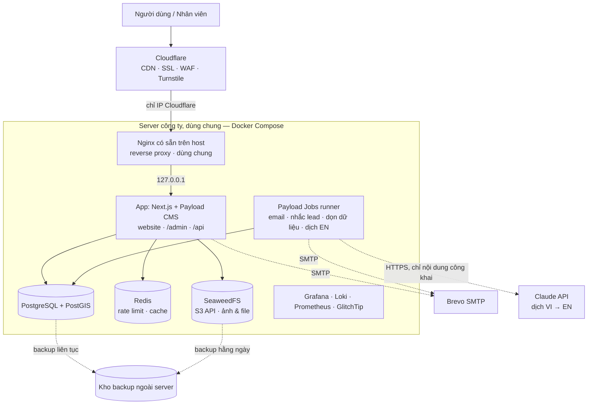
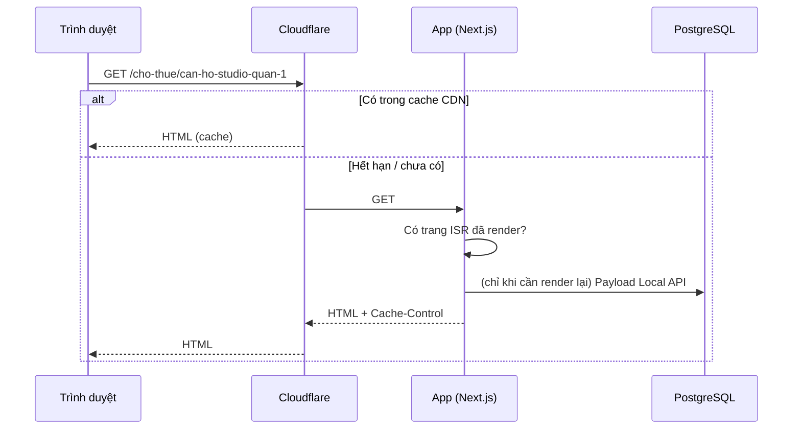
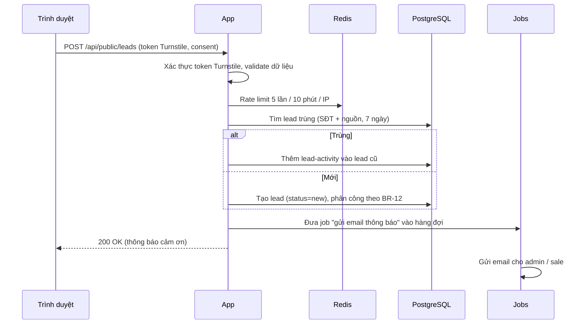

# ARCHITECTURE — Website TAMI

> Kiến trúc mục tiêu cho giai đoạn 1, duyệt ngày 16/10/2026. Nguồn yêu cầu: `docs/BRD.md` v1.5 (song ngữ Việt – Anh, AI tự dịch).
> Khi đã có code: cấu hình thật (`docker-compose*.yml`, `payload.config.ts`, `next.config.ts`) là nguồn chuẩn. File này mô tả **ý đồ và lý do**, cần cập nhật khi kiến trúc đổi.

---

## 1. Nguyên tắc

1. **Một ứng dụng duy nhất**: Next.js + Payload CMS chạy chung (website + admin + API). Ít thành phần thì ít thứ hỏng, dễ vận hành.
2. **Đọc nhiều, ghi ít**: trang công khai render sẵn và cache ở CDN; phần lớn request không chạm tới DB.
3. **Stateless**: app không lưu trạng thái trên đĩa hay bộ nhớ (file nằm ở object storage, session/rate limit nằm ở DB/Redis), nên chạy thêm bản app được mà không sửa code.
4. **Mã nguồn mở, tự host**: không phụ thuộc dịch vụ trả phí (NFR-09). Ngoại lệ duy nhất: Claude API để dịch tiếng Anh (D7), có hạn mức chi phí; API lỗi/hết hạn mức thì website vẫn chạy, chỉ bản tiếng Anh mới chưa có.
5. **Chừa chỗ mở rộng, không làm trước**: thiết kế sẵn điểm nối (§9), nhưng không xây tính năng chưa cần.

---

## 2. Sơ đồ tổng thể



Staging chạy **một bộ riêng** (app + PostgreSQL + Redis + bucket riêng) trên cùng server, khác tên miền, khác DB (`staging_db ≠ prod_db`).

---

## 3. Thành phần & công nghệ

| Thành phần | Công nghệ | Vai trò | Phí |
|---|---|---|---|
| Web + CMS + API | **Next.js** (App Router) + **Payload CMS 3**, TypeScript, Node.js LTS | Website công khai (SSR/ISR), trang `/admin`, REST API, Local API cho server component | Free |
| Giao diện | Tailwind CSS + shadcn/ui; font EB Garamond + Montserrat qua `next/font` (tự host) | UI website theo phong cách vinhomes.vn (`docs/DESIGN.md`) | Free |
| Song ngữ | **Payload `localization`** (nội dung `vi` / `en`) + **`next-intl`** (định tuyến `/en`, đường dẫn tiếng Anh, chuỗi giao diện, định dạng số/ngày) | Website công khai Việt – Anh | Free |
| Database | **PostgreSQL** + **PostGIS** + `unaccent` + `pg_trgm` | Dữ liệu chính, tọa độ, tìm kiếm tiếng Việt không dấu | Free |
| ORM / migration | Payload Postgres adapter (Drizzle bên dưới), `payload migrate` | Schema sinh từ cấu hình collection, migration versioned | Free |
| Cache / rate limit | Redis (hoặc Valkey) | Giới hạn gửi form, cache dùng chung khi chạy nhiều bản app | Free |
| Lưu file | **SeaweedFS** (S3 API) + plugin `@payloadcms/storage-s3` | Ảnh công khai (bucket `public`), CV/file nội bộ (bucket `private`) | Free |
| Xử lý ảnh | `sharp` (tích hợp trong Payload) | Sinh sẵn các cỡ ảnh + WebP khi upload | Free |
| Tác vụ nền | **Payload Jobs Queue** (lưu trong PostgreSQL) | Gửi email, nhắc lead quá hạn, dọn dữ liệu hết hạn lưu | Free |
| Reverse proxy | **Nginx có sẵn trên server** (đang phục vụ các site khác ở cổng 80/443) | Thêm file cấu hình riêng cho TAMI; điều hướng prod/staging, SSL origin, nén | Free |
| CDN / bảo vệ | Cloudflare (gói free) | Cache, SSL, chống DDoS, WAF cơ bản, Turnstile | Free |
| Email | Brevo SMTP (gói free ~300 mail/ngày) | Thông báo lead, hồ sơ ứng tuyển | Free trong hạn mức |
| Dịch tự động | **Claude API** (`@anthropic-ai/sdk`), model qua env `TRANSLATION_MODEL` | Dịch nội dung VI → EN trong job `translate-content` (BRD BR-08) | **Trả phí** theo lượng chữ, có hạn mức tháng |
| Bản đồ | OpenStreetMap tiles + MapLibre GL | Bản đồ vị trí dự án / tin | Free |
| Giám sát | Prometheus + Grafana + Loki, GlitchTip (lỗi), Uptime Kuma (uptime) | Metrics, log, lỗi, cảnh báo | Free |
| Backup | pgBackRest (PostgreSQL), restic (file) | Sao lưu ra ngoài server | Free (chỉ tốn chỗ lưu) |
| CI/CD | GitHub Actions | Build, test, deploy staging → production | Free trong hạn mức |
| Analytics | Google Analytics 4 + Search Console | Traffic, SEO | Free |

**Các quyết định chính:**

| # | Quyết định | Lý do | Phương án bị loại |
|---|---|---|---|
| D1 | Payload CMS thay vì NestJS + admin tự viết | Admin, phân quyền, nháp/xuất bản, phiên bản, upload có sẵn; ít code hơn nhiều | NestJS tách riêng: kiểm soát cao hơn nhưng phải tự viết toàn bộ admin |
| D2 | Tìm kiếm bằng PostgreSQL ở giai đoạn 1 | Đủ nhanh cho mục tiêu 100.000 tin; không phải đồng bộ dữ liệu sang hệ thống khác | OpenSearch: tốn RAM, thêm việc đồng bộ |
| D3 | Payload Jobs thay vì BullMQ | Không cần thêm worker riêng; job lưu trong DB, không mất khi restart | BullMQ: thêm một tiến trình phải vận hành |
| D4 | `sharp` của Payload thay vì imgproxy | Ảnh được resize lúc upload, phục vụ thẳng qua CDN; bớt một service | imgproxy: linh hoạt hơn nhưng thêm thành phần |
| D5 | SeaweedFS cho file | Có S3 API, nhẹ, giấy phép Apache 2.0 | MinIO: bản community đã bị giới hạn tính năng; S3 thuê ngoài: tốn phí |
| D6 | Song ngữ trong **cùng một bản ghi** (Payload localization) + `next-intl` với `localePrefix: 'as-needed'` và `pathnames` | Một bài có cả bản VI và EN, chung giá/ảnh/trạng thái, không phải đồng bộ hai bản ghi; tiếng Việt giữ URL gọn không tiền tố; đường dẫn tiếng Anh tự map (`/du-an` ↔ `/en/projects`) | Tách bản ghi riêng cho mỗi ngôn ngữ: dễ lệch giá/trạng thái giữa hai bản. Subdomain `en.`: thêm cấu hình DNS/SSL/cache, SEO chia đôi tên miền |
| D7 | Dịch tiếng Anh bằng **Claude API**, chạy nền trong Payload Jobs, tự lên web | Chất lượng dịch tốt cho văn bản marketing BĐS, hiểu bảng thuật ngữ, giữ cấu trúc richText; chạy nền nên không làm chậm lúc lưu bài; chỉ dịch trường đã đổi nên ít tốn | LibreTranslate tự host: miễn phí nhưng dịch kém, tốn RAM server dùng chung. Model tự host (Ollama): server 4 vCPU không đủ. Nhân viên tự dịch: tốn công, dễ bỏ sót |

---

## 4. Cấu trúc mã nguồn

Một repo, một app Next.js có nhúng Payload:

```
.
├── src/
│   ├── app/
│   │   ├── (frontend)/[locale]/  # Website công khai (Trang chủ, Dự án, Cho thuê, ...), dùng chung cho vi / en; layout.tsx (generateStaticParams → [], dựng `<html>` qua `PublicDocument`), not-found.tsx (nội dung 404, dùng lại ở `app/global-not-found.tsx`), error.tsx; không có catch-all
│   │   ├── global-error.tsx   # Trang lỗi gốc (khi layout lỗi), hotline lấy từ NEXT_PUBLIC_HOTLINE lúc build
│   │   ├── robots.ts          # /robots.txt lúc chạy theo APP_ENV (dùng lib/seo/robots)
│   │   └── (payload)/         # /admin và /api do Payload sinh; route tĩnh thắng catch-all /api/[...slug]: api/health, api/metrics (Prometheus, Bearer), api/monitoring-config (DSN GlitchTip lúc chạy)
│   ├── collections/           # Định nghĩa collection: Projects, Rentals, PropertyPosts, News, Leads, ...
│   │   └── _shared/           # content-defaults.ts: factory withContentDefaults (versions, trash, access, hook dùng chung)
│   ├── fields/                # Field nội dung dùng chung: slug, status, published-at, author, is-featured, translation, seo
│   ├── globals/               # SiteSettings, Homepage, Header, Footer
│   ├── access/                # Hàm phân quyền dùng chung: isAdmin, isAuthorOrAdmin, isAssignedOrAdmin
│   ├── hooks/                 # Hook collection: sinh mã tin, slug, gán lead, xoá cache, audit log (staff/), categories/ (cây, khoá scope, chặn xoá), pages/ (lock-kind, sync-privacy-version, revalidate-page), revalidate-global, trim-text
│   ├── endpoints/             # Endpoint tuỳ biến: gửi lead, ứng tuyển, tìm kiếm, đếm click
│   │   ├── _middleware/       # public-pipeline: rateLimit → verifyTurnstile → validate (PERMISSION §5)
│   │   └── public/            # Endpoint công khai: click-events (đã có), leads, job-applications
│   ├── jobs/                  # Payload Jobs: gửi email, nhắc lead, dọn dữ liệu
│   ├── lib/
│   │   ├── search/            # SearchService (PostgreSQL ở giai đoạn 1), normalize (không dấu, khớp unaccent)
│   │   ├── security/          # rate-limit (Redis Lua), turnstile, client-ip, ip-hash
│   │   ├── email/             # adapter SMTP Brevo, allowlist ngoài production, template email nội bộ (tiếng Việt)
│   │   ├── http/              # ok() / fail() theo response contract (API_SPEC §2); cache-policy.ts (Cache-Control trang/api/RSC, withDefaultNoStore)
│   │   ├── audit/             # Ghi audit-logs
│   │   ├── upload/            # Kiểm loại/cỡ file upload (media, private-files)
│   │   ├── session/           # Phiên admin 8 giờ không hoạt động (keepalive)
│   │   ├── health/            # runHealthChecks + probe DB/Redis/S3 cho /api/health
│   │   ├── click-stats/       # Gộp lượt bấm (hàm thuần cho job aggregate-click-stats); click-types.ts (CLICK_TYPES, CLICK_REF_COLLECTIONS)
│   │   ├── consent/           # consent-cookie.ts: đọc/ghi cookie đồng ý (analytics, pv = privacyPolicyVersion)
│   │   ├── monitoring/        # GlitchTip options + scrubText, metrics Prometheus, process-errors, service-name
│   │   ├── content/           # content-paths (path nội bộ /{locale}{key} cho revalidate), public-queries (publicWhere/findPublicList/BySlug), pagination, nav-link, get-globals/read-global/global-cache
│   │   ├── payload/           # preserve-request-locale, prod-migrations (AUTO_MIGRATE_ON_START)
│   │   ├── logger.ts          # pino JSON + redact/scrub PII, dùng chung app/jobs/Payload
│   │   ├── s3-config.ts       # Cấu hình S3 client (SeaweedFS) dùng chung
│   │   ├── translation/       # TranslationService: gọi Claude API, dịch richText theo node, thuật ngữ, hạn mức chi phí
│   │   ├── leads/             # Logic nghiệp vụ lead: chống trùng, phân công
│   │   └── seo/               # site-url (URL gốc lúc chạy), metadata (meta/OG/canonical/hreflang/noindex), json-ld, robots; sitemap làm ở layer-8-task-05
│   ├── components/            # UI dùng chung: ui/ (shadcn), admin/ (logo, icon, keepalive), media/ (Gallery, Lightbox, LazyMap, VideoFacade, ResponsiveImage), forms/ (FormField, ConsentCheckbox, TurnstileWidget, FormStatus, use-public-form), layout/ (PublicShell, load-shell, shell-data, Header, DesktopNav, MobileMenu, Footer, LanguageSwitcher, SkipLink, FloatingContact, Breadcrumb, Pagination, EmptyState, PageBanner), consent/ (CookieBanner, ConsentPreferences), analytics/ (GoogleAnalytics), seo/ (JsonLd), templates/ (CategoryListTemplate)
│   ├── i18n/                  # routing.ts (locales, pathnames vi ↔ en), request.ts, messages/vi.json, messages/en.json
│   ├── instrumentation.ts, instrumentation-client.ts  # Khởi tạo GlitchTip server/trình duyệt (chỉ khi có DSN)
│   ├── proxy.ts               # next-intl (Next 16 gọi là proxy, trước đây middleware): nhận /en, /vi/* → 301 về bản không tiền tố, bỏ qua /admin và /api
│   └── payload.config.ts
├── migrations/                # Migration do `payload migrate:create` sinh, đã commit
├── scripts/                   # deploy/ (deploy.sh + lib/ + deploy.test.sh, chạy trên server qua SSH); seed-categories.ts, seed-pages.ts, seed-shell-globals.ts, seed-sample-*.ts; upload-sourcemaps.mjs (upload source map lên GlitchTip lúc build image); jobs-runner.ts (`pnpm jobs` ở dev; container chạy thẳng `node node_modules/payload/bin.js run scripts/jobs-runner.ts`)
├── tests/e2e/                 # revalidate-globals.ts (`pnpm e2e:revalidate`, chạy tay với `next start`, chưa vào CI)
├── seed/                      # Dữ liệu nền: 34 tỉnh/thành, phường/xã, danh mục mặc định
├── docker/                    # Dockerfile, docker-compose.prod.yml, docker-compose.staging.yml
│   ├── backup/                # image postgres + pgBackRest, sidecar backup (pgBackRest + restic), e2e test
│   └── nginx/                 # tami.conf, tami-staging.conf (copy vào /etc/nginx/sites-available trên server)
├── docs/runbooks/             # deploy.md, restore.md
└── .github/                   # workflows/ (ci.yml, deploy.yml), actions/ssh-deploy
```

Quy ước: logic nghiệp vụ nằm trong `lib/` (gọi được từ hook, endpoint, job), không nằm rải trong component.

---

## 5. Luồng xử lý chính

### 5.1. Xem trang công khai



- Trang công khai: `Cache-Control: public, s-maxage=60, stale-while-revalidate=300`, nên nội dung mới lên web trong ≤ 1 phút (BRD §7.2).
- Khi lưu nội dung, hook `afterChange` gọi `revalidateTag` / `revalidatePath` để Next.js render lại trang liên quan (chi tiết, danh sách, trang chủ nếu là nội dung nổi bật).
- **Song ngữ:** `proxy.ts` (`next-intl`; Next 16 đổi tên `middleware.ts` thành `proxy.ts`) xác định ngôn ngữ từ URL (`/en/...` → `en`, còn lại → `vi`), không đọc `Accept-Language` để chuyển hướng, `/vi/*` chuyển 301 về bản không tiền tố, cookie `NEXT_LOCALE` chỉ do nút chuyển ngôn ngữ đặt (mỗi URL luôn trả cùng một ngôn ngữ, nên CDN cache an toàn). Server component gọi Payload Local API với `locale` và `fallbackLocale: false`; bản `en` lọc thêm `hasEnglish = true`, không có thì `notFound()`. Hook xoá cache gọi `revalidatePath` cho cả hai đường dẫn VI và EN. `sitemap.xml` sinh cả hai bản kèm `alternates` (`hreflang`).
- Ảnh, JS, CSS: `Cache-Control: public, max-age=31536000, immutable` (tên file có hash).
- **As-built (layer-4-task-03):** chính sách ở `src/lib/http/cache-policy.ts`. Trang công khai và `/admin` đặt qua `headers()` của `next.config.ts` (Next giữ header này cho trang tĩnh/ISR thay vì `s-maxage=31536000`). **Header khai ở `next.config.ts` thắng header do route tự đặt**, nên `/api/*` KHÔNG khai ở đó: route catch-all REST của Payload (`api/[...slug]/route.ts`) bọc `withDefaultNoStore` (response chưa có `Cache-Control` → `no-store`, kể cả 404/500 của file ảnh), còn `health`/`metrics` (`no-store`) và `monitoring-config` (`private, max-age=300`) tự đặt. Ảnh `/api/media/file/*` (200/206/304) đặt `public, max-age=31536000, immutable` qua `Media.upload.modifyResponseHeaders` (storage-s3 không tự đặt Cache-Control). Truy vấn trang công khai đi qua `src/lib/content/public-queries.ts` (`publicWhere`, `findPublicList`, `findPublicBySlug`). **Path có đuôi file** (`/robots.txt`, `/sitemap.xml`, `/llms.txt`, `/favicon.ico`, ảnh trong `public/`; trừ `/_next`, `/api`, `/admin`) có rule riêng `public, max-age=0, s-maxage=60` (`DOTTED_PATH_SOURCE`): request tới file chưa có rơi vào `/_not-found` tĩnh mà Next gắn `s-maxage=31536000`, Cloudflare cache theo đuôi file nên bản 404 sẽ che file thật deploy sau tới 1 năm; rule ép TTL 60s cho cả 200 lẫn 404 của nhóm này. `/_next/static/*` (tên có hash) giữ `public, max-age=31536000, immutable` mặc định của Next. Đã đo bằng `next start`: 404 của `/robots.txt`, `/sitemap.xml` và 200 của `/brand/*.png` đều `public, max-age=0, s-maxage=60`; 404 của trang thường vẫn `private, no-cache, no-store`. **Biến thể RSC (review L4-T03 round 2):** request tới trang công khai có header `RSC` / `Next-Router-Prefetch` / `Next-Router-State-Tree` / `Next-Router-Segment-Prefetch` hoặc query `_rsc` có giá trị (điều hướng client, prefetch; Next trả 307 → `?_rsc` hoặc `text/x-component`) nhận `no-store` (RFC 9111: cấm mọi cache) qua các rule `has` khai SAU rule trang công khai (rule sau thắng). Lý do: Cloudflare bỏ qua `Vary` và cache theo URL, nên nếu để `public` thì một request có `RSC: 1` lúc cache miss sẽ làm CDN lưu 307/flight payload rồi phát cho mọi khách. `has` của Next không khớp `_rsc` rỗng (`/?_rsc`) — vô hại vì không có header RSC thì vẫn là HTML thường, còn có header thì rule header áp. Path có đuôi file cũng có rule RSC `no-store` (khai sau `DOTTED_PATH_SOURCE`, layer-5-task-08); Cloudflare rule dưới đây phủ mọi path. **Yêu cầu Cloudflare (layer-6-task-01):** Cache Rule bypass cache khi request có header `rsc` (và `next-router-*`) hoặc query `_rsc`, và tôn trọng TTL origin cho HTML/path có đuôi file (không đặt Edge TTL ghi đè). HTML thường vẫn `public, s-maxage=60, stale-while-revalidate=300`. Ở `/en`, doc liên quan được populate (depth > 0) không bị lọc `hasEnglish`: trang phải bỏ doc chưa có bản EN khi render link/thẻ.
- **As-built (layer-5-task-08) — SEO + env lúc chạy:** URL tuyệt đối (canonical, hreflang, OG, JSON-LD) lấy từ `getSiteUrl()` (`src/lib/seo/site-url.ts`) đọc `NEXT_PUBLIC_SITE_URL` lúc chạy (không inline lúc build; trong `next build` trả `undefined` → bỏ các thẻ URL tuyệt đối). `noindex` theo `APP_ENV` ≠ `production` (`noindex, nofollow`); trang ép noindex hoặc `seo.noindex` → `noindex, follow`. Vì robots/canonical phụ thuộc env lúc chạy, **trang công khai không prerender lúc `next build`** (`[locale]/layout.tsx` `generateStaticParams()` trả `[]`): mỗi trang render ở request đầu sau deploy rồi ISR (`revalidate = 60`) như cũ; image dùng chung staging→prod nên không dùng build-arg theo môi trường. `/robots.txt` (`src/app/robots.ts`, force-dynamic): staging `Disallow: /`; production `Allow: /`, `Allow: /api/media/file/`, `Disallow: /admin`, `Disallow: /api/` (`Sitemap:` thêm ở layer-8-task-05).
- **As-built (layer-5-task-05, khung trang công khai):** `app/(frontend)/[locale]/layout.tsx` gọi `components/layout/load-shell.ts` (server-only: `getHeader/getFooter/getSiteSettings` theo locale, đọc như khách, `unstable_cache` tag `global:<slug>`; KHÔNG đọc `cookies()`/`headers()` nên HTML giống nhau cho mọi khách) rồi lọc thành view model (`shell-data.ts`) cho `PublicShell` (skip link → `header` → `main#main` → `footer`). Client component chỉ có `MobileMenu` (Radix Dialog), `DesktopNav` (`aria-current`), `LanguageSwitcher`, `CookieSettingsButton`; chúng chỉ nhận view model đã lọc. Menu CMS chỉ được dùng khi ĐẦY ĐỦ cho ngôn ngữ đó (mọi mục có nhãn + link hợp lệ), nếu không dùng menu cố định trong `messages/<locale>.json` (`layout.nav.items`, 7 mục, không "Mua bán"); footer tương tự. Layout `export const revalidate = 60`; global đọc lỗi (DB tắt lúc `next build`) thì dùng nội dung cố định và ghi log. Link "Cài đặt cookie" phát sự kiện `tami:open-cookie-settings` trên `window` (layer-5-task-07 lắng nghe). e2e làm mới cache: `pnpm e2e:revalidate` (`tests/e2e/revalidate-globals.ts`, cần `next start`).
- **As-built (layer-6-task-03) — 404 + redirect slug cũ:** (1) **Next 16 không SSR được `notFound()` ném từ trang**: lỗi 404 thoát khỏi boundary ở bước Fizz nên Next trả `<html id="__next_error__">` rỗng kèm payload RSC (status 404 đúng, nội dung chỉ hiện sau hydrate; đã kiểm bằng trang trơn không có Payload/next-intl). Chỉ URL **không khớp route nào** mới được Next dựng `/_not-found` bằng SSR đầy đủ. Vì vậy: bật `experimental.globalNotFound` (`next.config.ts`) và dùng `src/app/global-not-found.tsx` (dựng `components/layout/PublicDocument.tsx` + nội dung 404 của `[locale]/not-found.tsx`, ngôn ngữ từ `getLocale()` đọc header `x-next-intl-locale` do `proxy.ts` đặt; thiếu thì vi) và **bỏ catch-all `[locale]/[...rest]`**: `/en/khong-ton-tai`, `/khong-ton-tai` trả 404 + `h1` đúng ngôn ngữ + header/footer ngay trong HTML server (`Cache-Control: private, no-cache, no-store` do Next đặt cho 404 động). Không dùng `app/not-found.tsx` vì Flight render sẵn phần tử `not-found` gốc trong MỌI trang: `getLocale()` (headers) trong đó làm trang ISR `/[locale]` văng `DYNAMIC_SERVER_USAGE`; `global-not-found` không nằm trong cây của trang khác. Không cần `app/layout.tsx` (đã thử: root layout chuyển tiếp không đổi kết quả). `<html>` do `(frontend)/[locale]` (qua `PublicDocument`) và `(payload)` tự đặt. URL một đoạn có đuôi file (`/wp-login.php`) không qua proxy nên khớp `[locale]/page` với locale sai (layout `notFound()` → shell rỗng): `rewrites.afterFiles` trong `next.config.ts` chuyển sang `/__not-found__/:segment` (không route nào khớp) để cũng ra 404 đầy đủ; file trong `public/` và route tĩnh (`robots.txt`) phục vụ trước rewrite này. **Giới hạn còn lại:** `notFound()` ném từ page vẫn cho shell rỗng ở HTML server (status 404 + noindex đúng); trang chi tiết có slug tránh nó bằng kiểm tra tồn tại ở proxy (bullet layer-6-task-06 ngay dưới). (2) **Redirect 301 khi đổi slug (BR-05):** hook `afterChange` `src/hooks/create-slug-redirect.ts` (gắn trong `withContentDefaults` cho collection có route + slug) ghi collection `redirects` của `@payloadcms/plugin-redirects` (cấu hình ở `src/collections/redirects-plugin.ts`: `from`/`to` là đường dẫn công khai đầy đủ, chỉ 301, chỉ admin đọc/ghi); cập nhật redirect cũ trỏ tới URL vừa bỏ để không thành chuỗi (A→B, B→C ⇒ A→C), xoá redirect trùng URL đang công khai (đổi quay lại / slug cũ được dùng lại) để không thành vòng hay che trang thật. Website tra ở `src/proxy.ts` (`resolveRedirect` → `findRedirectTarget`) TRƯỚC next-intl, chỉ với URL dạng `<tiền tố chi tiết>/<slug>` (`isRedirectSourcePath`), trả `301` + `Location` cùng ngôn ngữ (giữ query), không tự đặt `Cache-Control` nên rule `headers()` của `next.config.ts` áp (`public, s-maxage=60, stale-while-revalidate=300`; biến thể RSC `no-store`); lỗi DB ghi log và bỏ qua redirect. Không tra trong `not-found.tsx`/trang vì chỉ proxy mới trả được HTTP 301 thật (`redirect()` trong trang cho 307/308 hoặc chuyển hướng phía client). Đích redirect phải qua `isSafeInternalPath` (`src/lib/content/internal-path.ts`: cấm ``, `//`, `/`, `/%2F`, `/%5C` đầu, khoảng trắng/ký tự điều khiển) và proxy chỉ 301 khi `origin` đích = `origin` request. Tra cứu có timeout 400 ms (quá hạn/lỗi → không redirect, ghi log) + cache trong bộ nhớ 60 s mỗi instance (cả trúng lẫn trượt, tối đa 1000 khoá) — redirect mới/xoá có thể trễ tới 60 s mỗi instance, tương đương độ trễ CDN. Ghi `redirects` tuần tự bằng `pg_advisory_xact_lock(726002)`.
- **As-built (layer-6-task-06) — Tin tức (S10/S05/S11) + 404 có nội dung cho trang động:** (1) **404 SSR đầy đủ cho slug không tồn tại / chưa công khai / thiếu bản EN:** `src/lib/content/resolve-missing-page.ts` (gọi trong `src/proxy.ts` SAU bước redirect slug cũ, TRƯỚC next-intl) khớp URL công khai của trang động theo bảng `MISSING_PAGE_RULES` (hiện: `/tin-tuc/[slug]` → `news`, `/tin-tuc/danh-muc/[category]` → `categories` scope `news`; trang chi tiết mới THÊM quy tắc ở đây) rồi gọi đúng `findPublicBySlug` mà page dùng (một điều kiện `publicWhere`). Không có → `NextResponse.rewrite` sang `/__not-found__/missing` (không route nào khớp nên Next dựng `global-not-found` bằng SSR đầy đủ) kèm header `x-next-intl-locale` (proxy bỏ qua next-intl nên tự đặt): HTTP 404, `h1` + header/footer đúng ngôn ngữ ngay trong HTML server, `noindex`, `Cache-Control: private, no-cache, no-store`. Tra có timeout 400 ms (quá hạn/lỗi → để page tự xử lý, ghi log, không cache), cache trong bộ nhớ: trang có 60 s, trang chưa có 10 s (bài mới xuất bản không bị chặn lâu). Page vẫn gọi `notFound()` làm lưới an toàn (race giữa kiểm tra và render; lúc đó chỉ còn shell). Trang danh sách vượt số trang (`?page=99`) cũng `notFound()` ở page nên vẫn là shell rỗng + 404. (2) **Cache:** trang chi tiết `/[locale]/tin-tuc/[slug]` là ISR (`generateStaticParams()` trả `[]` ở chính page; thiếu hàm này route có tham số động bị Next coi là dynamic, không vào cache và `revalidatePath` vô nghĩa). Đã đo bằng `next start`: lần 1 `x-nextjs-cache: MISS`, lần 2 `HIT`; PATCH `/api/news/:id` (admin) trả 200 sau ~100 ms và request kế tiếp ngay lập tức trả bản mới (`MISS` rồi `HIT`), không chờ 60 s. Trang danh sách `/tin-tuc` và `/tin-tuc/danh-muc/[category]` đọc `searchParams` (`?page=n`) nên `export const dynamic = "force-dynamic"` (nếu để ISR, đọc `searchParams` ném `DYNAMIC_SERVER_USAGE` → 500): không có mục cache Next để làm mới, CDN giữ theo `Cache-Control: public, s-maxage=60, stale-while-revalidate=300` của `next.config.ts`; vì vậy hook làm mới của `categories` có tác dụng với trang chi tiết/ISR và là lưới an toàn khi danh sách được chuyển sang ISR. (3) **Hook làm mới danh mục (G13):** `categories` có `route: null` nên không có hook chung; `src/hooks/categories/revalidate-category.ts` (`afterChange`/`afterDelete`) làm mới danh sách của loại nội dung (`/tin-tuc`, `/cho-thue`, `/tin-bds`, `/du-an`, `/tuyen-dung`, cả vi và en) + trang danh mục (`/danh-muc/[category]`, chỉ news/rental/property_post có; mọi slug cũ và mới của cả hai ngôn ngữ) mỗi khi sửa/đổi tên/xoá mềm/khôi phục/xoá. `internalPath` nhận tham số động bất kỳ (`[slug]`, `[category]`...), `publicPath` (content-paths.ts) dựng URL công khai theo ngôn ngữ. (4) **Tin tức:** `/tin-tuc` trang 1 = khối nổi bật (4 bài mới nhất: 1 lớn 7 cột + 3 hàng 5 cột) + lưới 12 bài; lưới loại các bài nổi bật ở MỌI trang (trang 2 không lặp), trang danh mục chỉ lưới 12 bài/trang gồm bài của danh mục con (chip "Tất cả" của danh mục cấp 1). Bài liên quan = tối đa 3 bài CÙNG danh mục (mới nhất, loại bài hiện tại); ở `/en` các truy vấn đều qua `publicWhere` nên bài liên quan/danh mục chưa có bản EN bị loại, và danh mục đã populate chưa có bản EN (`hasEnglish !== true`) không hiện nhãn/link (`visibleCategory`). `src/components/content/RichText.tsx` (dùng chung) render Lexical bằng danh sách node cho phép (đoạn, heading h1/h2→h2 và h3+→h3, danh sách, trích dẫn, link, ảnh `upload` của `media`, bảng, đường kẻ), node lạ (`html`, `block`...) bị bỏ cả nhánh, link chỉ nhận http(s)/mailto/tel/đường dẫn nội bộ và link ngoài luôn `rel="noopener noreferrer"`. JSON-LD `Article` (`inLanguage`, ảnh `large`, `publisher` từ `site-settings`; không có `author` vì nhân viên không công khai) cùng `BreadcrumbList`; OG dùng ảnh `og` 1200×630.
- **As-built (layer-6-task-07) — Dịch vụ (S14), Liên hệ (S15), Pháp lý (S16):** (1) **404 có nội dung:** `MISSING_PAGE_RULES` (`resolve-missing-page.ts`) thêm `/dich-vu/[slug]` → `services` và hai route CỐ ĐỊNH `/chinh-sach-bao-mat`, `/dieu-khoan-su-dung` → `pages` theo `kind` (quy tắc không có `param`, tra bằng `findPublicOne` trong `public-queries.ts` cùng `publicWhere`): trang pháp lý nháp/ẩn/xoá mềm hoặc EN chưa duyệt (`hasEnglish = false`) → proxy rewrite 404 SSR đầy đủ (đã đo `curl`: 404, `h1` + header/footer đúng ngôn ngữ, `noindex`, `Cache-Control: private, no-cache, no-store`). (2) **Cache:** cả ba nhóm trang là ISR (`revalidate = 60`; dịch vụ `generateStaticParams() → []`; trang pháp lý/liên hệ không đọc `searchParams` nên không cần `force-dynamic`; form liên hệ sau này tự đọc `?service=` ở client). Đã đo `next start`: `x-nextjs-cache: MISS` rồi `HIT`, `Cache-Control: public, s-maxage=60, stale-while-revalidate=300`. `/lien-he` đọc `site-settings` qua `get-globals` (tag `global:site-settings`). (3) **Trang Liên hệ:** hotline/email/địa chỉ/giờ làm việc (i18n)/mạng xã hội từ `site-settings`, bản đồ `LazyMap` từ `mapLocation` (Payload `point` = `[kinh độ, vĩ độ]`; chưa nhập hoặc toạ độ sai → ẩn cả khối bản đồ), vùng `LeadFormSlot` (`id="lead-form"`, layer-10-task-01 ráp `LeadForm` vào), JSON-LD `Organization` + `BreadcrumbList`. (4) **Trang pháp lý:** mục lục sinh từ `h2` cấp gốc (`section-headings.ts`; `RichText anchorSections` gắn `id=muc-N` theo thứ tự), "Phiên bản · Hiệu lực từ", in ấn ẩn header/footer/nút nổi/banner cookie (`print:hidden`). (5) **Dịch vụ:** hero `coverImage` (chưa có thì banner chữ), "Dịch vụ khác" 2 thẻ, `CtaBanner` → `/lien-he?service=<slug>`, JSON-LD `Service` + `BreadcrumbList`. (6) **`RichText` dùng chung:** gốc `break-words [overflow-wrap:anywhere]`, vùng cuộn bảng `role="region"` + `aria-label` (prop `tableLabel`), link nội bộ `doc` đã populate thành link thật (`doc-link.ts`: `CONTENT_ROUTES`/`LEGAL_PAGE_ROUTES`, ở `/en` cần `hasEnglish`; prop `locale`). (7) **Worker MapLibre:** MapLibre tự suy URL worker từ `import.meta.url`, bị bundler (Turbopack) làm hỏng (URL không phải http(s) → worker không tải, bản đồ đứng im ở bản build). `scripts/copy-maplibre-worker.mjs` (chạy đầu `pnpm dev` / `pnpm build`) chép `maplibre-gl-worker.mjs` + `maplibre-gl-shared.mjs` vào `public/vendor/maplibre/` (gitignore) và `LazyMap` gọi `setWorkerUrl` trỏ vào đó; Docker không đổi (`public` đã được copy từ builder).
- `/admin`, `/api/*`, form: **không cache** (Cloudflare bypass). Ngoại lệ: (1) `/api/monitoring-config` trả `Cache-Control: private, max-age=300` (chỉ cache ở trình duyệt, không cho CDN/proxy); (2) **ảnh media `/api/media/file/*`** (G1, đã chốt 17/10/2026) trả `Cache-Control: public, max-age=31536000, immutable` (tên file có hash/định danh bất biến, đổi ảnh = file mới) để Cloudflare cache được (rule Cloudflare ở `layer-6-task-01`; header do app đặt ở `layer-4-task-03`). Nginx **prod** không ghi đè/strip header này; Nginx **staging** thì ghi đè thành `private, no-store` cho riêng `/api/media/file/*` (kèm lặp lại `X-Robots-Tag` + header bảo mật) để Cloudflare không cache ảnh rồi phát cho người chưa qua basic auth — vì vậy rule Cache của Cloudflare ở `layer-6-task-01` chỉ áp cho host prod. Không location nào bật `proxy_cache`. `/api/metrics` luôn `no-store`; Nginx trả 404 cho đường này (Prometheus scrape thẳng `127.0.0.1:<cổng app>`).

### 5.2. Khách gửi form liên hệ



Phản hồi cho khách luôn giống nhau dù lead bị gộp hay tạo mới (không lộ dữ liệu đã có).

### 5.3. Upload ảnh

Nhân viên upload trong admin → Payload dùng `sharp` sinh các cỡ (`thumb` 400w, `card` 800w, `large` 1600w, `og` 1200×630) dạng WebP → lưu vào bucket `public` qua S3 API → website trả ảnh qua Cloudflare. **As-built:** bucket không có URL công khai; ảnh đi qua app tại `/api/media/file/<tên file>` (`payload.config.ts` không đặt `generateFileURL` cho `media`), nên đây là ngoại lệ cache của §5.1 (public, immutable, 1 năm).

CV ứng viên lưu vào bucket `private`. Chỉ tải được qua endpoint có kiểm tra quyền admin, không có URL công khai.

### 5.4. Tác vụ định kỳ (Payload Jobs)

| Job | Lịch | Việc |
|---|---|---|
| `send-notification-email` | Ngay khi có sự kiện | Email lead mới / giao lead / hồ sơ ứng tuyển. Retry 5 lần (backoff từ 30s); input sai → huỷ không retry; xong thì xoá job (không giữ PII) |
| `remind-unassigned-leads` | 10 phút/lần, giờ hành chính | Lead `new` chưa có sale sau 30 phút thì nhắc admin (BR-14) |
| `expire-offers` | Hằng ngày 00:05 | Bài Đăng tin BĐS quá hạn ưu đãi thì gắn "Đã kết thúc", xoá cache trang (BR-06) |
| `close-job-postings` | Hằng ngày 00:10 | Ẩn tin tuyển dụng quá hạn nộp |
| `data-retention` | Hằng tuần | Ẩn danh lead quá 24 tháng, xoá CV quá 12 tháng (BR-31) |
| `aggregate-click-stats` | Hằng giờ (cron `0 0 * * * *`, 6 trường) | Gộp số lượt bấm hotline/Zalo/fanpage cho dashboard; xoá `click-events` > 90 ngày đã gộp. Cộng dồn đọc-rồi-ghi, chỉ đúng khi có **1 process `jobs`** (Decision 3) |
| `translate-content` | Ngay khi lưu bản `vi` đang xuất bản / global, hoặc bấm "Dịch lại bằng AI" | Dịch các trường đã đổi sang `en` (bỏ qua bản `enSource = manual`), sinh slug `en`, bật `hasEnglish`, xoá cache `/en`. Gộp nhiều lần lưu liên tiếp của cùng bài (chờ ~1 phút). Thử lại 3 lần (backoff); lỗi thì `translation.status = failed`. Kiểm hạn mức tháng trước khi gọi (BR-08) |

---

## 6. Triển khai

### 6.1. Server thực tế (kiểm tra 16/10/2026)

| Hạng mục | Giá trị | Đánh giá |
|---|---|---|
| Truy cập | SSH alias `server` (`root@187.52.119.50`, key `id_ed25519_trungpq`) | — |
| Máy | VPS KVM, Ubuntu 24.04 LTS | ✅ |
| CPU | 4 vCPU AMD EPYC 9354P, tải ~0.3 | ✅ Đủ |
| RAM | 15GB, trống ~11GB, **chưa có swap** | ✅ Đủ; ⚠️ nên thêm swap 4GB |
| Ổ cứng | SSD 200GB, trống 118GB (sau khi dọn build cache) | ✅ Đủ giai đoạn 1; theo dõi theo lượng ảnh |
| Docker | Docker 29.7 + Compose v5.5 | ✅ Có sẵn |
| Reverse proxy | Nginx trên host, giữ cổng 80/443 | Dùng luôn, không thêm Caddy |

**Server dùng chung** với các dự án khác (ismartschool-lms prod/staging/sysupgrade, nta-web, crm-dhp, WordPress nhstar; ~19 container). Quy tắc khi đặt TAMI lên:

- Mọi container TAMI có tiền tố `tami-` / `tami-staging-`, compose project riêng, network riêng.
- **Chỉ bind cổng vào `127.0.0.1`** (không `0.0.0.0`); PostgreSQL / Redis / SeaweedFS **không mở cổng ra host**, app truy cập qua network nội bộ của compose.
- Cổng app: production `127.0.0.1:3010`, staging `127.0.0.1:3011` (tránh các cổng đang dùng: 3001, 3002, 3004, 3005, 4000, 4001, 5432–5434, 6380, 6381, 8088, 9001).
- Đặt giới hạn RAM cho từng container (`mem_limit`) để không ảnh hưởng dự án khác.
- Thêm site bằng file riêng trong `/etc/nginx/sites-available/` + symlink `sites-enabled/`; chạy `nginx -t` trước khi `reload`, **không sửa file của site khác**.

### 6.2. Các service của TAMI

| Service | Production | Staging | RAM ước tính |
|---|---|---|---|
| nginx (host) | có sẵn, thêm `tami.conf` | thêm `tami-staging.conf` | — |
| `app` | **đúng 1 bản** (chạy 2+ bản cần cache handler dùng chung trước — §9.1, G9) | 1 bản | `mem_limit` 1g / 768m (heap Node 768 / 576MB) |
| `jobs` | cùng image app, lệnh `node node_modules/payload/bin.js run scripts/jobs-runner.ts` (tương đương `pnpm jobs` nhưng không qua pnpm để node là PID 1 nhận SIGTERM; poll 5s, dừng an toàn bằng SIGTERM/SIGINT; `stop_grace_period: 60s`). **Chỉ 1 bản** (job gộp click không nguyên tử): compose đặt `container_name` cố định nên không `--scale` được; không tạo bản thứ hai ở môi trường nào | cùng image | `mem_limit` 384m (đo thực ~190MB khi rảnh; 256MB không đủ dư địa) |
| `postgres` | riêng (`tami-postgres:17-3.5-pgbackrest2.59` = `postgis/postgis:17-3.5` + pgbackrest, build từ `docker/backup/Dockerfile`; bật `archive_mode`, `archive_timeout=300`) | riêng | `mem_limit` 2g / 512m |
| `backup` (sidecar) | 1 bản: lịch + pgBackRest (diff/full/check) + restic, kho đích ngoài server cấu hình bằng env | 1 bản, kho riêng | `mem_limit` 384m / 256m |
| `redis` | riêng (có mật khẩu, `maxmemory 100mb`, `volatile-lru`) | riêng | 128m |
| `seaweedfs` | **As-built:** mỗi môi trường 1 instance riêng trong compose của mình (không publish cổng, khoá S3 lấy từ env), bucket riêng (`tami-prod-*`) — thay cho phương án dùng chung ban đầu, để prod/staging không chia sẻ dữ liệu hay khoá | instance riêng, bucket `tami-staging-*` | 256m |
| giám sát | dùng chung | dùng chung | ~1GB |

Tổng trần `mem_limit` as-built: prod ≈ 4,2GB (app 1g + jobs 384m + postgres 2g + redis 128m + seaweedfs 256m + backup 384m) + staging ≈ 2,3GB (768m + 384m + 512m + 128m + 256m + backup 256m) + giám sát dùng chung ~1GB ≈ 7,5GB; chưa tính các container chạy một lần (`migrate` 512m, `seaweedfs-init` 128m). Mức dùng thực thường thấp hơn trần, nằm gọn trong ~11GB đang trống.

**As-built (`docker/Dockerfile`, `docker/docker-compose.{prod,staging}.yml`, `docker/nginx/`):**
- Một image (`docker/Dockerfile`, Node 22, user `node`, `HEALTHCHECK /api/health`) chạy cả `app` (`next start`) và `jobs`; không dùng `output: standalone` vì `jobs` và `payload migrate` cần `payload` CLI + loader TS + toàn bộ dependency production. Không chứa `.env`, source map hay devDependencies.
- Compose project `tami` / `tami-staging`, container `tami-*` / `tami-staging-*`, network `tami-net` / `tami-staging-net`. Chỉ `app` publish `127.0.0.1:3010` / `127.0.0.1:3011`; log `json-file` xoay vòng cho Promtail/Alloy → Loki (không dùng driver loki vì cần plugin trên host dùng chung).
- **Migrate là bước riêng:** `docker compose ... --profile tools run --rm migrate` (`payload migrate`) chạy trước khi bật `app`/`jobs`. `payload.config.ts` chỉ bật `prodMigrations` (tự migrate lúc khởi động ở production) khi `AUTO_MIGRATE_ON_START=true`; compose không truyền biến này.
- Secret nằm ở env file trên server (`--env-file`), compose chỉ tham chiếu `${BIẾN}`; `docker compose config` fail nếu thiếu biến bắt buộc.
- Nginx: `snippets/tami-cloudflare-ips.conf` (allow dải IP Cloudflare + `deny all`) và site `tami.conf` / `tami-staging.conf`. IP khách đến app qua header `CF-Connecting-IP` (không dùng `real_ip_header` vì module realip ghi đè `$remote_addr` trước pha access, làm `allow`/`deny` so sánh IP khách). Không mở cổng 80. `listen 443 ssl http2;` (không dùng `http2 on;`) để chạy được trên nginx 1.18 (Ubuntu 22.04) và 1.24 (24.04); bản >= 1.25.1 chỉ cảnh báo deprecated.

### 6.3. Môi trường

| | Production | Staging |
|---|---|---|
| Tên miền | `<domain>` (điền) | `staging.<domain>` |
| DB | `DATABASE_URL_PROD` | `DATABASE_URL_STAGING` |
| Truy cập | Công khai | Cloudflare Access hoặc mật khẩu, `noindex` |
| Email | Gửi thật | Chỉ gửi tới danh sách email nội bộ |

Biến cấu hình theo môi trường (đã có trong code, `src/lib/env.ts`):

| Biến | Production | Staging | Ghi chú |
|---|---|---|---|
| `APP_ENV` | `production` (**bắt buộc**) | `staging` | Khác `production` thì email chỉ gửi tới `EMAIL_ALLOWLIST` |
| `EMAIL_ALLOWLIST` | — | danh sách email nội bộ | Rỗng ở môi trường không phải production → runner log lỗi |
| `TRUST_CF_CONNECTING_IP` | `true` | `true` | Chỉ bật khi Nginx chỉ nhận traffic từ IP Cloudflare; thiếu → mọi khách chung 1 bucket rate limit |
| `SMTP_PORT`, `EMAIL_FROM_ADDRESS` | Brevo (587) | Brevo | Mặc định 587 |
| `GLITCHTIP_DSN`, `GLITCHTIP_PUBLIC_DSN` | DSN dự án prod | DSN dự án staging | Server / trình duyệt; để trống thì không gửi lỗi. Trình duyệt lấy giá trị **lúc chạy** qua `/api/monitoring-config`, nên cùng một image promote staging → prod không cần build-arg riêng |
| `METRICS_TOKEN` | ≥ 32 ký tự | ≥ 32 ký tự | Bearer cho `/api/metrics`; chưa đặt thì endpoint trả 404 |
| `LOG_LEVEL` | `info` | `info` | Mặc định `info` (`silent` khi test) |

Secret nằm trong `.env` trên server (không commit). Danh sách biến mẫu đặt ở `.env.example`, gồm cả `ANTHROPIC_API_KEY`, `TRANSLATION_MODEL`, `TRANSLATION_MONTHLY_BUDGET_USD` (prod/staging giá trị riêng).

### 6.4. CI/CD

1. Push vào nhánh làm việc → GitHub Actions chạy lint, typecheck, test, build.
2. Build Docker image, gắn tag theo commit SHA.
3. Deploy **staging**: kéo image → `payload migrate` → khởi động app → health check `/api/health`.
4. Kiểm tra trên staging.
5. **Duyệt tay** → deploy **production** đúng image và migration đã test ở staging.
6. Health check fail thì quay về image trước.
7. **Dọn build cache sau mỗi lần deploy** (`docker builder prune --filter until=72h -f`) nếu build trên server. Server từng đầy ổ vì các dự án khác bỏ qua bước này (140GB cache, đã dọn 16/10/2026).

Các dự án khác trên server deploy bằng GitHub Actions self-hosted runner (`/opt/actions-runner-*`); TAMI **không** dùng cách đó.

**As-built (`.github/workflows/deploy.yml`, `.github/actions/ssh-deploy/`, `scripts/deploy/deploy.sh` + `lib/*.sh`, `docs/runbooks/deploy.md`; quyết định: `.context/decisions.md` Decision 4):**
- Runner GitHub build image (tag = commit SHA, label OCI) → push GHCR → job SSH vào server (host key ghim bằng secret `DEPLOY_SSH_KNOWN_HOSTS`, `StrictHostKeyChecking=yes`) chạy `deploy.sh`. Deploy **theo digest** (`ghcr.io/<repo>@sha256:…`), không dùng `latest`.
- Kích hoạt bằng `workflow_run` của CI: chỉ khi CI PASS cho push vào `staging` của chính repo (không `main`, không PR/fork). Nhánh mặc định repo phải là `staging`.
- Staging tự động; production là job trên GitHub Environment `production` (required reviewers, cấu hình trên GitHub) và nhận đúng digest staging đã chạy; server còn kiểm cặp digest + commit SHA có trong `/opt/tami/state/staging.history` (dòng `<digest> <thời điểm> <sha>`) và từ chối digest cũ hơn `production.current` (trừ `--allow-older`, chỉ chạy tay).
- Mã triển khai (`docker/`, `scripts/deploy/`) upload vào **release bất biến theo môi trường + SHA** `/opt/tami/releases/<env>/<sha>/` (không ghi đè release khác); `deploy.sh` chạy từ chính release đó và đổi symlink `releases/<env>/current` nguyên tử trong khoá. Production vì thế luôn dùng compose/config của đúng commit đã duyệt. Giữ 5 release mới nhất mỗi môi trường.
- `deploy.sh`: khoá `flock` chung → kiểm release (+ production: digest/SHA đã qua staging) → đổi `current` → pull → cổng `HIGH_RISK_MIGRATION` (production bị chặn khi có migration chưa apply mang dấu) → `payload migrate` → up `app`/`jobs` → health `/api/health` (retry/timeout) + `jobs` ổn định → mọi lỗi sau khi bắt đầu đổi container (kể cả `compose up` lỗi) quay về image + release trước (exit 1; rollback cũng lỗi → exit 3) (state ở `/opt/tami/state`). Migration đã chạy không rollback được nên phải backward-compatible.
- Không build trên server nên không có `docker builder prune`; script chỉ xoá image `tami` cũ (giữ current/previous của cả hai môi trường), không prune toàn cục.

Quy tắc migration theo `AGENTS.md` (Non-negotiables): migration versioned, không `db push`, không sửa migration đã chạy, thay đổi phá dữ liệu phải gắn `HIGH_RISK_MIGRATION`.

---

## 7. Bảo mật

| Lớp | Biện pháp |
|---|---|
| Mạng | Container TAMI chỉ bind `127.0.0.1`; DB/Redis/file không mở cổng ra host. Mục tiêu: firewall chỉ mở 22/80/443 (80/443 cho dải IP Cloudflare), SSH bằng key, fail2ban. ⚠️ Hiện firewall server **đang tắt** và DB/Redis/MinIO của dự án khác mở `0.0.0.0`: bật firewall phải phối hợp team các dự án đó |
| Truyền tải | HTTPS toàn bộ (Cloudflare Full Strict + chứng chỉ origin) |
| Đăng nhập admin | Mật khẩu mạnh, khoá tạm sau 5 lần sai; **lớp xác thực thứ 2** bằng Cloudflare Access (OTP qua email công ty) đặt trước `/admin`, vì Payload chưa có 2FA tích hợp sẵn (`docs/PERMISSION.md` §7) |
| Phân quyền | Kiểm tra quyền ở tầng collection/field của Payload, theo `docs/PERMISSION.md`; không tin dữ liệu phía client |
| Form công khai | Turnstile + rate limit + validate schema + giới hạn độ dài; ô consent bắt buộc |
| Upload | Kiểm tra MIME thật + giới hạn dung lượng; CV ở bucket private; tên file ngẫu nhiên |
| Nội dung | Rich text lưu dạng JSON (Lexical), render an toàn; không cho chèn HTML/script tuỳ ý |
| Dữ liệu cá nhân | SĐT/email khách chỉ hiện cho người có quyền; audit log khi phân công, xuất Excel và xem/tải CV (danh sách đủ ở `docs/PERMISSION.md` §6) |
| Dịch AI | `ANTHROPIC_API_KEY` chỉ ở `.env` server (prod/staging key riêng), chỉ job phía server dùng, không bao giờ ra trình duyệt. Chỉ gửi trường nội dung công khai; lead, CV, dữ liệu nhân viên **không** đi qua `TranslationService` (chặn bằng danh sách collection cho phép). As-built (`src/lib/translation/`): danh sách cho phép nằm ở `allowlist.ts` (projects, rentals, property-posts, news, services, job-postings, pages, categories, developers, `media.alt`, globals site-settings/header/footer; kiểm đầu tiên, trước khi tạo client). `translation.lastError` chỉ nhận mã cố định (`errors.ts`), không bao giờ thông điệp/stack/header của provider. Thiếu `ANTHROPIC_API_KEY` thì app vẫn chạy, dịch trả `not_configured`. Kết quả dịch là văn bản / JSON Lexical, validate lại cấu trúc trước khi lưu, không nhận HTML. Staging dùng hạn mức thấp |
| Phụ thuộc | Dependabot / `pnpm audit` trong CI |
| Header | CSP, HSTS, X-Frame-Options, Referrer-Policy |

---

## 8. Giám sát, sao lưu, khôi phục

**Giám sát**
- Uptime Kuma kiểm tra trang chủ, `/api/health`, staging mỗi phút; cảnh báo qua email/Telegram.
- GlitchTip nhận lỗi từ server (`GLITCHTIP_DSN`) và trình duyệt (`GLITCHTIP_PUBLIC_DSN`, đọc lúc chạy qua `/api/monitoring-config`). SDK chỉ được tải khi có DSN. Lỗi xảy ra trước khi SDK init (trước idle callback + fetch cấu hình, trong lúc hydrate) sẽ không được thu; lỗi server vẫn được thu. Tracing tắt; source map trình duyệt chỉ sinh + upload khi build có `GLITCHTIP_AUTH_TOKEN` (`scripts/upload-sourcemaps.mjs`, debug ID, `.map` luôn bị xoá khỏi image; runbook deploy §8), không token thì stack trình duyệt bị minify. Event qua `beforeSend` được lọc email/SĐT (`scrubText`).
- `/api/metrics` (Prometheus): Bearer `METRICS_TOKEN`, trả 404 khi chưa đặt token, Nginx không public đường này. Metric `tami_*`, lưu in-memory theo từng process. Latency SSR lấy từ log Nginx.
- Logging: pino JSON ra stdout cho Loki, dùng chung cho app, jobs và logger nội bộ của Payload (`src/lib/logger.ts`). Khoá nhạy cảm (`phone`, `email`, `fullName`, `message`, `password`, cookie, authorization) bị che tới 3 cấp lồng; `hooks.logMethod` + `scrubText` (giới hạn 4KB) lọc email/SĐT trong `msg` (chuỗi, `{ msg }`, tham số `%o/%O/%j`) và `err`; logger con kế thừa hook.
- Process: `unhandledRejection` ghi log rồi chạy tiếp (Sentry mode `none`); `uncaughtException` ghi log rồi thoát.
- Prometheus + Grafana: CPU, RAM, ổ cứng, kết nối DB, thời gian phản hồi. Loki gom log.
- Cảnh báo: ổ cứng > 80%, lỗi 5xx tăng đột biến, backup không chạy.

**Sao lưu** (NFR-05; runbook `docs/runbooks/restore.md`, quyết định `.context/decisions.md` Decision 5)

| Dữ liệu | Cách | Tần suất | Giữ |
|---|---|---|---|
| PostgreSQL | pgBackRest: WAL liên tục + full hằng tuần + diff hằng ngày | Liên tục (RPO ≤ 15 phút) | 30 ngày |
| File (SeaweedFS) | restic | Hằng ngày | 30 bản ngày + 12 bản tháng |
| Cấu hình server | Lưu trong repo (trừ secret) + secret cất riêng | Mỗi lần đổi | — |

Kho backup phải nằm **ngoài server** (server khác của công ty, hoặc dịch vụ lưu trữ giá rẻ như Backblaze B2). Diễn tập khôi phục lên staging 6 tháng/lần, mục tiêu RTO ≤ 4 giờ.

**As-built (`docker/backup/*`, service `postgres` + `backup` trong `docker/docker-compose.{staging,prod}.yml`, `docs/runbooks/restore.md`, test `docker/backup/test/e2e.sh`):**
- **Đích cấu hình bằng env, chưa chốt nhà cung cấp:** S3-compatible (B2, MinIO/SeaweedFS công ty…) hoặc SFTP sang server khác, qua hai env file trên server (`$BACKUP_ENV_DIR/pgbackrest.env`, `restic.env`, thư mục `ssh/`; mẫu `docker/backup/*-env.example`, không commit credential). Kho mã hoá (pgBackRest `aes-256-cbc`, restic). SFTP cho pgBackRest bị giới hạn bởi libssh2 1.9 của image (runbook §9); khuyến nghị kho S3.
- **PostgreSQL:** image tuỳ biến (cùng base `17-3.5`, giữ volume) có pgbackrest; `archive_mode=on`, `archive_command=pgbackrest --stanza=tami archive-push %p`, `archive_timeout=300` (RPO đo được 297 s); sidecar `backup` chạy full Chủ nhật 02:00 + diff ngày khác 02:00 (giờ Việt Nam) + `check` mỗi 10 phút; giữ 6 bản full + WAL (≥ 35 ngày) ⇒ PITR 30 ngày. Sidecar dùng pgdata read-only + socket chung với postgres. **Trần WAL chưa lên kho** `archive-push-queue-max` (staging 4GiB / prod 8GiB, env `BACKUP_ARCHIVE_PUSH_QUEUE_MAX`): kho chết quá trần thì BỎ WAL (gãy PITR, cần full mới) thay vì đầy ổ server dùng chung; base postgis ghim digest + build assert Debian 11/glibc 2.31.
- **File:** restic hằng ngày 03:00 qua S3 API (`rclone sync` bucket → volume `backup-mirror` → `restic backup`, không chụp volume SeaweedFS đang ghi), `forget --keep-daily 30 --keep-monthly 12 --prune`, `restic check` (đọc thử 10%) Chủ nhật.
- **Heartbeat:** `/var/lib/tami-backup/<kind>.success` chỉ ghi khi job exit 0 + textfile metric `tami_backup_last_success_timestamp_seconds{kind,env}` (node_exporter textfile collector khi có Prometheus) + URL push tuỳ chọn (Uptime Kuma). `stanza-create`/`restic init` chạy tay.
- **Test thật (Docker, S3 TLS + SFTP):** PITR về mốc T và restore mới nhất khớp số bản ghi, restic restore khớp sha256, heartbeat/scheduler/`archive_timeout` đúng, chuyển image từ volume gốc giữ dữ liệu/collation/index, kho không với tới không làm phình `pg_wal` (trần WAL) và full mới chạy được khi kho hồi phục. **Chưa chạy trên server thật** (kiểm ở layer-6-task-01 + diễn tập đầu tiên).

---

## 9. Lộ trình mở rộng

### 9.1. Khi traffic / dữ liệu tăng

| Mức | Dấu hiệu | Việc làm | Sửa code? |
|---|---|---|---|
| 1 (hiện tại) | — | 1 server dùng chung, mọi thứ trong Docker Compose; **đúng 1 bản `app`** (và 1 bản `jobs`) mỗi môi trường | — |
| 2 | CPU/RAM thường > 70%, DB chậm, hoặc dự án khác trên server ảnh hưởng TAMI | Chuyển TAMI sang server riêng / tách PostgreSQL sang server riêng; chạy 2+ bản app sau nginx (upstream). **Điều kiện trước khi chạy bản thứ 2:** cache ISR (`.next/cache`) và `revalidatePath` hiện chỉ có hiệu lực trong từng process → phải chuyển sang cache handler dùng chung (vd Redis, `cacheHandler` của Next) để bài mới làm mới cache ở mọi bản; metrics `/api/metrics` in-memory theo process (Prometheus scrape từng bản) | Có, nhỏ: cấu hình cache handler dùng chung (G9, user chốt 17/10/2026) |
| 3 | Tìm kiếm chậm (p95 > 500ms) dù đã tối ưu index | Thêm OpenSearch, đồng bộ qua Payload Jobs; đổi implementation của `SearchService` | Chỉ trong `lib/search` |
| 4 | DB quá tải đọc | Thêm read replica PostgreSQL | Cấu hình adapter |
| 5 | Nhiều server | Chuyển sang Kubernetes / Docker Swarm | Không (app đã stateless) |

### 9.2. Khi mở cho bên ngoài đăng tin

Đã chuẩn bị sẵn từ giai đoạn 1, gần như không tốn thêm công:

| Đã chuẩn bị | Ở đâu |
|---|---|
| Tài khoản nội bộ nằm trong collection `staff`; tài khoản bên ngoài sẽ là collection `members` riêng | `docs/ERD.md` |
| Mỗi nội dung có `author` | Mọi collection nội dung |
| Phân quyền theo bản ghi (`isAuthorOrAdmin`), không chỉ theo vai trò | `src/access/` |
| Lead gắn với nội dung nguồn và người đăng | `leads` |
| Tìm kiếm đi qua `SearchService` | `src/lib/search` |

Phải làm thêm khi mở: đăng ký/đăng nhập + OTP cho `members`, giao diện đăng tin riêng (không dùng `/admin`), trạng thái "Chờ duyệt" + hàng đợi kiểm duyệt, báo cáo vi phạm, giới hạn số tin, và **thủ tục pháp lý sàn TMĐT** (BRD §6).

Nếu không bao giờ mở rộng: các phần chuẩn bị trên vẫn dùng bình thường cho nội bộ, không tốn thêm tài nguyên.
