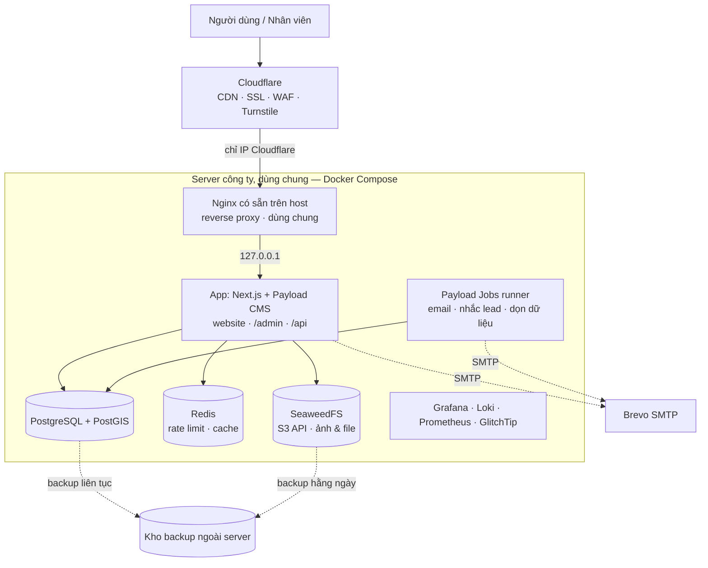
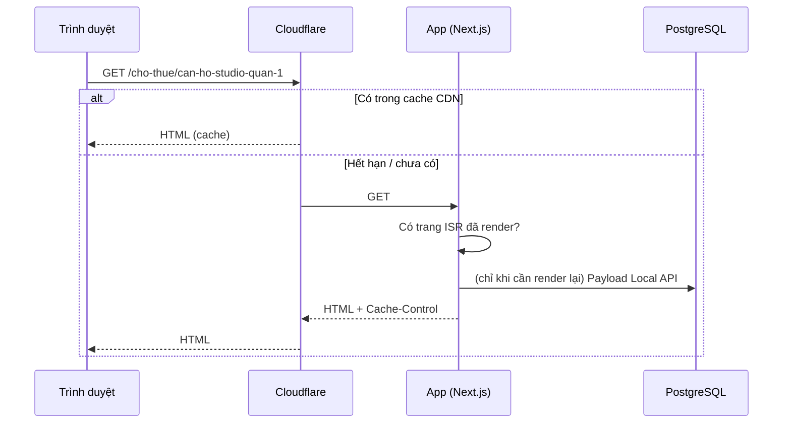
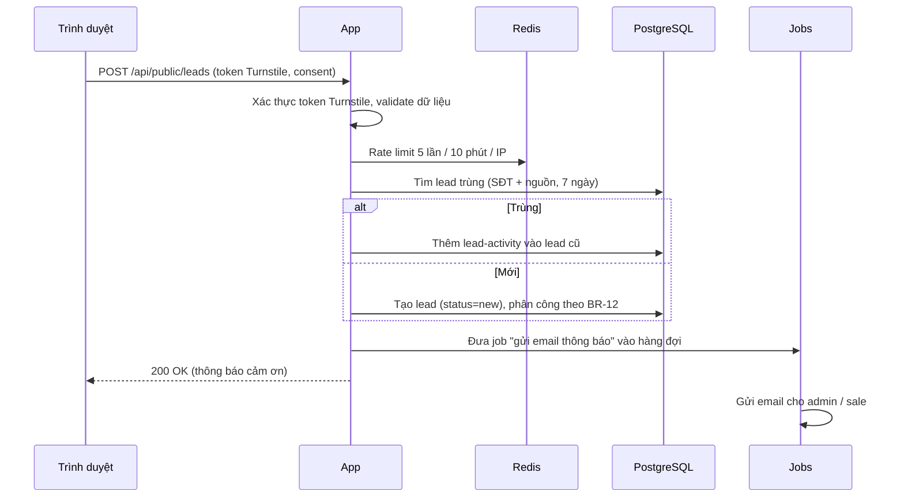

# ARCHITECTURE — Website TAMI

> Kiến trúc mục tiêu cho giai đoạn 1, duyệt ngày 16/10/2026. Nguồn yêu cầu: `docs/BRD.md` v1.4 (song ngữ Việt – Anh).
> Khi đã có code: cấu hình thật (`docker-compose*.yml`, `payload.config.ts`, `next.config.ts`) là nguồn chuẩn. File này mô tả **ý đồ và lý do**, cần cập nhật khi kiến trúc đổi.

---

## 1. Nguyên tắc

1. **Một ứng dụng duy nhất**: Next.js + Payload CMS chạy chung (website + admin + API). Ít thành phần thì ít thứ hỏng, dễ vận hành.
2. **Đọc nhiều, ghi ít**: trang công khai render sẵn và cache ở CDN; phần lớn request không chạm tới DB.
3. **Stateless**: app không lưu trạng thái trên đĩa hay bộ nhớ (file nằm ở object storage, session/rate limit nằm ở DB/Redis), nên chạy thêm bản app được mà không sửa code.
4. **Mã nguồn mở, tự host**: không phụ thuộc dịch vụ trả phí (NFR-09).
5. **Chừa chỗ mở rộng, không làm trước**: thiết kế sẵn điểm nối (§9), nhưng không xây tính năng chưa cần.

---

## 2. Sơ đồ tổng thể



Staging chạy **một bộ riêng** (app + PostgreSQL + Redis + bucket riêng) trên cùng server, khác tên miền, khác DB (`staging_db ≠ prod_db`).

---

## 3. Thành phần & công nghệ

| Thành phần | Công nghệ | Vai trò | Phí |
|---|---|---|---|
| Web + CMS + API | **Next.js** (App Router) + **Payload CMS 3**, TypeScript, Node.js LTS | Website công khai (SSR/ISR), trang `/admin`, REST API, Local API cho server component | Free |
| Giao diện | Tailwind CSS + shadcn/ui; font EB Garamond + Montserrat qua `next/font` (tự host) | UI website theo phong cách vinhomes.vn (`docs/DESIGN.md`) | Free |
| Song ngữ | **Payload `localization`** (nội dung `vi` / `en`) + **`next-intl`** (định tuyến `/en`, đường dẫn tiếng Anh, chuỗi giao diện, định dạng số/ngày) | Website công khai Việt – Anh | Free |
| Database | **PostgreSQL** + **PostGIS** + `unaccent` + `pg_trgm` | Dữ liệu chính, tọa độ, tìm kiếm tiếng Việt không dấu | Free |
| ORM / migration | Payload Postgres adapter (Drizzle bên dưới), `payload migrate` | Schema sinh từ cấu hình collection, migration versioned | Free |
| Cache / rate limit | Redis (hoặc Valkey) | Giới hạn gửi form, cache dùng chung khi chạy nhiều bản app | Free |
| Lưu file | **SeaweedFS** (S3 API) + plugin `@payloadcms/storage-s3` | Ảnh công khai (bucket `public`), CV/file nội bộ (bucket `private`) | Free |
| Xử lý ảnh | `sharp` (tích hợp trong Payload) | Sinh sẵn các cỡ ảnh + WebP khi upload | Free |
| Tác vụ nền | **Payload Jobs Queue** (lưu trong PostgreSQL) | Gửi email, nhắc lead quá hạn, dọn dữ liệu hết hạn lưu | Free |
| Reverse proxy | **Nginx có sẵn trên server** (đang phục vụ các site khác ở cổng 80/443) | Thêm file cấu hình riêng cho TAMI; điều hướng prod/staging, SSL origin, nén | Free |
| CDN / bảo vệ | Cloudflare (gói free) | Cache, SSL, chống DDoS, WAF cơ bản, Turnstile | Free |
| Email | Brevo SMTP (gói free ~300 mail/ngày) | Thông báo lead, hồ sơ ứng tuyển | Free trong hạn mức |
| Bản đồ | OpenStreetMap tiles + MapLibre GL | Bản đồ vị trí dự án / tin | Free |
| Giám sát | Prometheus + Grafana + Loki, GlitchTip (lỗi), Uptime Kuma (uptime) | Metrics, log, lỗi, cảnh báo | Free |
| Backup | pgBackRest (PostgreSQL), restic (file) | Sao lưu ra ngoài server | Free (chỉ tốn chỗ lưu) |
| CI/CD | GitHub Actions | Build, test, deploy staging → production | Free trong hạn mức |
| Analytics | Google Analytics 4 + Search Console | Traffic, SEO | Free |

**Các quyết định chính:**

| # | Quyết định | Lý do | Phương án bị loại |
|---|---|---|---|
| D1 | Payload CMS thay vì NestJS + admin tự viết | Admin, phân quyền, nháp/xuất bản, phiên bản, upload có sẵn; ít code hơn nhiều | NestJS tách riêng: kiểm soát cao hơn nhưng phải tự viết toàn bộ admin |
| D2 | Tìm kiếm bằng PostgreSQL ở giai đoạn 1 | Đủ nhanh cho mục tiêu 100.000 tin; không phải đồng bộ dữ liệu sang hệ thống khác | OpenSearch: tốn RAM, thêm việc đồng bộ |
| D3 | Payload Jobs thay vì BullMQ | Không cần thêm worker riêng; job lưu trong DB, không mất khi restart | BullMQ: thêm một tiến trình phải vận hành |
| D4 | `sharp` của Payload thay vì imgproxy | Ảnh được resize lúc upload, phục vụ thẳng qua CDN; bớt một service | imgproxy: linh hoạt hơn nhưng thêm thành phần |
| D5 | SeaweedFS cho file | Có S3 API, nhẹ, giấy phép Apache 2.0 | MinIO: bản community đã bị giới hạn tính năng; S3 thuê ngoài: tốn phí |
| D6 | Song ngữ trong **cùng một bản ghi** (Payload localization) + `next-intl` với `localePrefix: 'as-needed'` và `pathnames` | Một bài có cả bản VI và EN, chung giá/ảnh/trạng thái, không phải đồng bộ hai bản ghi; tiếng Việt giữ URL gọn không tiền tố; đường dẫn tiếng Anh tự map (`/du-an` ↔ `/en/projects`) | Tách bản ghi riêng cho mỗi ngôn ngữ: dễ lệch giá/trạng thái giữa hai bản. Subdomain `en.`: thêm cấu hình DNS/SSL/cache, SEO chia đôi tên miền |

---

## 4. Cấu trúc mã nguồn

Một repo, một app Next.js có nhúng Payload:

```
.
├── src/
│   ├── app/
│   │   ├── (frontend)/[locale]/  # Website công khai (Trang chủ, Dự án, Cho thuê, ...), dùng chung cho vi / en
│   │   └── (payload)/         # /admin và /api do Payload sinh
│   ├── collections/           # Định nghĩa collection: Projects, Rentals, PropertyPosts, News, Leads, ...
│   ├── globals/               # SiteSettings, Homepage, Header, Footer
│   ├── access/                # Hàm phân quyền dùng chung: isAdmin, isAuthorOrAdmin, isAssignedOrAdmin
│   ├── hooks/                 # Hook collection: sinh mã tin, slug, gán lead, xoá cache, audit log
│   ├── endpoints/             # Endpoint tuỳ biến: gửi lead, ứng tuyển, tìm kiếm, đếm click
│   ├── jobs/                  # Payload Jobs: gửi email, nhắc lead, dọn dữ liệu
│   ├── lib/
│   │   ├── search/            # SearchService (PostgreSQL ở giai đoạn 1)
│   │   ├── leads/             # Logic nghiệp vụ lead: chống trùng, phân công
│   │   └── seo/               # Sinh metadata, JSON-LD, sitemap
│   ├── components/            # UI dùng chung
│   ├── i18n/                  # routing.ts (locales, pathnames vi ↔ en), request.ts, messages/vi.json, messages/en.json
│   ├── middleware.ts          # next-intl: nhận /en, nhớ cookie NEXT_LOCALE, bỏ qua /admin và /api
│   └── payload.config.ts
├── migrations/                # Migration do `payload migrate:create` sinh, đã commit
├── seed/                      # Dữ liệu nền: 34 tỉnh/thành, phường/xã, danh mục mặc định
├── docker/                    # Dockerfile, docker-compose.prod.yml, docker-compose.staging.yml
│   └── nginx/                 # tami.conf, tami-staging.conf (copy vào /etc/nginx/sites-available trên server)
└── .github/workflows/         # CI/CD
```

Quy ước: logic nghiệp vụ nằm trong `lib/` (gọi được từ hook, endpoint, job), không nằm rải trong component.

---

## 5. Luồng xử lý chính

### 5.1. Xem trang công khai



- Trang công khai: `Cache-Control: public, s-maxage=60, stale-while-revalidate=300`, nên nội dung mới lên web trong ≤ 1 phút (BRD §7.2).
- Khi lưu nội dung, hook `afterChange` gọi `revalidateTag` / `revalidatePath` để Next.js render lại trang liên quan (chi tiết, danh sách, trang chủ nếu là nội dung nổi bật).
- **Song ngữ:** middleware `next-intl` xác định ngôn ngữ từ URL (`/en/...` → `en`, còn lại → `vi`), không đọc `Accept-Language` để chuyển hướng (mỗi URL luôn trả cùng một ngôn ngữ, nên CDN cache an toàn). Server component gọi Payload Local API với `locale` và `fallbackLocale: false`; bản `en` lọc thêm `hasEnglish = true`, không có thì `notFound()`. Hook xoá cache gọi `revalidatePath` cho cả hai đường dẫn VI và EN. `sitemap.xml` sinh cả hai bản kèm `alternates` (`hreflang`).
- Ảnh, JS, CSS: `Cache-Control: public, max-age=31536000, immutable` (tên file có hash).
- `/admin`, `/api/*`, form: **không cache** (Cloudflare bypass).

### 5.2. Khách gửi form liên hệ



Phản hồi cho khách luôn giống nhau dù lead bị gộp hay tạo mới (không lộ dữ liệu đã có).

### 5.3. Upload ảnh

Nhân viên upload trong admin → Payload dùng `sharp` sinh các cỡ (`thumb` 400w, `card` 800w, `large` 1600w, `og` 1200×630) dạng WebP → lưu vào bucket `public` qua S3 API → website trả ảnh qua Cloudflare.

CV ứng viên lưu vào bucket `private`. Chỉ tải được qua endpoint có kiểm tra quyền admin, không có URL công khai.

### 5.4. Tác vụ định kỳ (Payload Jobs)

| Job | Lịch | Việc |
|---|---|---|
| `send-notification-email` | Ngay khi có sự kiện | Email lead mới / giao lead / hồ sơ ứng tuyển |
| `remind-unassigned-leads` | 10 phút/lần, giờ hành chính | Lead `new` chưa có sale sau 30 phút thì nhắc admin (BR-14) |
| `expire-offers` | Hằng ngày 00:05 | Bài Đăng tin BĐS quá hạn ưu đãi thì gắn "Đã kết thúc", xoá cache trang (BR-06) |
| `close-job-postings` | Hằng ngày 00:10 | Ẩn tin tuyển dụng quá hạn nộp |
| `data-retention` | Hằng tuần | Ẩn danh lead quá 24 tháng, xoá CV quá 12 tháng (BR-31) |
| `aggregate-click-stats` | Hằng giờ | Gộp số lượt bấm hotline/Zalo/fanpage cho dashboard |

---

## 6. Triển khai

### 6.1. Server thực tế (kiểm tra 16/10/2026)

| Hạng mục | Giá trị | Đánh giá |
|---|---|---|
| Truy cập | SSH alias `server` (`root@187.52.119.50`, key `id_ed25519_trungpq`) | — |
| Máy | VPS KVM, Ubuntu 24.04 LTS | ✅ |
| CPU | 4 vCPU AMD EPYC 9354P, tải ~0.3 | ✅ Đủ |
| RAM | 15GB, trống ~11GB, **chưa có swap** | ✅ Đủ; ⚠️ nên thêm swap 4GB |
| Ổ cứng | SSD 200GB, trống 118GB (sau khi dọn build cache) | ✅ Đủ giai đoạn 1; theo dõi theo lượng ảnh |
| Docker | Docker 29.7 + Compose v5.5 | ✅ Có sẵn |
| Reverse proxy | Nginx trên host, giữ cổng 80/443 | Dùng luôn, không thêm Caddy |

**Server dùng chung** với các dự án khác (ismartschool-lms prod/staging/sysupgrade, nta-web, crm-dhp, WordPress nhstar; ~19 container). Quy tắc khi đặt TAMI lên:

- Mọi container TAMI có tiền tố `tami-` / `tami-staging-`, compose project riêng, network riêng.
- **Chỉ bind cổng vào `127.0.0.1`** (không `0.0.0.0`); PostgreSQL / Redis / SeaweedFS **không mở cổng ra host**, app truy cập qua network nội bộ của compose.
- Cổng app: production `127.0.0.1:3010`, staging `127.0.0.1:3011` (tránh các cổng đang dùng: 3001, 3002, 3004, 3005, 4000, 4001, 5432–5434, 6380, 6381, 8088, 9001).
- Đặt giới hạn RAM cho từng container (`mem_limit`) để không ảnh hưởng dự án khác.
- Thêm site bằng file riêng trong `/etc/nginx/sites-available/` + symlink `sites-enabled/`; chạy `nginx -t` trước khi `reload`, **không sửa file của site khác**.

### 6.2. Các service của TAMI

| Service | Production | Staging | RAM ước tính |
|---|---|---|---|
| nginx (host) | có sẵn, thêm `tami.conf` | thêm `tami-staging.conf` | — |
| `app` | 1 bản (có thể chạy 2) | 1 bản | 512MB–1GB / bản |
| `jobs` | cùng image app, chạy chế độ runner | cùng image | 256MB |
| `postgres` | riêng | riêng | 1–2GB / 256–512MB |
| `redis` | riêng | riêng | 128MB |
| `seaweedfs` | dùng chung giữa prod/staging, bucket riêng | bucket riêng | 256MB |
| giám sát | dùng chung | dùng chung | ~1GB |

Tổng ước tính ~4–5GB RAM, nằm gọn trong ~11GB đang trống.

### 6.3. Môi trường

| | Production | Staging |
|---|---|---|
| Tên miền | `<domain>` (điền) | `staging.<domain>` |
| DB | `DATABASE_URL_PROD` | `DATABASE_URL_STAGING` |
| Truy cập | Công khai | Cloudflare Access hoặc mật khẩu, `noindex` |
| Email | Gửi thật | Chỉ gửi tới danh sách email nội bộ |

Secret nằm trong `.env` trên server (không commit). Danh sách biến mẫu đặt ở `.env.example`.

### 6.4. CI/CD

1. Push vào nhánh làm việc → GitHub Actions chạy lint, typecheck, test, build.
2. Build Docker image, gắn tag theo commit SHA.
3. Deploy **staging**: kéo image → `payload migrate` → khởi động app → health check `/api/health`.
4. Kiểm tra trên staging.
5. **Duyệt tay** → deploy **production** đúng image và migration đã test ở staging.
6. Health check fail thì quay về image trước.
7. **Dọn build cache sau mỗi lần deploy** (`docker builder prune --filter until=72h -f`) nếu build trên server. Server từng đầy ổ vì các dự án khác bỏ qua bước này (140GB cache, đã dọn 16/10/2026).

Các dự án khác trên server deploy bằng GitHub Actions self-hosted runner (`/opt/actions-runner-*`). TAMI có thể dùng cùng cách (runner riêng `/opt/actions-runner-tami`), hoặc build image trên GitHub rồi SSH vào kéo về. Chốt ở bước DevOps.

Quy tắc migration theo `AGENTS.md` (Non-negotiables): migration versioned, không `db push`, không sửa migration đã chạy, thay đổi phá dữ liệu phải gắn `HIGH_RISK_MIGRATION`.

---

## 7. Bảo mật

| Lớp | Biện pháp |
|---|---|
| Mạng | Container TAMI chỉ bind `127.0.0.1`; DB/Redis/file không mở cổng ra host. Mục tiêu: firewall chỉ mở 22/80/443 (80/443 cho dải IP Cloudflare), SSH bằng key, fail2ban. ⚠️ Hiện firewall server **đang tắt** và DB/Redis/MinIO của dự án khác mở `0.0.0.0`: bật firewall phải phối hợp team các dự án đó |
| Truyền tải | HTTPS toàn bộ (Cloudflare Full Strict + chứng chỉ origin) |
| Đăng nhập admin | Mật khẩu mạnh, khoá tạm sau 5 lần sai; **lớp xác thực thứ 2** bằng Cloudflare Access (OTP qua email công ty) đặt trước `/admin`, vì Payload chưa có 2FA tích hợp sẵn (`docs/PERMISSION.md` §7) |
| Phân quyền | Kiểm tra quyền ở tầng collection/field của Payload, theo `docs/PERMISSION.md`; không tin dữ liệu phía client |
| Form công khai | Turnstile + rate limit + validate schema + giới hạn độ dài; ô consent bắt buộc |
| Upload | Kiểm tra MIME thật + giới hạn dung lượng; CV ở bucket private; tên file ngẫu nhiên |
| Nội dung | Rich text lưu dạng JSON (Lexical), render an toàn; không cho chèn HTML/script tuỳ ý |
| Dữ liệu cá nhân | SĐT/email khách chỉ hiện cho người có quyền; audit log khi xem danh sách và khi xuất Excel |
| Phụ thuộc | Dependabot / `pnpm audit` trong CI |
| Header | CSP, HSTS, X-Frame-Options, Referrer-Policy |

---

## 8. Giám sát, sao lưu, khôi phục

**Giám sát**
- Uptime Kuma kiểm tra trang chủ, `/api/health`, staging mỗi phút; cảnh báo qua email/Telegram.
- GlitchTip nhận lỗi từ server và trình duyệt.
- Prometheus + Grafana: CPU, RAM, ổ cứng, kết nối DB, thời gian phản hồi. Loki gom log.
- Cảnh báo: ổ cứng > 80%, lỗi 5xx tăng đột biến, backup không chạy.

**Sao lưu** (NFR-05)

| Dữ liệu | Cách | Tần suất | Giữ |
|---|---|---|---|
| PostgreSQL | pgBackRest: WAL liên tục + full hằng tuần + diff hằng ngày | Liên tục (RPO ≤ 15 phút) | 30 ngày |
| File (SeaweedFS) | restic | Hằng ngày | 30 bản ngày + 12 bản tháng |
| Cấu hình server | Lưu trong repo (trừ secret) + secret cất riêng | Mỗi lần đổi | — |

Kho backup phải nằm **ngoài server** (server khác của công ty, hoặc dịch vụ lưu trữ giá rẻ như Backblaze B2). Diễn tập khôi phục lên staging 6 tháng/lần, mục tiêu RTO ≤ 4 giờ.

---

## 9. Lộ trình mở rộng

### 9.1. Khi traffic / dữ liệu tăng

| Mức | Dấu hiệu | Việc làm | Sửa code? |
|---|---|---|---|
| 1 (hiện tại) | — | 1 server dùng chung, mọi thứ trong Docker Compose | — |
| 2 | CPU/RAM thường > 70%, DB chậm, hoặc dự án khác trên server ảnh hưởng TAMI | Chuyển TAMI sang server riêng / tách PostgreSQL sang server riêng; chạy 2+ bản app sau nginx (upstream) | Không |
| 3 | Tìm kiếm chậm (p95 > 500ms) dù đã tối ưu index | Thêm OpenSearch, đồng bộ qua Payload Jobs; đổi implementation của `SearchService` | Chỉ trong `lib/search` |
| 4 | DB quá tải đọc | Thêm read replica PostgreSQL | Cấu hình adapter |
| 5 | Nhiều server | Chuyển sang Kubernetes / Docker Swarm | Không (app đã stateless) |

### 9.2. Khi mở cho bên ngoài đăng tin

Đã chuẩn bị sẵn từ giai đoạn 1, gần như không tốn thêm công:

| Đã chuẩn bị | Ở đâu |
|---|---|
| Tài khoản nội bộ nằm trong collection `staff`; tài khoản bên ngoài sẽ là collection `members` riêng | `docs/ERD.md` |
| Mỗi nội dung có `author` | Mọi collection nội dung |
| Phân quyền theo bản ghi (`isAuthorOrAdmin`), không chỉ theo vai trò | `src/access/` |
| Lead gắn với nội dung nguồn và người đăng | `leads` |
| Tìm kiếm đi qua `SearchService` | `src/lib/search` |

Phải làm thêm khi mở: đăng ký/đăng nhập + OTP cho `members`, giao diện đăng tin riêng (không dùng `/admin`), trạng thái "Chờ duyệt" + hàng đợi kiểm duyệt, báo cáo vi phạm, giới hạn số tin, và **thủ tục pháp lý sàn TMĐT** (BRD §6).

Nếu không bao giờ mở rộng: các phần chuẩn bị trên vẫn dùng bình thường cho nội bộ, không tốn thêm tài nguyên.
