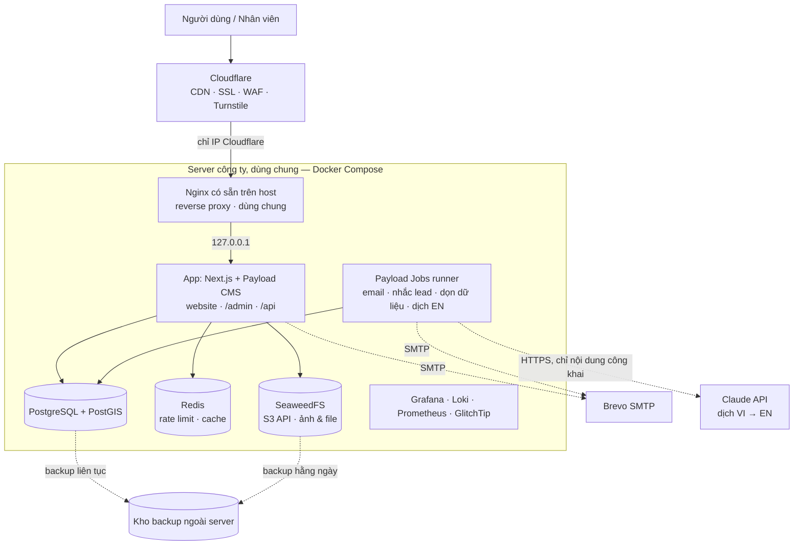
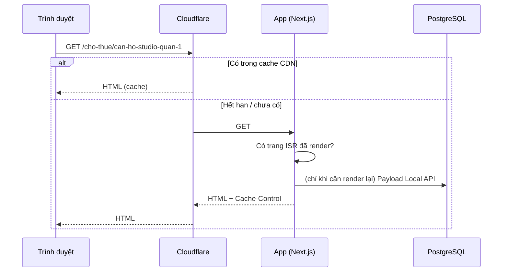
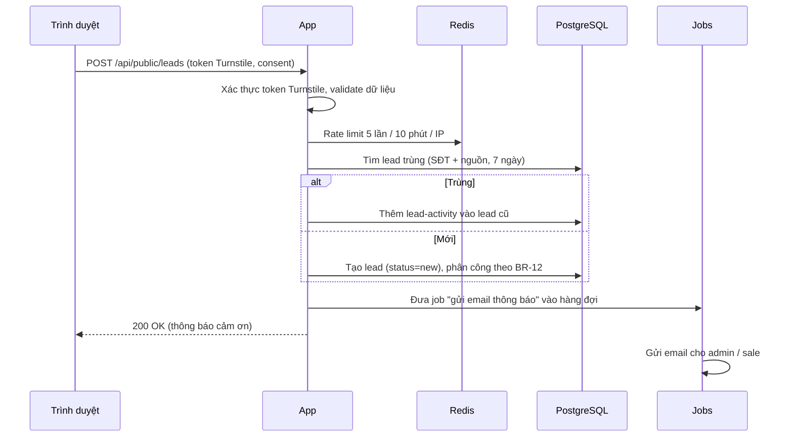

# ARCHITECTURE — Website TAMI

> Kiến trúc mục tiêu cho giai đoạn 1, duyệt ngày 16/10/2026. Nguồn yêu cầu: `docs/BRD.md` v1.5 (song ngữ Việt – Anh, AI tự dịch).
> Khi đã có code: cấu hình thật (`docker-compose*.yml`, `payload.config.ts`, `next.config.ts`) là nguồn chuẩn. File này mô tả **ý đồ và lý do**, cần cập nhật khi kiến trúc đổi.

---

## 1. Nguyên tắc

1. **Một ứng dụng duy nhất**: Next.js + Payload CMS chạy chung (website + admin + API). Ít thành phần thì ít thứ hỏng, dễ vận hành.
2. **Đọc nhiều, ghi ít**: trang công khai render sẵn và cache ở CDN; phần lớn request không chạm tới DB.
3. **Stateless**: app không lưu trạng thái trên đĩa hay bộ nhớ (file nằm ở object storage, session/rate limit nằm ở DB/Redis), nên chạy thêm bản app được mà không sửa code.
4. **Mã nguồn mở, tự host**: không phụ thuộc dịch vụ trả phí (NFR-09). Ngoại lệ duy nhất: Claude API để dịch tiếng Anh (D7), có hạn mức chi phí; API lỗi/hết hạn mức thì website vẫn chạy, chỉ bản tiếng Anh mới chưa có.
5. **Chừa chỗ mở rộng, không làm trước**: thiết kế sẵn điểm nối (§9), nhưng không xây tính năng chưa cần.

---

## 2. Sơ đồ tổng thể



Staging chạy **một bộ riêng** (app + PostgreSQL + Redis + bucket riêng) trên cùng server, khác tên miền, khác DB (`staging_db ≠ prod_db`).

---

## 3. Thành phần & công nghệ

| Thành phần | Công nghệ | Vai trò | Phí |
|---|---|---|---|
| Web + CMS + API | **Next.js** (App Router) + **Payload CMS 3**, TypeScript, Node.js LTS | Website công khai (SSR/ISR), trang `/admin`, REST API, Local API cho server component | Free |
| Giao diện | Tailwind CSS + shadcn/ui; font EB Garamond + Montserrat qua `next/font` (tự host) | UI website theo phong cách vinhomes.vn (`docs/DESIGN.md`) | Free |
| Song ngữ | **Payload `localization`** (nội dung `vi` / `en`) + **`next-intl`** (định tuyến `/en`, đường dẫn tiếng Anh, chuỗi giao diện, định dạng số/ngày) | Website công khai Việt – Anh | Free |
| Database | **PostgreSQL** + **PostGIS** + `unaccent` + `pg_trgm` | Dữ liệu chính, tọa độ, tìm kiếm tiếng Việt không dấu | Free |
| ORM / migration | Payload Postgres adapter (Drizzle bên dưới), `payload migrate` | Schema sinh từ cấu hình collection, migration versioned | Free |
| Cache / rate limit | Redis (hoặc Valkey) | Giới hạn gửi form, cache dùng chung khi chạy nhiều bản app | Free |
| Lưu file | **SeaweedFS** (S3 API) + plugin `@payloadcms/storage-s3` | Ảnh công khai (bucket `public`), CV/file nội bộ (bucket `private`) | Free |
| Xử lý ảnh | `sharp` (tích hợp trong Payload) | Sinh sẵn các cỡ ảnh + WebP khi upload | Free |
| Tác vụ nền | **Payload Jobs Queue** (lưu trong PostgreSQL) | Gửi email, nhắc lead quá hạn, dọn dữ liệu hết hạn lưu | Free |
| Reverse proxy | **Nginx có sẵn trên server** (đang phục vụ các site khác ở cổng 80/443) | Thêm file cấu hình riêng cho TAMI; điều hướng prod/staging, SSL origin, nén | Free |
| CDN / bảo vệ | Cloudflare (gói free) | Cache, SSL, chống DDoS, WAF cơ bản, Turnstile | Free |
| Email | Brevo SMTP (gói free ~300 mail/ngày) | Thông báo lead, hồ sơ ứng tuyển | Free trong hạn mức |
| Dịch tự động | **Claude API** (`@anthropic-ai/sdk`), model qua env `TRANSLATION_MODEL` | Dịch nội dung VI → EN trong job `translate-content` (BRD BR-08) | **Trả phí** theo lượng chữ, có hạn mức tháng |
| Bản đồ | OpenStreetMap tiles + MapLibre GL | Bản đồ vị trí dự án / tin | Free |
| Giám sát | Prometheus + Grafana + Loki, GlitchTip (lỗi), Uptime Kuma (uptime) | Metrics, log, lỗi, cảnh báo | Free |
| Backup | pgBackRest (PostgreSQL), restic (file) | Sao lưu ra ngoài server | Free (chỉ tốn chỗ lưu) |
| CI/CD | GitHub Actions | Build, test, deploy staging → production | Free trong hạn mức |
| Analytics | Google Analytics 4 + Search Console | Traffic, SEO | Free |

**Các quyết định chính:**

| # | Quyết định | Lý do | Phương án bị loại |
|---|---|---|---|
| D1 | Payload CMS thay vì NestJS + admin tự viết | Admin, phân quyền, nháp/xuất bản, phiên bản, upload có sẵn; ít code hơn nhiều | NestJS tách riêng: kiểm soát cao hơn nhưng phải tự viết toàn bộ admin |
| D2 | Tìm kiếm bằng PostgreSQL ở giai đoạn 1 | Đủ nhanh cho mục tiêu 100.000 tin; không phải đồng bộ dữ liệu sang hệ thống khác | OpenSearch: tốn RAM, thêm việc đồng bộ |
| D3 | Payload Jobs thay vì BullMQ | Không cần thêm worker riêng; job lưu trong DB, không mất khi restart | BullMQ: thêm một tiến trình phải vận hành |
| D4 | `sharp` của Payload thay vì imgproxy | Ảnh được resize lúc upload, phục vụ thẳng qua CDN; bớt một service | imgproxy: linh hoạt hơn nhưng thêm thành phần |
| D5 | SeaweedFS cho file | Có S3 API, nhẹ, giấy phép Apache 2.0 | MinIO: bản community đã bị giới hạn tính năng; S3 thuê ngoài: tốn phí |
| D6 | Song ngữ trong **cùng một bản ghi** (Payload localization) + `next-intl` với `localePrefix: 'as-needed'` và `pathnames` | Một bài có cả bản VI và EN, chung giá/ảnh/trạng thái, không phải đồng bộ hai bản ghi; tiếng Việt giữ URL gọn không tiền tố; đường dẫn tiếng Anh tự map (`/du-an` ↔ `/en/projects`) | Tách bản ghi riêng cho mỗi ngôn ngữ: dễ lệch giá/trạng thái giữa hai bản. Subdomain `en.`: thêm cấu hình DNS/SSL/cache, SEO chia đôi tên miền |
| D7 | Dịch tiếng Anh bằng **Claude API**, chạy nền trong Payload Jobs, tự lên web | Chất lượng dịch tốt cho văn bản marketing BĐS, hiểu bảng thuật ngữ, giữ cấu trúc richText; chạy nền nên không làm chậm lúc lưu bài; chỉ dịch trường đã đổi nên ít tốn | LibreTranslate tự host: miễn phí nhưng dịch kém, tốn RAM server dùng chung. Model tự host (Ollama): server 4 vCPU không đủ. Nhân viên tự dịch: tốn công, dễ bỏ sót |

---

## 4. Cấu trúc mã nguồn

Một repo, một app Next.js có nhúng Payload:

```
.
├── src/
│   ├── app/
│   │   ├── (frontend)/[locale]/  # Website công khai (Trang chủ, Dự án, Cho thuê, ...), dùng chung cho vi / en
│   │   └── (payload)/         # /admin và /api do Payload sinh; route tĩnh thắng catch-all /api/[...slug]: api/health, api/metrics (Prometheus, Bearer), api/monitoring-config (DSN GlitchTip lúc chạy)
│   ├── collections/           # Định nghĩa collection: Projects, Rentals, PropertyPosts, News, Leads, ...
│   │   └── _shared/           # content-defaults.ts: factory withContentDefaults (versions, trash, access, hook dùng chung)
│   ├── fields/                # Field nội dung dùng chung: slug, status, published-at, author, is-featured, translation, seo
│   ├── globals/               # SiteSettings, Homepage, Header, Footer
│   ├── access/                # Hàm phân quyền dùng chung: isAdmin, isAuthorOrAdmin, isAssignedOrAdmin
│   ├── hooks/                 # Hook collection: sinh mã tin, slug, gán lead, xoá cache, audit log (staff/)
│   ├── endpoints/             # Endpoint tuỳ biến: gửi lead, ứng tuyển, tìm kiếm, đếm click
│   │   ├── _middleware/       # public-pipeline: rateLimit → verifyTurnstile → validate (PERMISSION §5)
│   │   └── public/            # Endpoint công khai: click-events (đã có), leads, job-applications
│   ├── jobs/                  # Payload Jobs: gửi email, nhắc lead, dọn dữ liệu
│   ├── lib/
│   │   ├── search/            # SearchService (PostgreSQL ở giai đoạn 1), normalize (không dấu, khớp unaccent)
│   │   ├── security/          # rate-limit (Redis Lua), turnstile, client-ip, ip-hash
│   │   ├── email/             # adapter SMTP Brevo, allowlist ngoài production, template email nội bộ (tiếng Việt)
│   │   ├── http/              # ok() / fail() theo response contract (API_SPEC §2)
│   │   ├── audit/             # Ghi audit-logs
│   │   ├── upload/            # Kiểm loại/cỡ file upload (media, private-files)
│   │   ├── session/           # Phiên admin 8 giờ không hoạt động (keepalive)
│   │   ├── health/            # runHealthChecks + probe DB/Redis/S3 cho /api/health
│   │   ├── click-stats/       # Gộp lượt bấm (hàm thuần cho job aggregate-click-stats)
│   │   ├── monitoring/        # GlitchTip options + scrubText, metrics Prometheus, process-errors, service-name
│   │   ├── content/           # content-paths: map collection → path nội bộ /{locale}{pathnames key} cho revalidate
│   │   ├── payload/           # preserve-request-locale, prod-migrations (AUTO_MIGRATE_ON_START)
│   │   ├── logger.ts          # pino JSON + redact/scrub PII, dùng chung app/jobs/Payload
│   │   ├── s3-config.ts       # Cấu hình S3 client (SeaweedFS) dùng chung
│   │   ├── translation/       # TranslationService: gọi Claude API, dịch richText theo node, thuật ngữ, hạn mức chi phí
│   │   ├── leads/             # Logic nghiệp vụ lead: chống trùng, phân công
│   │   └── seo/               # Sinh metadata, JSON-LD, sitemap
│   ├── components/            # UI dùng chung: ui/ (shadcn), admin/ (logo, icon, keepalive), media/ (Gallery, Lightbox, LazyMap, VideoFacade, ResponsiveImage), forms/ (FormField, ConsentCheckbox, TurnstileWidget, FormStatus, use-public-form)
│   ├── i18n/                  # routing.ts (locales, pathnames vi ↔ en), request.ts, messages/vi.json, messages/en.json
│   ├── instrumentation.ts, instrumentation-client.ts  # Khởi tạo GlitchTip server/trình duyệt (chỉ khi có DSN)
│   ├── proxy.ts               # next-intl (Next 16 gọi là proxy, trước đây middleware): nhận /en, /vi/* → 301 về bản không tiền tố, bỏ qua /admin và /api
│   └── payload.config.ts
├── migrations/                # Migration do `payload migrate:create` sinh, đã commit
├── scripts/                   # jobs-runner.ts (`pnpm jobs` ở dev; container chạy thẳng `node node_modules/payload/bin.js run scripts/jobs-runner.ts`)
├── seed/                      # Dữ liệu nền: 34 tỉnh/thành, phường/xã, danh mục mặc định
├── docker/                    # Dockerfile, docker-compose.prod.yml, docker-compose.staging.yml
│   └── nginx/                 # tami.conf, tami-staging.conf (copy vào /etc/nginx/sites-available trên server)
└── .github/workflows/         # CI/CD
```

Quy ước: logic nghiệp vụ nằm trong `lib/` (gọi được từ hook, endpoint, job), không nằm rải trong component.

---

## 5. Luồng xử lý chính

### 5.1. Xem trang công khai



- Trang công khai: `Cache-Control: public, s-maxage=60, stale-while-revalidate=300`, nên nội dung mới lên web trong ≤ 1 phút (BRD §7.2).
- Khi lưu nội dung, hook `afterChange` gọi `revalidateTag` / `revalidatePath` để Next.js render lại trang liên quan (chi tiết, danh sách, trang chủ nếu là nội dung nổi bật).
- **Song ngữ:** `proxy.ts` (`next-intl`; Next 16 đổi tên `middleware.ts` thành `proxy.ts`) xác định ngôn ngữ từ URL (`/en/...` → `en`, còn lại → `vi`), không đọc `Accept-Language` để chuyển hướng, `/vi/*` chuyển 301 về bản không tiền tố, cookie `NEXT_LOCALE` chỉ do nút chuyển ngôn ngữ đặt (mỗi URL luôn trả cùng một ngôn ngữ, nên CDN cache an toàn). Server component gọi Payload Local API với `locale` và `fallbackLocale: false`; bản `en` lọc thêm `hasEnglish = true`, không có thì `notFound()`. Hook xoá cache gọi `revalidatePath` cho cả hai đường dẫn VI và EN. `sitemap.xml` sinh cả hai bản kèm `alternates` (`hreflang`).
- Ảnh, JS, CSS: `Cache-Control: public, max-age=31536000, immutable` (tên file có hash).
- **As-built (layer-4-task-03):** chính sách ở `src/lib/http/cache-policy.ts`. Trang công khai và `/admin` đặt qua `headers()` của `next.config.ts` (Next giữ header này cho trang tĩnh/ISR thay vì `s-maxage=31536000`). **Header khai ở `next.config.ts` thắng header do route tự đặt**, nên `/api/*` KHÔNG khai ở đó: route catch-all REST của Payload (`api/[...slug]/route.ts`) bọc `withDefaultNoStore` (response chưa có `Cache-Control` → `no-store`, kể cả 404/500 của file ảnh), còn `health`/`metrics` (`no-store`) và `monitoring-config` (`private, max-age=300`) tự đặt. Ảnh `/api/media/file/*` (200/206/304) đặt `public, max-age=31536000, immutable` qua `Media.upload.modifyResponseHeaders` (storage-s3 không tự đặt Cache-Control). Truy vấn trang công khai đi qua `src/lib/content/public-queries.ts` (`publicWhere`, `findPublicList`, `findPublicBySlug`). **Path có đuôi file** (`/robots.txt`, `/sitemap.xml`, `/llms.txt`, `/favicon.ico`, ảnh trong `public/`; trừ `/_next`, `/api`, `/admin`) có rule riêng `public, max-age=0, s-maxage=60` (`DOTTED_PATH_SOURCE`): request tới file chưa có rơi vào `/_not-found` tĩnh mà Next gắn `s-maxage=31536000`, Cloudflare cache theo đuôi file nên bản 404 sẽ che file thật deploy sau tới 1 năm; rule ép TTL 60s cho cả 200 lẫn 404 của nhóm này. `/_next/static/*` (tên có hash) giữ `public, max-age=31536000, immutable` mặc định của Next. Đã đo bằng `next start`: 404 của `/robots.txt`, `/sitemap.xml` và 200 của `/brand/*.png` đều `public, max-age=0, s-maxage=60`; 404 của trang thường vẫn `private, no-cache, no-store`. **Biến thể RSC (review L4-T03 round 2):** request tới trang công khai có header `RSC` / `Next-Router-Prefetch` / `Next-Router-State-Tree` / `Next-Router-Segment-Prefetch` hoặc query `_rsc` có giá trị (điều hướng client, prefetch; Next trả 307 → `?_rsc` hoặc `text/x-component`) nhận `no-store` (RFC 9111: cấm mọi cache) qua các rule `has` khai SAU rule trang công khai (rule sau thắng). Lý do: Cloudflare bỏ qua `Vary` và cache theo URL, nên nếu để `public` thì một request có `RSC: 1` lúc cache miss sẽ làm CDN lưu 307/flight payload rồi phát cho mọi khách. `has` của Next không khớp `_rsc` rỗng (`/?_rsc`) — vô hại vì không có header RSC thì vẫn là HTML thường, còn có header thì rule header áp. Path có đuôi file chưa có rule RSC (follow-up `layer-5-task-08`), Cloudflare rule dưới đây phủ mọi path. **Yêu cầu Cloudflare (layer-6-task-01):** Cache Rule bypass cache khi request có header `rsc` (và `next-router-*`) hoặc query `_rsc`, và tôn trọng TTL origin cho HTML/path có đuôi file (không đặt Edge TTL ghi đè). HTML thường vẫn `public, s-maxage=60, stale-while-revalidate=300`. Ở `/en`, doc liên quan được populate (depth > 0) không bị lọc `hasEnglish`: trang phải bỏ doc chưa có bản EN khi render link/thẻ.
- `/admin`, `/api/*`, form: **không cache** (Cloudflare bypass). Ngoại lệ: (1) `/api/monitoring-config` trả `Cache-Control: private, max-age=300` (chỉ cache ở trình duyệt, không cho CDN/proxy); (2) **ảnh media `/api/media/file/*`** (G1, đã chốt 17/10/2026) trả `Cache-Control: public, max-age=31536000, immutable` (tên file có hash/định danh bất biến, đổi ảnh = file mới) để Cloudflare cache được (rule Cloudflare ở `layer-6-task-01`; header do app đặt ở `layer-4-task-03`). Nginx **prod** không ghi đè/strip header này; Nginx **staging** thì ghi đè thành `private, no-store` cho riêng `/api/media/file/*` (kèm lặp lại `X-Robots-Tag` + header bảo mật) để Cloudflare không cache ảnh rồi phát cho người chưa qua basic auth — vì vậy rule Cache của Cloudflare ở `layer-6-task-01` chỉ áp cho host prod. Không location nào bật `proxy_cache`. `/api/metrics` luôn `no-store`; Nginx trả 404 cho đường này (Prometheus scrape thẳng `127.0.0.1:<cổng app>`).

### 5.2. Khách gửi form liên hệ



Phản hồi cho khách luôn giống nhau dù lead bị gộp hay tạo mới (không lộ dữ liệu đã có).

### 5.3. Upload ảnh

Nhân viên upload trong admin → Payload dùng `sharp` sinh các cỡ (`thumb` 400w, `card` 800w, `large` 1600w, `og` 1200×630) dạng WebP → lưu vào bucket `public` qua S3 API → website trả ảnh qua Cloudflare. **As-built:** bucket không có URL công khai; ảnh đi qua app tại `/api/media/file/<tên file>` (`payload.config.ts` không đặt `generateFileURL` cho `media`), nên đây là ngoại lệ cache của §5.1 (public, immutable, 1 năm).

CV ứng viên lưu vào bucket `private`. Chỉ tải được qua endpoint có kiểm tra quyền admin, không có URL công khai.

### 5.4. Tác vụ định kỳ (Payload Jobs)

| Job | Lịch | Việc |
|---|---|---|
| `send-notification-email` | Ngay khi có sự kiện | Email lead mới / giao lead / hồ sơ ứng tuyển. Retry 5 lần (backoff từ 30s); input sai → huỷ không retry; xong thì xoá job (không giữ PII) |
| `remind-unassigned-leads` | 10 phút/lần, giờ hành chính | Lead `new` chưa có sale sau 30 phút thì nhắc admin (BR-14) |
| `expire-offers` | Hằng ngày 00:05 | Bài Đăng tin BĐS quá hạn ưu đãi thì gắn "Đã kết thúc", xoá cache trang (BR-06) |
| `close-job-postings` | Hằng ngày 00:10 | Ẩn tin tuyển dụng quá hạn nộp |
| `data-retention` | Hằng tuần | Ẩn danh lead quá 24 tháng, xoá CV quá 12 tháng (BR-31) |
| `aggregate-click-stats` | Hằng giờ (cron `0 0 * * * *`, 6 trường) | Gộp số lượt bấm hotline/Zalo/fanpage cho dashboard; xoá `click-events` > 90 ngày đã gộp. Cộng dồn đọc-rồi-ghi, chỉ đúng khi có **1 process `jobs`** (Decision 3) |
| `translate-content` | Ngay khi lưu bản `vi` đang xuất bản / global, hoặc bấm "Dịch lại bằng AI" | Dịch các trường đã đổi sang `en` (bỏ qua bản `enSource = manual`), sinh slug `en`, bật `hasEnglish`, xoá cache `/en`. Gộp nhiều lần lưu liên tiếp của cùng bài (chờ ~1 phút). Thử lại 3 lần (backoff); lỗi thì `translation.status = failed`. Kiểm hạn mức tháng trước khi gọi (BR-08) |

---

## 6. Triển khai

### 6.1. Server thực tế (kiểm tra 16/10/2026)

| Hạng mục | Giá trị | Đánh giá |
|---|---|---|
| Truy cập | SSH alias `server` (`root@187.52.119.50`, key `id_ed25519_trungpq`) | — |
| Máy | VPS KVM, Ubuntu 24.04 LTS | ✅ |
| CPU | 4 vCPU AMD EPYC 9354P, tải ~0.3 | ✅ Đủ |
| RAM | 15GB, trống ~11GB, **chưa có swap** | ✅ Đủ; ⚠️ nên thêm swap 4GB |
| Ổ cứng | SSD 200GB, trống 118GB (sau khi dọn build cache) | ✅ Đủ giai đoạn 1; theo dõi theo lượng ảnh |
| Docker | Docker 29.7 + Compose v5.5 | ✅ Có sẵn |
| Reverse proxy | Nginx trên host, giữ cổng 80/443 | Dùng luôn, không thêm Caddy |

**Server dùng chung** với các dự án khác (ismartschool-lms prod/staging/sysupgrade, nta-web, crm-dhp, WordPress nhstar; ~19 container). Quy tắc khi đặt TAMI lên:

- Mọi container TAMI có tiền tố `tami-` / `tami-staging-`, compose project riêng, network riêng.
- **Chỉ bind cổng vào `127.0.0.1`** (không `0.0.0.0`); PostgreSQL / Redis / SeaweedFS **không mở cổng ra host**, app truy cập qua network nội bộ của compose.
- Cổng app: production `127.0.0.1:3010`, staging `127.0.0.1:3011` (tránh các cổng đang dùng: 3001, 3002, 3004, 3005, 4000, 4001, 5432–5434, 6380, 6381, 8088, 9001).
- Đặt giới hạn RAM cho từng container (`mem_limit`) để không ảnh hưởng dự án khác.
- Thêm site bằng file riêng trong `/etc/nginx/sites-available/` + symlink `sites-enabled/`; chạy `nginx -t` trước khi `reload`, **không sửa file của site khác**.

### 6.2. Các service của TAMI

| Service | Production | Staging | RAM ước tính |
|---|---|---|---|
| nginx (host) | có sẵn, thêm `tami.conf` | thêm `tami-staging.conf` | — |
| `app` | 1 bản (có thể chạy 2) | 1 bản | `mem_limit` 1g / 768m (heap Node 768 / 576MB) |
| `jobs` | cùng image app, lệnh `node node_modules/payload/bin.js run scripts/jobs-runner.ts` (tương đương `pnpm jobs` nhưng không qua pnpm để node là PID 1 nhận SIGTERM; poll 5s, dừng an toàn bằng SIGTERM/SIGINT; `stop_grace_period: 60s`). **Chỉ 1 bản** (job gộp click không nguyên tử): compose đặt `container_name` cố định nên không `--scale` được; không tạo bản thứ hai ở môi trường nào | cùng image | `mem_limit` 384m (đo thực ~190MB khi rảnh; 256MB không đủ dư địa) |
| `postgres` | riêng (`postgis/postgis:17-3.5`) | riêng | `mem_limit` 2g / 512m |
| `redis` | riêng (có mật khẩu, `maxmemory 100mb`, `volatile-lru`) | riêng | 128m |
| `seaweedfs` | **As-built:** mỗi môi trường 1 instance riêng trong compose của mình (không publish cổng, khoá S3 lấy từ env), bucket riêng (`tami-prod-*`) — thay cho phương án dùng chung ban đầu, để prod/staging không chia sẻ dữ liệu hay khoá | instance riêng, bucket `tami-staging-*` | 256m |
| giám sát | dùng chung | dùng chung | ~1GB |

Tổng trần `mem_limit` as-built: prod ≈ 3,8GB (app 1g + jobs 384m + postgres 2g + redis 128m + seaweedfs 256m) + staging ≈ 2,0GB (768m + 384m + 512m + 128m + 256m) + giám sát dùng chung ~1GB ≈ 6,8GB; chưa tính các container chạy một lần (`migrate` 512m, `seaweedfs-init` 128m). Mức dùng thực thường thấp hơn trần, nằm gọn trong ~11GB đang trống.

**As-built (`docker/Dockerfile`, `docker/docker-compose.{prod,staging}.yml`, `docker/nginx/`):**
- Một image (`docker/Dockerfile`, Node 22, user `node`, `HEALTHCHECK /api/health`) chạy cả `app` (`next start`) và `jobs`; không dùng `output: standalone` vì `jobs` và `payload migrate` cần `payload` CLI + loader TS + toàn bộ dependency production. Không chứa `.env`, source map hay devDependencies.
- Compose project `tami` / `tami-staging`, container `tami-*` / `tami-staging-*`, network `tami-net` / `tami-staging-net`. Chỉ `app` publish `127.0.0.1:3010` / `127.0.0.1:3011`; log `json-file` xoay vòng cho Promtail/Alloy → Loki (không dùng driver loki vì cần plugin trên host dùng chung).
- **Migrate là bước riêng:** `docker compose ... --profile tools run --rm migrate` (`payload migrate`) chạy trước khi bật `app`/`jobs`. `payload.config.ts` chỉ bật `prodMigrations` (tự migrate lúc khởi động ở production) khi `AUTO_MIGRATE_ON_START=true`; compose không truyền biến này.
- Secret nằm ở env file trên server (`--env-file`), compose chỉ tham chiếu `${BIẾN}`; `docker compose config` fail nếu thiếu biến bắt buộc.
- Nginx: `snippets/tami-cloudflare-ips.conf` (allow dải IP Cloudflare + `deny all`) và site `tami.conf` / `tami-staging.conf`. IP khách đến app qua header `CF-Connecting-IP` (không dùng `real_ip_header` vì module realip ghi đè `$remote_addr` trước pha access, làm `allow`/`deny` so sánh IP khách). Không mở cổng 80. `listen 443 ssl http2;` (không dùng `http2 on;`) để chạy được trên nginx 1.18 (Ubuntu 22.04) và 1.24 (24.04); bản >= 1.25.1 chỉ cảnh báo deprecated.

### 6.3. Môi trường

| | Production | Staging |
|---|---|---|
| Tên miền | `<domain>` (điền) | `staging.<domain>` |
| DB | `DATABASE_URL_PROD` | `DATABASE_URL_STAGING` |
| Truy cập | Công khai | Cloudflare Access hoặc mật khẩu, `noindex` |
| Email | Gửi thật | Chỉ gửi tới danh sách email nội bộ |

Biến cấu hình theo môi trường (đã có trong code, `src/lib/env.ts`):

| Biến | Production | Staging | Ghi chú |
|---|---|---|---|
| `APP_ENV` | `production` (**bắt buộc**) | `staging` | Khác `production` thì email chỉ gửi tới `EMAIL_ALLOWLIST` |
| `EMAIL_ALLOWLIST` | — | danh sách email nội bộ | Rỗng ở môi trường không phải production → runner log lỗi |
| `TRUST_CF_CONNECTING_IP` | `true` | `true` | Chỉ bật khi Nginx chỉ nhận traffic từ IP Cloudflare; thiếu → mọi khách chung 1 bucket rate limit |
| `SMTP_PORT`, `EMAIL_FROM_ADDRESS` | Brevo (587) | Brevo | Mặc định 587 |
| `GLITCHTIP_DSN`, `GLITCHTIP_PUBLIC_DSN` | DSN dự án prod | DSN dự án staging | Server / trình duyệt; để trống thì không gửi lỗi. Trình duyệt lấy giá trị **lúc chạy** qua `/api/monitoring-config`, nên cùng một image promote staging → prod không cần build-arg riêng |
| `METRICS_TOKEN` | ≥ 32 ký tự | ≥ 32 ký tự | Bearer cho `/api/metrics`; chưa đặt thì endpoint trả 404 |
| `LOG_LEVEL` | `info` | `info` | Mặc định `info` (`silent` khi test) |

Secret nằm trong `.env` trên server (không commit). Danh sách biến mẫu đặt ở `.env.example`, gồm cả `ANTHROPIC_API_KEY`, `TRANSLATION_MODEL`, `TRANSLATION_MONTHLY_BUDGET_USD` (prod/staging giá trị riêng).

### 6.4. CI/CD

1. Push vào nhánh làm việc → GitHub Actions chạy lint, typecheck, test, build.
2. Build Docker image, gắn tag theo commit SHA.
3. Deploy **staging**: kéo image → `payload migrate` → khởi động app → health check `/api/health`.
4. Kiểm tra trên staging.
5. **Duyệt tay** → deploy **production** đúng image và migration đã test ở staging.
6. Health check fail thì quay về image trước.
7. **Dọn build cache sau mỗi lần deploy** (`docker builder prune --filter until=72h -f`) nếu build trên server. Server từng đầy ổ vì các dự án khác bỏ qua bước này (140GB cache, đã dọn 16/10/2026).

Các dự án khác trên server deploy bằng GitHub Actions self-hosted runner (`/opt/actions-runner-*`). TAMI có thể dùng cùng cách (runner riêng `/opt/actions-runner-tami`), hoặc build image trên GitHub rồi SSH vào kéo về. Chốt ở bước DevOps.

Quy tắc migration theo `AGENTS.md` (Non-negotiables): migration versioned, không `db push`, không sửa migration đã chạy, thay đổi phá dữ liệu phải gắn `HIGH_RISK_MIGRATION`.

---

## 7. Bảo mật

| Lớp | Biện pháp |
|---|---|
| Mạng | Container TAMI chỉ bind `127.0.0.1`; DB/Redis/file không mở cổng ra host. Mục tiêu: firewall chỉ mở 22/80/443 (80/443 cho dải IP Cloudflare), SSH bằng key, fail2ban. ⚠️ Hiện firewall server **đang tắt** và DB/Redis/MinIO của dự án khác mở `0.0.0.0`: bật firewall phải phối hợp team các dự án đó |
| Truyền tải | HTTPS toàn bộ (Cloudflare Full Strict + chứng chỉ origin) |
| Đăng nhập admin | Mật khẩu mạnh, khoá tạm sau 5 lần sai; **lớp xác thực thứ 2** bằng Cloudflare Access (OTP qua email công ty) đặt trước `/admin`, vì Payload chưa có 2FA tích hợp sẵn (`docs/PERMISSION.md` §7) |
| Phân quyền | Kiểm tra quyền ở tầng collection/field của Payload, theo `docs/PERMISSION.md`; không tin dữ liệu phía client |
| Form công khai | Turnstile + rate limit + validate schema + giới hạn độ dài; ô consent bắt buộc |
| Upload | Kiểm tra MIME thật + giới hạn dung lượng; CV ở bucket private; tên file ngẫu nhiên |
| Nội dung | Rich text lưu dạng JSON (Lexical), render an toàn; không cho chèn HTML/script tuỳ ý |
| Dữ liệu cá nhân | SĐT/email khách chỉ hiện cho người có quyền; audit log khi phân công, xuất Excel và xem/tải CV (danh sách đủ ở `docs/PERMISSION.md` §6) |
| Dịch AI | `ANTHROPIC_API_KEY` chỉ ở `.env` server (prod/staging key riêng), chỉ job phía server dùng, không bao giờ ra trình duyệt. Chỉ gửi trường nội dung công khai; lead, CV, dữ liệu nhân viên **không** đi qua `TranslationService` (chặn bằng danh sách collection cho phép). Kết quả dịch là văn bản / JSON Lexical, validate lại cấu trúc trước khi lưu, không nhận HTML. Staging dùng hạn mức thấp |
| Phụ thuộc | Dependabot / `pnpm audit` trong CI |
| Header | CSP, HSTS, X-Frame-Options, Referrer-Policy |

---

## 8. Giám sát, sao lưu, khôi phục

**Giám sát**
- Uptime Kuma kiểm tra trang chủ, `/api/health`, staging mỗi phút; cảnh báo qua email/Telegram.
- GlitchTip nhận lỗi từ server (`GLITCHTIP_DSN`) và trình duyệt (`GLITCHTIP_PUBLIC_DSN`, đọc lúc chạy qua `/api/monitoring-config`). SDK chỉ được tải khi có DSN. Lỗi xảy ra trước khi SDK init (trước idle callback + fetch cấu hình, trong lúc hydrate) sẽ không được thu; lỗi server vẫn được thu. Tracing tắt; source map chưa upload (follow-up) nên stack trình duyệt bị minify. Event qua `beforeSend` được lọc email/SĐT (`scrubText`).
- `/api/metrics` (Prometheus): Bearer `METRICS_TOKEN`, trả 404 khi chưa đặt token, Nginx không public đường này. Metric `tami_*`, lưu in-memory theo từng process. Latency SSR lấy từ log Nginx.
- Logging: pino JSON ra stdout cho Loki, dùng chung cho app, jobs và logger nội bộ của Payload (`src/lib/logger.ts`). Khoá nhạy cảm (`phone`, `email`, `fullName`, `message`, `password`, cookie, authorization) bị che tới 3 cấp lồng; `hooks.logMethod` + `scrubText` (giới hạn 4KB) lọc email/SĐT trong `msg` (chuỗi, `{ msg }`, tham số `%o/%O/%j`) và `err`; logger con kế thừa hook.
- Process: `unhandledRejection` ghi log rồi chạy tiếp (Sentry mode `none`); `uncaughtException` ghi log rồi thoát.
- Prometheus + Grafana: CPU, RAM, ổ cứng, kết nối DB, thời gian phản hồi. Loki gom log.
- Cảnh báo: ổ cứng > 80%, lỗi 5xx tăng đột biến, backup không chạy.

**Sao lưu** (NFR-05)

| Dữ liệu | Cách | Tần suất | Giữ |
|---|---|---|---|
| PostgreSQL | pgBackRest: WAL liên tục + full hằng tuần + diff hằng ngày | Liên tục (RPO ≤ 15 phút) | 30 ngày |
| File (SeaweedFS) | restic | Hằng ngày | 30 bản ngày + 12 bản tháng |
| Cấu hình server | Lưu trong repo (trừ secret) + secret cất riêng | Mỗi lần đổi | — |

Kho backup phải nằm **ngoài server** (server khác của công ty, hoặc dịch vụ lưu trữ giá rẻ như Backblaze B2). Diễn tập khôi phục lên staging 6 tháng/lần, mục tiêu RTO ≤ 4 giờ.

---

## 9. Lộ trình mở rộng

### 9.1. Khi traffic / dữ liệu tăng

| Mức | Dấu hiệu | Việc làm | Sửa code? |
|---|---|---|---|
| 1 (hiện tại) | — | 1 server dùng chung, mọi thứ trong Docker Compose; **đúng 1 bản `app`** (và 1 bản `jobs`) mỗi môi trường | — |
| 2 | CPU/RAM thường > 70%, DB chậm, hoặc dự án khác trên server ảnh hưởng TAMI | Chuyển TAMI sang server riêng / tách PostgreSQL sang server riêng; chạy 2+ bản app sau nginx (upstream). **Điều kiện trước khi chạy bản thứ 2:** cache ISR (`.next/cache`) và `revalidatePath` hiện chỉ có hiệu lực trong từng process → phải chuyển sang cache handler dùng chung (vd Redis, `cacheHandler` của Next) để bài mới làm mới cache ở mọi bản; metrics `/api/metrics` in-memory theo process (Prometheus scrape từng bản) | Có, nhỏ: cấu hình cache handler dùng chung (G9, user chốt 17/10/2026) |
| 3 | Tìm kiếm chậm (p95 > 500ms) dù đã tối ưu index | Thêm OpenSearch, đồng bộ qua Payload Jobs; đổi implementation của `SearchService` | Chỉ trong `lib/search` |
| 4 | DB quá tải đọc | Thêm read replica PostgreSQL | Cấu hình adapter |
| 5 | Nhiều server | Chuyển sang Kubernetes / Docker Swarm | Không (app đã stateless) |

### 9.2. Khi mở cho bên ngoài đăng tin

Đã chuẩn bị sẵn từ giai đoạn 1, gần như không tốn thêm công:

| Đã chuẩn bị | Ở đâu |
|---|---|
| Tài khoản nội bộ nằm trong collection `staff`; tài khoản bên ngoài sẽ là collection `members` riêng | `docs/ERD.md` |
| Mỗi nội dung có `author` | Mọi collection nội dung |
| Phân quyền theo bản ghi (`isAuthorOrAdmin`), không chỉ theo vai trò | `src/access/` |
| Lead gắn với nội dung nguồn và người đăng | `leads` |
| Tìm kiếm đi qua `SearchService` | `src/lib/search` |

Phải làm thêm khi mở: đăng ký/đăng nhập + OTP cho `members`, giao diện đăng tin riêng (không dùng `/admin`), trạng thái "Chờ duyệt" + hàng đợi kiểm duyệt, báo cáo vi phạm, giới hạn số tin, và **thủ tục pháp lý sàn TMĐT** (BRD §6).

Nếu không bao giờ mở rộng: các phần chuẩn bị trên vẫn dùng bình thường cho nội bộ, không tốn thêm tài nguyên.
