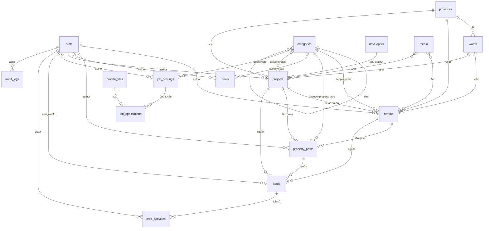

# ERD — Thiết kế dữ liệu Website TAMI

> **Trạng thái:** thiết kế ban đầu (16/10/2026), dựng từ `docs/BRD.md` v1.5 (song ngữ Việt – Anh, AI tự dịch, §1.1), **chưa có code**.
> Khi đã có code, **nguồn chuẩn** là cấu hình collection trong `src/collections/*`, `src/globals/*` và migration trong `migrations/`. Nếu file này lệch với code thì **code thắng**, và phải cập nhật file này trong cùng task (xem `AGENTS.md` § Doc Impact).

---

## 1. Tổng quan

| Hạng mục | Lựa chọn |
|---|---|
| Database | PostgreSQL + PostGIS + `unaccent` + `pg_trgm` |
| Tầng truy cập | Payload CMS 3, Postgres adapter (Drizzle bên dưới) |
| Migration | `payload migrate:create` sinh file vào `migrations/`, commit vào repo; chạy `payload migrate` khi deploy |
| Khoá chính | UUID (`idType: 'uuid'`). Mã hiển thị cho người dùng (`CT-000123`, `LD-000123`) là cột riêng, sinh từ sequence PostgreSQL |
| Tên bảng | Payload tự sinh `snake_case` theo slug collection; quan hệ nhiều-nhiều nằm ở bảng `<collection>_rels`, field dạng array ở bảng con, lịch sử phiên bản ở `_<collection>_v` |
| Thời gian | Mọi collection có `createdAt`, `updatedAt` (Payload tự quản lý), lưu UTC, hiển thị theo giờ Việt Nam |
| Xoá | **Xoá mềm** cho nội dung và lead (tính năng Trash của Payload, hoặc trường `deletedAt` nếu phiên bản đang dùng chưa hỗ trợ). Chỉ admin khôi phục hoặc xoá hẳn |
| Lịch sử | Bật `versions` (không bật drafts) cho các collection nội dung: xem và khôi phục bản cũ |
| Tiền | Số nguyên VNĐ (`number`, lưu `numeric`). Không lưu dạng chữ "3,5 tỷ" |

**Quy ước trạng thái** (dùng trường `status` riêng, không dùng `_status` drafts của Payload, để khớp BR-01/BR-02):

| Áp dụng cho | Giá trị |
|---|---|
| `rentals` | `draft` · `published` · `hidden` · `rented` |
| `projects`, `property-posts`, `news`, `services`, `job-postings`, `pages` | `draft` · `published` · `hidden` |

Website công khai chỉ đọc bản ghi có `status` ∈ {`published`, `rented`} (với `rentals`) hoặc `published` (các loại khác), và chưa bị xoá mềm. Bản tiếng Anh (`/en`) còn phải có `hasEnglish = true` (§1.1).

### 1.1. Song ngữ (Payload localization)

Cấu hình: `localization: { locales: ['vi', 'en'], defaultLocale: 'vi', fallback: false }` (BRD FR-PUB-18, BR-07).

- Trường `localized: true` lưu riêng bản `vi` và `en`. Payload đặt các cột này ở bảng `<collection>_locales` (cột `_locale`, `_parent_id`), không nằm ở bảng chính.
- **Localized** (áp cho mọi collection/global ở §4, không ghi lại từng bảng): `title`, `name`, `slug`, `summary`, `excerpt`, `description`, `overview`, `content`, các trường richText/textarea hiển thị cho khách, nhãn trong array (vd `amenities.name`, `floorPlans.title`), nhóm `seo`, chữ trong globals `homepage` / `header` / `footer`, `media.alt` / `caption`.
- **Không localized** (dùng chung hai bản): số, giá, diện tích, ngày, quan hệ, `status`, `code`, `author`, select/enum (nhãn hiển thị dịch ở file chuỗi giao diện), ảnh/file, toạ độ, `provinces` / `wards` (tên riêng tiếng Việt).
- **`hasEnglish`** (checkbox, I, mặc định `false`) có trên mọi collection nội dung: `projects`, `rentals`, `property-posts`, `news`, `services`, `job-postings`, `pages`, `categories`, `developers`. Hệ thống tự bật khi đủ trường bắt buộc tiếng Anh: `title`/`name`, `slug`, mô tả ngắn (`summary` / `excerpt` / `description`), nội dung chính (`overview` / `content` / `description` tuỳ collection); hook `beforeValidate` chặn bật khi còn thiếu. Với `pages` loại pháp lý, chỉ **admin** bật (BR-08).
- **`translation`** (group, không localized, chỉ đọc trong admin trừ nút "Dịch lại bằng AI") đi kèm `hasEnglish` trên các collection trên và các global `homepage`, `header`, `footer`, `site-settings` (BR-08):

| Trường | Kiểu | Ghi chú |
|---|---|---|
| `status` | select, I | `none` (chưa dịch) · `queued` · `done` · `failed` · `pending_review` (trang pháp lý chờ admin duyệt) |
| `enSource` | select | `ai` · `manual`. Nhân viên sửa bất kỳ trường `en` nào → `manual`, AI không dịch đè |
| `viChangedAfterManual` | checkbox, I | Bản `vi` đổi sau khi bản `en` đã sửa tay → nhắc trong admin |
| `sourceHash` | text | Hash từng trường `vi` lần dịch gần nhất (json `{field: hash}`), để chỉ dịch trường đã đổi |
| `translatedAt` | date | |
| `model` | text | Model đã dùng |
| `lastError` | text | Lỗi lần dịch gần nhất (không chứa nội dung bài) |
- Trường bắt buộc (**R**) chỉ bắt buộc ở bản `vi`; bản `en` chỉ bắt buộc khi `hasEnglish = true`.
- **Slug**: unique theo cặp (`_locale`, `slug`) trong cùng collection (với `categories`: theo (`_locale`, `scope`, `slug`)). Bản `en` sinh từ `title` tiếng Anh.

---

## 2. Sơ đồ quan hệ

---

## 3. Danh sách collection

| Nhóm | Collection | Mục đích |
|---|---|---|
| Tài khoản | `staff` | Tài khoản đăng nhập admin (Admin, Sale) |
| Danh mục nền | `provinces`, `wards`, `categories`, `developers` | Địa giới, phân loại, chủ đầu tư |
| Nội dung | `projects`, `rentals`, `property-posts`, `news`, `services`, `job-postings`, `pages` | Nội dung hiển thị trên web |
| Khách hàng | `leads`, `lead-activities`, `job-applications` | Dữ liệu khách để lại, hồ sơ ứng tuyển |
| File | `media`, `private-files` | Ảnh/file công khai; CV và file nội bộ |
| Hệ thống | `audit-logs`, `click-events`, `click-stats-daily`, `redirects`, `payload-jobs`, `translation-usage` | Nhật ký, thống kê, chuyển hướng, hàng đợi job, chi phí dịch AI |
| Globals | `site-settings`, `homepage`, `header`, `footer` | Cấu hình dùng chung |
| *(để dành)* | `members` | Tài khoản người đăng bên ngoài, **chưa tạo** (ARCHITECTURE §9.2) |

---

## 4. Chi tiết collection

Ký hiệu: **R** = bắt buộc · **U** = unique · **I** = có index · `rel→X` = quan hệ tới collection X.

### 4.1. `staff` (auth)

| Trường | Kiểu | Ràng buộc | Ghi chú |
|---|---|---|---|
| `email` | email | R, U | Payload auth, dùng để đăng nhập |
| `password` | (Payload) | R | Hash do Payload quản lý; khoá tạm sau 5 lần sai (`maxLoginAttempts: 5`) |
| `fullName` | text | R | Hiện trên tin đăng ("Sale phụ trách") |
| `phone` | text | | Hiện trên tin đăng |
| `avatar` | upload `rel→media` | | |
| `role` | select | R, I | `admin` · `sale`, mặc định `sale` |
| `active` | checkbox | R | Mặc định `true`. Khoá tài khoản = `false` (không xoá, để giữ lịch sử) |
| `lastLoginAt` | date | | |

Quy tắc: luôn còn ít nhất 1 `admin` đang hoạt động (hook chặn khoá / hạ quyền admin cuối cùng).

### 4.2. `provinces`, `wards` (seed sẵn)

**`provinces`**

| Trường | Kiểu | Ràng buộc | Ghi chú |
|---|---|---|---|
| `code` | text | R, U | Mã đơn vị hành chính |
| `name` | text | R | "Thành phố Hồ Chí Minh" |
| `shortName` | text | | "TP.HCM" |
| `slug` | text | R, U | `ho-chi-minh` |
| `sortOrder` | number | | |

**`wards`**

| Trường | Kiểu | Ràng buộc | Ghi chú |
|---|---|---|---|
| `province` | `rel→provinces` | R, I | |
| `code` | text | R, U | |
| `name` | text | R | |
| `type` | select | R | `phuong` · `xa` · `dac_khu` |
| `slug` | text | R | Unique trong cùng tỉnh |
| `legacyNames` | array of text | | Tên cũ trước 01/07/2025 (vd "Phường Bến Nghé, Quận 1"), dùng cho tìm kiếm (LGL-01) |

Dữ liệu seed từ danh mục hành chính chính thức, đặt ở `seed/`. Chỉ admin sửa.

### 4.3. `categories`

| Trường | Kiểu | Ràng buộc | Ghi chú |
|---|---|---|---|
| `name` | text | R | |
| `slug` | text | R | Unique theo (`_locale`, `scope`, `slug`) |
| `scope` | select | R, I | `rental` · `property_post` · `news` · `project` · `job` |
| `parent` | `rel→categories` | | Cùng `scope` với con (hook kiểm tra); tối đa 2 cấp |
| `description` | textarea | | Dùng cho trang danh mục + SEO |
| `sortOrder` | number | | |
| `seo` | group | | Xem §4.14 |

Không xoá được danh mục đang có nội dung hoặc có danh mục con (hook `beforeDelete`).

Dữ liệu mặc định (seed, admin sửa được):
- `rental`: Căn hộ dịch vụ · Căn hộ chung cư · Studio · Nhà nguyên căn · Văn phòng · Mặt bằng kinh doanh
- `property_post`: Tin BĐS · Voucher / Ưu đãi
- `news`: Thị trường · Tin TAMI · Đời sống

### 4.4. `developers` (chủ đầu tư)

| Trường | Kiểu | Ràng buộc | Ghi chú |
|---|---|---|---|
| `name` | text | R | |
| `slug` | text | R, U | |
| `logo` | upload `rel→media` | | |
| `description` | richText | | |
| `website` | text (URL) | | |
| `showAsPartner` | checkbox | | Hiện trong khối đối tác trên trang chủ (FR-PUB-17) |
| `sortOrder` | number | | |

### 4.5. `projects`

| Trường | Kiểu | Ràng buộc | Ghi chú |
|---|---|---|---|
| `title` | text | R | |
| `slug` | text | R, U | Tự sinh từ `title` (BR-05) |
| `category` | `rel→categories` (scope=`project`) | R, I | Loại hình: chung cư, đô thị, nghỉ dưỡng… |
| `developer` | `rel→developers` | I | |
| `salesStatus` | select | R, I | `upcoming` (sắp mở bán) · `selling` (đang mở bán) · `handed_over` (đã bàn giao) |
| `province` | `rel→provinces` | R, I | |
| `ward` | `rel→wards` | I | |
| `address` | text | | |
| `location` | point (PostGIS) | | Tọa độ hiển thị bản đồ |
| `priceFromVnd`, `priceToVnd` | number | ≥ 0 | Khoảng giá |
| `areaFromM2`, `areaToM2` | number | ≥ 0 | |
| `scale` | group | | `totalUnits`, `blocks`, `floors`, `landAreaM2`, `handoverTime` (text) |
| `summary` | textarea | R | Đoạn ngắn cho thẻ danh sách + meta description |
| `overview` | richText | | |
| `amenities` | array | | `{ name, icon? }` |
| `gallery` | upload hasMany `rel→media` | R khi `published` | Ảnh đầu tiên là ảnh đại diện |
| `floorPlans` | array | | `{ title, image rel→media }` |
| `documents` | upload hasMany `rel→media` | | Brochure, bảng giá công khai (PDF) |
| `legalInfo` | richText | | Pháp lý dự án (LGL-02) |
| `salesPolicy` | richText | | |
| `isFeatured` | checkbox | I | Ứng viên cho khối "Dự án nổi bật" |
| `status` | select | R, I | Xem §1 |
| `publishedAt` | date | I | Tự gán khi xuất bản lần đầu |
| `author` | `rel→staff` | R, I | Tự gán người tạo |
| `seo` | group | | §4.14 |

### 4.6. `rentals` (Cho thuê)

| Trường | Kiểu | Ràng buộc | Ghi chú |
|---|---|---|---|
| `code` | text | R, U | Tự sinh `CT-000001` từ sequence, chỉ đọc |
| `title` | text | R | |
| `slug` | text | R, U | |
| `category` | `rel→categories` (scope=`rental`) | R, I | |
| `project` | `rel→projects` | I | Nếu thuộc dự án |
| `province` | `rel→provinces` | R, I | |
| `ward` | `rel→wards` | R, I | |
| `address` | text | R | Số nhà, đường (có thể ẩn số nhà trên web, xem `showExactAddress`) |
| `showExactAddress` | checkbox | | Mặc định `false`: chỉ hiện đường + phường |
| `location` | point (PostGIS) | | |
| `priceMonthlyVnd` | number | R nếu không thỏa thuận, ≥ 0 | Giá thuê/tháng |
| `priceNegotiable` | checkbox | | `true` thì hiện "Thỏa thuận" |
| `areaM2` | number | R, > 0 | |
| `bedrooms` | number | ≥ 0 | |
| `bathrooms` | number | ≥ 0 | |
| `floor` | text | | Tầng (vd "12", "Tầng trệt") |
| `houseDirection` | select | | `N` · `NE` · `E` · `SE` · `S` · `SW` · `W` · `NW` |
| `balconyDirection` | select | | Như trên |
| `furnishing` | select | I | `none` (không nội thất) · `basic` (cơ bản) · `full` (đầy đủ) |
| `rentalTerms` | group | | Xem bên dưới |
| `description` | richText | R | |
| `gallery` | upload hasMany `rel→media` | R khi `published`, tối thiểu 3 ảnh | |
| `videoUrl` | text (URL) | | YouTube / TikTok |
| `legalNote` | textarea | | |
| `isFeatured` | checkbox | I | |
| `status` | select | R, I | `draft` · `published` · `hidden` · `rented` |
| `rentedAt` | date | | Tự gán khi chuyển `rented` |
| `publishedAt` | date | I | |
| `author` | `rel→staff` | R, I | Sale phụ trách; lead từ tin này tự giao cho người này (BR-12) |
| `searchText` | text (ẩn) | I (trigram) | Tự sinh, xem §6 |
| `seo` | group | | |

**`rentalTerms`** (group)

| Trường | Kiểu | Ghi chú |
|---|---|---|
| `minLeaseMonths` | number | Thời hạn thuê tối thiểu |
| `depositMonths` | number | Số tháng cọc |
| `paymentCycle` | select | `monthly` · `quarterly` · `semiannual` · `annual` |
| `includedServices` | select hasMany | `electricity` · `water` · `internet` · `cleaning` · `laundry` · `parking` · `management_fee` · `security` |
| `availableFrom` | date | Ngày trống phòng |

### 4.7. `property-posts` (Đăng tin BĐS)

| Trường | Kiểu | Ràng buộc | Ghi chú |
|---|---|---|---|
| `title` | text | R | |
| `slug` | text | R, U | |
| `category` | `rel→categories` (scope=`property_post`) | R, I | Tin BĐS, Voucher/Ưu đãi… |
| `cover` | upload `rel→media` | R | |
| `gallery` | upload hasMany `rel→media` | | |
| `excerpt` | textarea | R | |
| `content` | richText | R | |
| `priceVnd` | number | | Tuỳ chọn |
| `priceNote` | text | | Tuỳ chọn, vd "Chỉ từ 2,1 tỷ" |
| `province` | `rel→provinces` | I | Tuỳ chọn |
| `ward` | `rel→wards` | | Tuỳ chọn |
| `relatedProject` | `rel→projects` | | Tuỳ chọn |
| `relatedRental` | `rel→rentals` | | Tuỳ chọn |
| `offer` | group | | `startAt`, `endAt` (I), `voucherCode`, `terms` (textarea). Có `endAt` đã qua thì gắn "Đã kết thúc" (BR-06) |
| `isFeatured` | checkbox | I | Ứng viên khối "Ưu đãi nổi bật" |
| `status` | select | R, I | |
| `publishedAt` | date | I | |
| `author` | `rel→staff` | R, I | Lead từ bài này tự giao cho người này |
| `seo` | group | | |

### 4.8. `news` (Tin tức)

| Trường | Kiểu | Ràng buộc | Ghi chú |
|---|---|---|---|
| `title` | text | R | |
| `slug` | text | R, U | |
| `category` | `rel→categories` (scope=`news`) | R, I | |
| `cover` | upload `rel→media` | R | |
| `excerpt` | textarea | R | |
| `content` | richText | R | |
| `tags` | text hasMany | | |
| `status` | select | R, I | |
| `publishedAt` | date | I | Cho phép hẹn giờ (FR-ADM-16) |
| `author` | `rel→staff` | R, I | |
| `seo` | group | | |

### 4.9. `services` (Dịch vụ)

| Trường | Kiểu | Ràng buộc | Ghi chú |
|---|---|---|---|
| `title` | text | R | Phân phối · Môi giới · Khai thác căn hộ dịch vụ |
| `slug` | text | R, U | |
| `icon` | upload `rel→media` | | |
| `summary` | textarea | R | Hiện trên trang chủ |
| `content` | richText | | |
| `sortOrder` | number | | |
| `status` | select | R | |
| `seo` | group | | |

### 4.10. `job-postings`, `job-applications`

**`job-postings`**

| Trường | Kiểu | Ràng buộc | Ghi chú |
|---|---|---|---|
| `title` | text | R | |
| `slug` | text | R, U | |
| `category` | `rel→categories` (scope=`job`) | | Kinh doanh, Marketing… |
| `province` | `rel→provinces` | | Nơi làm việc |
| `workplace` | text | | Địa chỉ cụ thể |
| `employmentType` | select | R | `full_time` · `part_time` · `internship` · `contract` |
| `salaryMinVnd`, `salaryMaxVnd` | number | | Dùng cho JSON-LD `JobPosting` |
| `salaryText` | text | | "Thỏa thuận", "15–30 triệu + hoa hồng" |
| `quantity` | number | | |
| `deadline` | date | R, I | Quá hạn thì tự ẩn khỏi danh sách |
| `description`, `requirements`, `benefits` | richText | R / R / | |
| `status` | select | R, I | |
| `publishedAt` | date | | |
| `author` | `rel→staff` | R | |
| `seo` | group | | |

**`job-applications`** (chỉ admin đọc)

| Trường | Kiểu | Ràng buộc | Ghi chú |
|---|---|---|---|
| `jobPosting` | `rel→job-postings` | R, I | |
| `fullName` | text | R | |
| `phone` | text | R | |
| `email` | email | R | |
| `cv` | upload `rel→private-files` | R | PDF/DOC/DOCX ≤ 5MB |
| `message` | textarea | | |
| `status` | select | R, I | `new` · `reviewing` · `interview` · `hired` · `rejected` |
| `note` | textarea | | Ghi chú nội bộ |
| `consentAt` | date | R | |
| `consentVersion` | text | R | Phiên bản chính sách tại thời điểm đồng ý |
| `locale` | select | R | `vi` · `en`: ngôn ngữ khách dùng khi nộp (BR-21) |
| `ipHash` | text | | Hash IP (không lưu IP thô) |
| `anonymizedAt` | date | | Đặt khi job `data-retention` xử lý |

### 4.11. `leads`, `lead-activities`

**`leads`**

| Trường | Kiểu | Ràng buộc | Ghi chú |
|---|---|---|---|
| `code` | text | R, U | `LD-000001` |
| `source` | select | R, I | `rental` · `property_post` · `project` · `contact` |
| `rental` | `rel→rentals` | I | Có giá trị khi `source=rental` |
| `propertyPost` | `rel→property-posts` | I | Khi `source=property_post` |
| `project` | `rel→projects` | I | Khi `source=project` |
| `fullName` | text | R | |
| `phone` | text | R | Như khách nhập |
| `phoneNormalized` | text | R, I | Chuẩn hoá `+84…`, dùng chống trùng (BR-15) |
| `email` | email | | |
| `message` | textarea | | Nhu cầu / lời nhắn |
| `status` | select | R, I | `new` · `contacted` · `consulting` · `won` · `lost` · `spam` |
| `lostReason` | textarea | R khi `status=lost` | |
| `assignedTo` | `rel→staff` | I | |
| `assignedAt` | date | | |
| `firstContactedAt` | date | | Lần đầu chuyển khỏi `new` |
| `lastActivityAt` | date | I | Dùng cho hạn lưu 24 tháng |
| `mergedCount` | number | | Số lần khách gửi lại và được gộp |
| `consentAt` | date | R | |
| `consentVersion` | text | R | |
| `locale` | select | R, I | `vi` · `en`: ngôn ngữ khách dùng khi gửi form (BR-17). Không dùng để chống trùng |
| `utm` | group | | `source`, `medium`, `campaign`, `term`, `content` |
| `pageUrl` | text | | Trang khách gửi form |
| `referrer` | text | | |
| `ipHash` | text | | |
| `userAgent` | text | | |
| `anonymizedAt` | date | | Sau khi ẩn danh: xoá `fullName`, `phone`, `email`, `message` |

**Chống trùng (BR-15):** tìm lead có cùng `phoneNormalized` + cùng `source` + cùng bản ghi nguồn, `createdAt` trong 7 ngày, chưa `won`/`lost`/`spam`. Có thì tăng `mergedCount`, cập nhật `lastActivityAt` và thêm `lead-activities` loại `merged`.

**Phân công (BR-12):** `source` ∈ {`rental`, `property_post`} và `author` của bản ghi nguồn đang `active` → `assignedTo = author`. Các trường hợp khác để trống, chờ admin.

**`lead-activities`** (chỉ thêm, không sửa, không xoá)

| Trường | Kiểu | Ràng buộc | Ghi chú |
|---|---|---|---|
| `lead` | `rel→leads` | R, I | |
| `type` | select | R | `note` · `call` · `status_change` · `assignment` · `merged` · `email_sent` |
| `content` | textarea | | |
| `fromStatus`, `toStatus` | select | | Khi `status_change` |
| `fromAssignee`, `toAssignee` | `rel→staff` | | Khi `assignment` |
| `actor` | `rel→staff` | | Trống = hệ thống |

Đổi `status` / `assignedTo` của lead tự sinh activity tương ứng (hook `afterChange`).

### 4.12. `media`, `private-files` (upload)

**`media`** (bucket `public`, ai cũng đọc được)

| Trường | Kiểu | Ràng buộc | Ghi chú |
|---|---|---|---|
| file | upload | R | Ảnh ≤ 10MB (JPG/PNG/WebP/AVIF), PDF ≤ 20MB |
| `alt` | text | R với ảnh | Accessibility + SEO |
| `caption` | text | | |
| `uploadedBy` | `rel→staff` | | |

Cỡ ảnh sinh khi upload (WebP): `thumb` 400w · `card` 800w · `large` 1600w · `og` 1200×630.

**`private-files`** (bucket `private`, không có URL công khai): CV ứng viên và file nội bộ. Chỉ admin tải được qua endpoint có kiểm quyền.

### 4.13. Hệ thống

**`audit-logs`** (chỉ thêm; chỉ admin đọc; không ai sửa hay xoá)

| Trường | Kiểu | Ghi chú |
|---|---|---|
| `actor` | `rel→staff` | |
| `action` | select | `lead.assign` · `lead.export` · `content.delete` · `content.restore` · `staff.create` · `staff.update_role` · `staff.deactivate` · `auth.login_failed` · `application.view_cv` · `content.retranslate` · `content.approve_translation` |
| `collection` | text | |
| `docId` | text | |
| `summary` | text | Mô tả ngắn |
| `meta` | json | Dữ liệu trước/sau (không chứa mật khẩu) |
| `ipHash` | text | |

**`click-events`**: `type` (`hotline` · `zalo` · `fanpage`), `pagePath`, `refCollection`, `refId`. Giữ 90 ngày. Mỗi giờ gộp vào **`click-stats-daily`** (`date`, `type`, `refCollection`, `refId`, `count`, unique theo 5 cột) cho dashboard.

**`redirects`**: plugin `@payloadcms/plugin-redirects` (`from`, `to`, `type=301`). Đổi slug của nội dung đã xuất bản thì hook tự tạo redirect cho đúng ngôn ngữ (BR-05): `from` / `to` là đường dẫn đầy đủ, vd `/en/for-rent/old-slug` → `/en/for-rent/new-slug`.

**`payload-jobs`**: bảng hàng đợi do Payload Jobs quản lý.

**`translation-usage`** (chỉ admin đọc; hệ thống ghi): `month` (`YYYY-MM`, U), `inputTokens`, `outputTokens`, `requests`, `estimatedCostUsd`. Job dịch cộng dồn sau mỗi lần gọi; vượt hạn mức tháng (env `TRANSLATION_MONTHLY_BUDGET_USD`) thì dừng dịch và báo admin.

### 4.14. Nhóm `seo` (dùng chung)

| Trường | Kiểu | Ghi chú |
|---|---|---|
| `metaTitle` | text | Trống thì lấy `title` |
| `metaDescription` | textarea | Trống thì lấy `summary` / `excerpt` |
| `ogImage` | upload `rel→media` | Trống thì lấy ảnh đại diện |
| `noindex` | checkbox | |
| `canonical` | text | |

Dùng plugin `@payloadcms/plugin-seo`.

### 4.15. Globals

> Globals: các trường chữ (tiêu đề khối, slide, nhãn menu, cột footer, `siteName`, `address`, `copyright`) là localized; link, ảnh, số điện thoại, email dùng chung. `header.navItems[].link` lưu **khoá trang** (vd `projects`, `rentals`) hoặc URL tuyệt đối, để mỗi ngôn ngữ tự ra đúng đường dẫn.

**`site-settings`**: `siteName`, `logo`, `logoDark`, `favicon`, `hotline`, `zaloUrl`, `fanpageUrl`, `email`, `address`, `mapLocation` (point), `socialLinks` (array `{platform, url}`), `notificationEmails` (array email nhận thông báo lead/ứng tuyển), `privacyPolicyVersion` (dùng làm `consentVersion`), `gaMeasurementId`, `translationGlossary` (array `{vi, en, note?}`: thuật ngữ cố định cho AI dịch, vd `căn hộ dịch vụ` → `serviced apartment`; tên riêng như TAMI HOMES, tên dự án giữ nguyên), `translationEnabled` (checkbox, tắt nhanh dịch tự động). Hạn mức chi phí và API key nằm ở biến môi trường, **không** lưu DB.

**`homepage`**:

| Khối | Trường |
|---|---|
| `hero` | `slides` (array 1–8: `image`, `title`, `subtitle`, `ctaLabel`, `ctaLink`) |
| `about` | `enabled`, `title`, `content` (richText), `image`, `stats` (array `{value, label}`, vd "10+ năm") |
| `featuredProjects` | `enabled`, `title`, `projects` (`rel→projects` hasMany, tối đa 6; trống thì lấy `isFeatured` mới nhất) |
| `services` | `enabled`, `title`, `items` (`rel→services` hasMany) |
| `featuredOffers` | `enabled`, `title`, `posts` (`rel→property-posts` hasMany; trống thì lấy `isFeatured` còn hạn) |
| `partners` | `enabled`, `title` (lấy `developers.showAsPartner`) |
| `blockOrder` | array thứ tự khối |
| `seo` | group |

**`header`**: `navItems` (array `{label, link, children?}`), `ctaButton`.
**`footer`**: `columns` (array `{title, links[]}`), `contactBlock`, `copyright`.

---

## 5. Index

Payload tạo index cho trường `index: true` và `unique: true`. Các index dưới đây **tạo thêm bằng migration SQL** cho truy vấn công khai:

| Bảng | Index | Phục vụ |
|---|---|---|
| `rentals` | `(status, category_id, province_id, price_monthly_vnd)` | Lọc danh sách Cho thuê |
| `rentals` | `(status, ward_id)` | Lọc theo phường |
| `rentals` | `(status, published_at DESC)` | Sắp xếp mới nhất |
| `rentals` | `(status, area_m2)`, `(status, bedrooms)` | Lọc diện tích, phòng ngủ |
| `rentals` | GIN `search_text gin_trgm_ops` | Tìm từ khoá không dấu |
| `rentals`, `projects` | GIST `location` | Sẵn cho tìm theo bản đồ sau này |
| `projects` | `(status, sales_status, province_id)` | Lọc dự án |
| `property_posts` | `(status, category_id, published_at DESC)`, `(status, is_featured, offer_end_at)` | Danh sách, khối ưu đãi |
| `news` | `(status, category_id, published_at DESC)` | Danh sách tin tức |
| `leads` | `(phone_normalized, source, created_at DESC)` | Chống trùng |
| `leads` | `(status, assigned_to_id, created_at DESC)` | Danh sách lead trong admin |
| `audit_logs` | `(created_at DESC)`, `(collection, doc_id)` | Tra cứu nhật ký |

Với dữ liệu đang xoá mềm: index chỉ áp lên bản ghi chưa xoá (partial index `WHERE deleted_at IS NULL`, nếu dùng trường `deletedAt`).

**Song ngữ:** cột localized nằm ở bảng `<collection>_locales`, nên index tìm kiếm và slug đặt ở đó:

| Bảng | Index | Phục vụ |
|---|---|---|
| `<collection>_locales` (mọi collection nội dung) | UNIQUE `(_locale, slug)` | Tra trang theo slug từng ngôn ngữ |
| `rentals_locales` | GIN `search_text gin_trgm_ops` (thay cho index trên bảng `rentals`) | Tìm từ khoá theo ngôn ngữ đang xem |
| `rentals`, `projects`, `property_posts`, `news`, `job_postings` | thêm cột `has_english` ngay sau `status` trong các index danh sách ở trên, vd `(status, has_english, category_id, …)` | Lọc danh sách bản tiếng Anh |

---

## 6. Tìm kiếm (giai đoạn 1)

- Cột `searchText` của `rentals` (localized) được hook `beforeChange` sinh **cho từng ngôn ngữ** từ: `code` + `title` của ngôn ngữ đó + `address` + tên phường + tên tỉnh + `legacyNames` của phường + tên dự án. Chuyển chữ thường và bỏ dấu (`unaccent`). Tìm ở `/en` dùng `searchText` bản `en` (vẫn gõ được tên địa danh tiếng Việt không dấu).
- Từ khoá người dùng nhập cũng được chuẩn hoá như vậy, rồi tìm bằng `ILIKE` / similarity của `pg_trgm` trên index GIN.
- Toàn bộ nằm sau `SearchService` (`src/lib/search`). Khi cần OpenSearch thì chỉ đổi implementation (ARCHITECTURE §9.1).
- `property-posts` và `news`: tìm đơn giản theo tiêu đề (đủ cho giai đoạn 1).

---

## 7. Lưu trữ & xoá dữ liệu

| Dữ liệu | Thời hạn | Cách xử lý (job `data-retention`) |
|---|---|---|
| `leads` | 24 tháng từ `lastActivityAt` ⚠️ | Ẩn danh: xoá họ tên, SĐT, email, lời nhắn; giữ số liệu thống kê |
| `job-applications` | 12 tháng từ `createdAt` ⚠️ | Xoá file CV, ẩn danh thông tin cá nhân |
| `click-events` | 90 ngày | Xoá (đã gộp vào `click-stats-daily`) |
| `audit-logs` | 24 tháng | Xoá bản cũ hơn |
| Nội dung đã xoá mềm | Giữ đến khi admin xoá hẳn | — |
| Bản phiên bản (`versions`) | Giữ 20 bản gần nhất mỗi bản ghi | Payload `maxPerDoc: 20` |

---

## 8. Mở rộng sau này

- **Tài khoản bên ngoài**: thêm collection auth `members` (không gộp vào `staff`); trường `author` của nội dung đổi thành quan hệ polymorphic `rel→[staff, members]`. Đây là migration có kiểm soát; dữ liệu cũ không đổi giá trị.
- **Kiểm duyệt**: thêm giá trị `pending` vào `status`, kèm `reviewedBy`, `reviewedAt`, `rejectReason`.
- **Mua bán**: đã bỏ khỏi phạm vi, **không thiết kế**, không để sẵn trường nào.
- **Bảng phình to** (`click-events`, `audit-logs`): khi vượt vài chục triệu dòng thì chuyển sang partition theo tháng.
