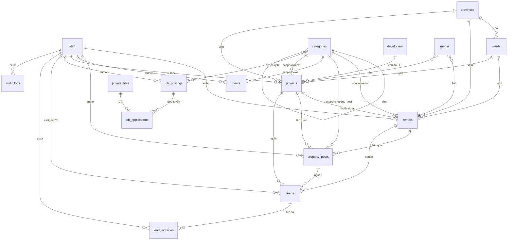

# ERD — Thiết kế dữ liệu Website TAMI

> **Trạng thái:** thiết kế ban đầu (16/10/2026), dựng từ `docs/BRD.md` v1.5 (song ngữ Việt – Anh, AI tự dịch, §1.1), **chưa có code**.
> Khi đã có code, **nguồn chuẩn** là cấu hình collection trong `src/collections/*`, `src/globals/*` và migration trong `migrations/`. Nếu file này lệch với code thì **code thắng**, và phải cập nhật file này trong cùng task (xem `AGENTS.md` § Doc Impact).

---

## 1. Tổng quan

| Hạng mục | Lựa chọn |
|---|---|
| Database | PostgreSQL + PostGIS + `unaccent` + `pg_trgm` |
| Tầng truy cập | Payload CMS 3, Postgres adapter (Drizzle bên dưới) |
| Migration | `payload migrate:create` sinh file vào `migrations/`, commit vào repo; chạy `payload migrate` khi deploy |
| Khoá chính | UUID (`idType: 'uuid'`). Mã hiển thị cho người dùng (`CT-000123`, `LD-000123`) là cột riêng, sinh từ sequence PostgreSQL |
| Tên bảng | Payload tự sinh `snake_case` theo slug collection; quan hệ nhiều-nhiều nằm ở bảng `<collection>_rels`, field dạng array ở bảng con, lịch sử phiên bản ở `_<collection>_v` |
| Thời gian | Mọi collection có `createdAt`, `updatedAt` (Payload tự quản lý), lưu UTC, hiển thị theo giờ Việt Nam |
| Xoá | **Xoá mềm** cho nội dung và lead (tính năng Trash của Payload, hoặc trường `deletedAt` nếu phiên bản đang dùng chưa hỗ trợ). Chỉ admin khôi phục hoặc xoá hẳn |
| Lịch sử | Bật `versions` (không bật drafts) cho các collection nội dung: xem và khôi phục bản cũ |
| Tiền | Số nguyên VNĐ (`number`, lưu `numeric`). Không lưu dạng chữ "3,5 tỷ" |

**Quy ước trạng thái** (dùng trường `status` riêng, không dùng `_status` drafts của Payload, để khớp BR-01/BR-02):

| Áp dụng cho | Giá trị |
|---|---|
| `rentals` | `draft` · `published` · `hidden` · `rented` |
| `projects`, `property-posts`, `news`, `services`, `job-postings`, `pages` | `draft` · `published` · `hidden` |

Website công khai chỉ đọc bản ghi có `status` ∈ {`published`, `rented`} (với `rentals`) hoặc `published` (các loại khác), và chưa bị xoá mềm; với bài có `publishedAt` thì còn phải `publishedAt ≤ now` (hẹn giờ, FR-ADM-16). Bản tiếng Anh (`/en`) còn phải có `hasEnglish = true` (§1.1).

### 1.1. Song ngữ (Payload localization)

Cấu hình: `localization: { locales: [{ code: 'vi', label: 'Tiếng Việt' }, { code: 'en', label: 'English' }], defaultLocale: 'vi', fallback: false }` (mã locale `vi`/`en`; `label` chỉ là nhãn ô chọn ngôn ngữ ở admin — BL-039) (BRD FR-PUB-18, BR-07).

- Trường `localized: true` lưu riêng bản `vi` và `en`. Payload đặt các cột này ở bảng `<collection>_locales` (cột `_locale`, `_parent_id`), không nằm ở bảng chính.
- **Localized** (áp cho mọi collection/global ở §4, không ghi lại từng bảng): `title`, `name`, `slug`, `summary`, `excerpt`, `description`, `overview`, `content`, các trường richText/textarea hiển thị cho khách, nhãn trong array (vd `amenities.name`, `floorPlans.title`), nhóm `seo`, chữ trong globals `homepage` / `header` / `footer`, `media.alt` / `caption`.
- **Không localized** (dùng chung hai bản): số, giá, diện tích, ngày, quan hệ, `status`, `code`, `author`, select/enum (nhãn hiển thị dịch ở file chuỗi giao diện), ảnh/file, toạ độ, `provinces` / `wards` (tên riêng tiếng Việt).
- **`hasEnglish`** (checkbox, I, mặc định `false`) có trên mọi collection nội dung: `projects`, `rentals`, `property-posts`, `news`, `services`, `job-postings`, `pages`, `categories`, `developers`. Hệ thống tự bật khi đủ trường bắt buộc tiếng Anh: `title`/`name`, `slug` (trừ `pages`, route cố định theo `kind`, §4.9b), mô tả ngắn (`summary` / `excerpt` / `description`), nội dung chính (`overview` / `content` / `description` tuỳ collection); hook `beforeValidate` chặn bật khi còn thiếu. Với `pages` loại pháp lý, chỉ **admin** bật (BR-08).
- **`translation`** (group, không localized, chỉ đọc trong admin trừ nút "Dịch lại bằng AI") đi kèm `hasEnglish` trên các collection trên và các global `homepage`, `header`, `footer`, `site-settings` (BR-08):

| Trường | Kiểu | Ghi chú |
|---|---|---|
| `status` | select, I | `none` (chưa dịch) · `queued` · `done` · `failed` · `pending_review` (trang pháp lý chờ admin duyệt) |
| `enSource` | select | `ai` · `manual`. Nhân viên sửa bất kỳ trường `en` nào → `manual`, AI không dịch đè |
| `viChangedAfterManual` | checkbox, I | Bản `vi` đổi sau khi bản `en` đã sửa tay → nhắc trong admin |
| `sourceHash` | text | Hash từng trường `vi` lần dịch gần nhất (json `{khoá-trường: sha256}`, khoá array theo `id` hàng, vd `navItems.<id>.label`), để chỉ dịch trường đã đổi. Khi người sửa tay `en` → đặt lại bằng hash `vi` hiện tại (mốc so cho `viChangedAfterManual`). Nhân bản (Duplicate) đặt lại cả nhóm `translation` về chưa dịch |
| `translatedAt` | date | |
| `model` | text | Model đã dùng |
| `lastError` | text | Lỗi lần dịch gần nhất (không chứa nội dung bài) |
- Trường bắt buộc (**R**) chỉ bắt buộc ở bản `vi`; bản `en` chỉ bắt buộc khi `hasEnglish = true`.
- **Slug**: unique theo cặp (`_locale`, `slug`) trong cùng collection (với `categories`: theo (`_locale`, `scope`, `slug`)). Bản `en` sinh từ `title` tiếng Anh.

---

## 2. Sơ đồ quan hệ

---

## 3. Danh sách collection

| Nhóm | Collection | Mục đích |
|---|---|---|
| Tài khoản | `staff` | Tài khoản đăng nhập admin (Admin, Sale) |
| Danh mục nền | `provinces`, `wards`, `categories`, `developers` | Địa giới, phân loại, chủ đầu tư |
| Nội dung | `projects`, `rentals`, `property-posts`, `news`, `services`, `job-postings`, `pages` | Nội dung hiển thị trên web |
| Khách hàng | `leads`, `lead-activities`, `job-applications` | Dữ liệu khách để lại, hồ sơ ứng tuyển |
| File | `media`, `private-files` | Ảnh/file công khai; CV ứng viên (chỉ CV) |
| Hệ thống | `audit-logs`, `click-events`, `click-stats-daily`, `redirects`, `payload-jobs`, `translation-usage` | Nhật ký, thống kê, chuyển hướng, hàng đợi job, chi phí dịch AI |
| Globals | `site-settings`, `homepage`, `header`, `footer` | Cấu hình dùng chung |
| *(để dành)* | `members` | Tài khoản người đăng bên ngoài, **chưa tạo** (ARCHITECTURE §9.2) |

---

## 4. Chi tiết collection

Ký hiệu: **R** = bắt buộc · **U** = unique · **I** = có index · `rel→X` = quan hệ tới collection X. Với `slug` (localized), **U** nghĩa là unique theo (`_locale`, `slug`) trong collection (§1.1), không phải unique toàn cột.

### 4.1. `staff` (auth)

| Trường | Kiểu | Ràng buộc | Ghi chú |
|---|---|---|---|
| `email` | email | R, U | Payload auth, dùng để đăng nhập |
| `password` | (Payload) | R | Hash do Payload quản lý; khoá tạm sau 5 lần sai (`maxLoginAttempts: 5`) |
| `fullName` | text | R | Hiện trên tin đăng ("Sale phụ trách") |
| `phone` | text | | Hiện trên tin đăng |
| `avatar` | upload `rel→media` | | |
| `role` | select | R, I | `admin` · `sale`, mặc định `sale` |
| `active` | checkbox | R | Mặc định `true`. Khoá tài khoản = `false` (không xoá, để giữ lịch sử) |
| `lastLoginAt` | date | | |

Quy tắc: luôn còn ít nhất 1 `admin` đang hoạt động (hook chặn khoá / hạ quyền admin cuối cùng).

### 4.2. `provinces`, `wards` (seed sẵn)

**`provinces`**

| Trường | Kiểu | Ràng buộc | Ghi chú |
|---|---|---|---|
| `code` | text | R, U | Mã đơn vị hành chính |
| `name` | text | R | "Thành phố Hồ Chí Minh" |
| `shortName` | text | | "TP.HCM" |
| `slug` | text | R, U | `ho-chi-minh` |
| `sortOrder` | number | | |

**`wards`**

| Trường | Kiểu | Ràng buộc | Ghi chú |
|---|---|---|---|
| `province` | `rel→provinces` | R, I | |
| `code` | text | R, U | |
| `name` | text | R | |
| `type` | select | R | `phuong` · `xa` · `dac_khu` |
| `slug` | text | R | Unique trong cùng tỉnh |
| `legacyNames` | array `{ name: text }` | | Tên cũ trước 01/07/2025 (vd "Phường Bến Nghé, Quận 1"), dùng cho tìm kiếm (LGL-01) |

Dữ liệu seed từ danh mục hành chính chính thức, đặt ở `seed/`. Chỉ admin sửa.

**As-built (layer 2 task 02):**
- **Mã:** `provinces.code` = mã BNV 2 chữ số ("29"); `wards.code` = mã TMS 8 chữ số ("70101063"). Cả hai là khoá upsert của seed (kiểu text).
- **Nguồn dữ liệu:** `seed/data/danh-muc-phuong-xa-moi.xlsx` là nguồn chính (mã, tên tỉnh, tên phường/xã sau 01/07/2025); `seed/data/vietnam-sap-nhap-phuong-xa.csv` chỉ dùng lấy tên cũ (`legacyNames`). Seed lúc chạy chỉ đọc `seed/data/administrative-units.json` (34 tỉnh/thành, 3.321 đơn vị: 687 phường, 2.621 xã, 13 đặc khu). File JSON do script sinh: `node scripts/build-admin-units.mjs` (Node >= 22.18); script thất bại nếu sai số lượng, trùng khoá so khớp, csv không khớp xlsx hoặc alias thừa. Khoá so khớp xlsx/csv giữ nguyên chữ cái và dấu thanh, chỉ bỏ qua vị trí dấu thanh (hoà/hòa), hoa/thường, khoảng trắng, nháy cong/thẳng, gạch ngang dài/ngắn, "Tp"/"Thành phố". Phần còn lại chỉ nối bằng bảng alias cùng-một-phường trong script. Lỗi chính tả trong xlsx được sửa bằng bảng override tên theo mã (`WARD_NAME_OVERRIDES`, áp trước khi so khớp; hiện có 1 mục: 40153016 "Phường Đào Duy Tư" -> "Phường Đào Duy Từ", quyết định user 2026-10-17, csv ghi đúng); script thất bại nếu override thừa/không khớp tên xlsx, hoặc một dòng csv bị hai phường xlsx cùng khớp.
- **`legacyNames`:** mảng `{ name }` (bảng `wards_legacy_names`), mỗi phần tử có dạng "<phường/xã cũ>, <quận/huyện cũ>" ("Phường Bến Nghé, Quận 1"); đơn vị cũ cấp huyện (đặc khu) chỉ có tên huyện cũ. Hook `searchText` của rentals sau này phải làm phẳng `.name`.
- **Dẫn xuất:** `provinces.slug` = `slugify` tên bỏ tiền tố "Tỉnh"/"Thành phố"; `shortName` = tên bỏ tiền tố (riêng TP.HCM = "TP.HCM"); `sortOrder` = mã BNV dạng số. `wards.slug` = `slugify(name)` (cùng hàm `src/lib/slug.ts` của app), thêm hậu tố `-2`, `-3`... khi trùng trong cùng tỉnh (UNIQUE `province` + `slug`; trùng giữa các tỉnh được phép).
- **Xoá:** xoá tỉnh còn phường/xã, tin cho thuê hoặc dự án (kể cả đã xoá mềm) tham chiếu bị hook `beforeDelete` chặn (409, thông báo rõ; FK `province_id` của `rentals`/`projects` là NOT NULL nhưng `ON DELETE SET NULL` nên nếu không chặn sẽ là lỗi 500). Xoá phường/xã còn tin cho thuê (kể cả xoá mềm) tham chiếu cũng bị chặn 409 (`src/hooks/wards/guard-delete.ts`); xoá phường/xã xoá luôn `legacyNames` (cascade).
- **Seed lại ghi đè chỉnh sửa tay:** `pnpm seed` upsert theo `code`; mọi chỉnh sửa của admin ở `name`/`type`/`slug`/`legacyNames`/`shortName`/`sortOrder` bị ghi đè bằng dữ liệu chính thức ở lần seed kế tiếp (bản ghi không đổi thì không ghi).

### 4.3. `categories`

| Trường | Kiểu | Ràng buộc | Ghi chú |
|---|---|---|---|
| `name` | text | R | |
| `slug` | text | R | Unique theo (`_locale`, `scope`, `slug`) |
| `scope` | select | R, I | `rental` · `property_post` · `news` · `project` · `job` |
| `parent` | `rel→categories` | | Cùng `scope` với con (hook kiểm tra); tối đa 2 cấp |
| `description` | textarea | | Dùng cho trang danh mục + SEO |
| `sortOrder` | number | | |
| `seo` | group | | Xem §4.14 |

Không xoá được danh mục đang có nội dung hoặc có danh mục con (hook `beforeDelete`).

Dữ liệu mặc định (seed, admin sửa được):
- `rental`: Căn hộ dịch vụ · Căn hộ chung cư · Studio · Nhà nguyên căn · Văn phòng · Mặt bằng kinh doanh
- `property_post`: Tin BĐS · Voucher / Ưu đãi
- `news`: Thị trường · Tin TAMI · Đời sống

**As-built (layer-4-task-01):** `src/collections/Categories.ts` dùng `withContentDefaults` với `omit` `status`/`publishedAt`/`author`/`isFeatured`, `route: null`, `versions: false`, nên có thêm `hasEnglish` + `translation`, xoá mềm (`deletedAt`) và audit, nhưng không có `status`/`author`. Khách/sale đọc, chỉ admin ghi. `scope` chỉ chọn lúc tạo (sửa sau bị bỏ qua, kể cả Local API `overrideAccess: true`, nhờ hook `lock-scope`) để không làm lệch cha–con và nội dung đang dùng. `disableDuplicate: true` (Payload thêm " - Copy" vào mọi locale của trường `unique` và copy nguyên slug locale khác, phá UNIQUE `(_locale, scope, slug)`). Cha không được ở thùng rác.
- **UNIQUE (`_locale`, `scope`, `slug`)**: Postgres không tạo được UNIQUE xuyên hai bảng (`scope` ở `categories`, `slug` ở `categories_locales`), nên có trường ẩn `scopeSlug` (localized, `unique`, giá trị `<scope>/<slug>`, do hook ghi, không lộ ra API) và Payload sinh `UNIQUE (scope_slug, _locale)` trên `categories_locales`; cùng ngữ nghĩa, không cần SQL tuỳ biến hay trigger. Cột `slug` chỉ có index thường. Kiểm trùng lúc ghi lọc theo `scope` rồi thêm `-2`, `-3`.
- **Chặn xoá** (`src/hooks/categories/guard-delete.ts`): cả xoá hẳn (`beforeDelete`) lẫn xoá mềm (đặt `deletedAt`, `beforeValidate`) đều trả 409 khi còn danh mục con hoặc còn nội dung dùng, tính cả bản đã xoá mềm. Bảng scope → collection nằm ở `src/hooks/categories/scope-collections.ts` (`rentals`, `property-posts`, `news`, `projects`, `job-postings`, trường `category`); collection chưa có trong config thì bỏ qua.
- **Cây** (`validate-tree.ts`): `parent` phải cùng `scope`, là danh mục gốc (tối đa 2 cấp), không phải chính nó; danh mục đang có con không gắn được vào cha khác.
- Seed: `seed/categories.ts` (`pnpm seed:categories`), idempotent theo (`scope`, slug sinh từ tên).

### 4.4. `developers` (chủ đầu tư)

| Trường | Kiểu | Ràng buộc | Ghi chú |
|---|---|---|---|
| `name` | text | R | |
| `slug` | text | R, U | |
| `logo` | upload `rel→media` | | |
| `description` | richText | | |
| `website` | text (URL) | | |
| `showAsPartner` | checkbox | | Hiện trong khối đối tác trên trang chủ (FR-PUB-17) |
| `sortOrder` | number | | |

**As-built (layer-4-task-01):** `src/collections/Developers.ts`, `withContentDefaults` với `omit` `status`/`publishedAt`/`author`/`isFeatured`/`seo`, `versions: false`; có `hasEnglish` + `translation`, xoá mềm. `slug` (localized) tự sinh từ `name`, unique theo (`_locale`, `slug`). `website` chỉ nhận http(s). Khách/sale đọc, chỉ admin ghi (PERMISSION §3.2).

### 4.5. `projects`

| Trường | Kiểu | Ràng buộc | Ghi chú |
|---|---|---|---|
| `title` | text | R | |
| `slug` | text | R, U | Tự sinh từ `title` (BR-05) |
| `category` | `rel→categories` (scope=`project`) | R, I | Loại hình: chung cư, đô thị, nghỉ dưỡng… |
| `developer` | `rel→developers` | I | |
| `salesStatus` | select | R, I | `upcoming` (sắp mở bán) · `selling` (đang mở bán) · `handed_over` (đã bàn giao) |
| `province` | `rel→provinces` | R, I | |
| `ward` | `rel→wards` | I | |
| `address` | text | | |
| `location` | point (PostGIS) | | Tọa độ hiển thị bản đồ |
| `priceFromVnd`, `priceToVnd` | number | ≥ 0 | Khoảng giá |
| `areaFromM2`, `areaToM2` | number | ≥ 0 | |
| `scale` | group | | `totalUnits`, `blocks`, `floors`, `landAreaM2`, `handoverTime` (text) |
| `summary` | textarea | R | Đoạn ngắn cho thẻ danh sách + meta description |
| `overview` | richText | | |
| `amenities` | array | | `{ name, icon?, description? }` (`description` localized, BL-052) |
| `amenitiesImage` | upload `rel→media` (ảnh) | | Ảnh khối tiện ích trang chi tiết (BL-052) |
| `productTypes` | select hasMany | I | BL-052. `PROPERTY_TYPES` (`src/shared/listing-options.ts`): `apartment` · `townhouse` · `villa` · `shophouse` · `land` · `resort` · `condotel` · `office` |
| `featuredAmenities` | select hasMany | I | BL-052, cho bộ lọc. `PROJECT_FEATURES`: `near_school` · `near_hospital` · `near_mall` · `near_metro` · `water_view` · `pool_gym_spa` · `green_park` |
| `products` | array (≤ 8) | | BL-052. `{ type R (localized), count?, areaFrom?, areaTo? }` — số ≥ 0, `areaTo` ≥ `areaFrom` |
| `videoUrl` | text | | BL-052. Link video giới thiệu, chỉ `https://` YouTube/TikTok (validate như `rentals.videoUrl`) |
| `highlights` | array (≤ 8) | | `{ title R, description?, icon? }` — điểm nổi bật (BL-020 P5) |
| `nearbyAmenities` | array (≤ 40) | | `{ category R, name R, distance?, location? }` — `category`: `education` · `healthcare` · `shopping` · `park` · `transport` · `other` |
| `priceTable` | array (≤ 30) | | `{ unitType R, areaFrom?, areaTo?, priceFrom?, priceTo?, availability?, note? }` — bảng giá theo loại căn; `availability`: `available` · `few_left` · `sold_out` |
| `priceUpdatedAt` | date | | Ngày cập nhật bảng giá (chỉ ngày) |
| `faqs` | array (≤ 20) | | `{ question R, answer R }` |
| `gallery` | upload hasMany `rel→media` | R khi `published` | Ảnh đầu tiên là ảnh đại diện |
| `floorPlans` | array | | `{ title, image rel→media }` |
| `documents` | upload hasMany `rel→media` | | Brochure, bảng giá công khai (PDF) |
| `legalInfo` | richText | | Pháp lý dự án (LGL-02) |
| `salesPolicy` | richText | | |
| `isFeatured` | checkbox | I | Ứng viên cho khối "Dự án nổi bật" |
| `status` | select | R, I | Xem §1 |
| `publishedAt` | date | I | Tự gán khi xuất bản lần đầu |
| `author` | `rel→staff` | R, I | Tự gán người tạo |
| `seo` | group | | §4.14 |

> **As-built (layer-5-task-01):** `src/collections/Projects.ts`, migration `20261017_125429_projects`. Localized: `title`, `slug`, `summary`, `overview`, `legalInfo`, `salesPolicy`, `amenities[].name`, `floorPlans[].title`, `scale.handoverTime`. `location` = PostGIS `geometry(Point)` (migration có `CREATE EXTENSION IF NOT EXISTS postgis`; DB test phải bật PostGIS). `gallery` bắt buộc ≥ 1 ảnh khi `status=published` (draft được trống), ảnh đầu là ảnh đại diện; `floorPlans[].image` bắt buộc; `documents` chỉ PDF; giá/diện tích `min: 0`, không ràng buộc chéo (from ≤ to) vì spec không yêu cầu. `category` giới hạn scope `project`. Bộ field nội dung qua `withContentDefaults` (`englishRequiredFields`: title, slug, summary, overview). Dữ liệu mẫu (`pnpm seed --sample`): 2 dự án draft, chưa có ảnh.

> **As-built (BL-020, feature-public-ui-market-vinhomes P5-T01) — khối nội dung dự án kiểu market:** thêm `highlights`, `nearbyAmenities`, `priceTable`, `priceUpdatedAt`, `faqs` (field ở `src/collections/projects/market-blocks.ts`, tab admin "Nội dung mở rộng"). Tất cả tuỳ chọn (mảng rỗng hợp lệ) và không thuộc `englishRequiredFields`, nên dự án cũ lưu/xuất bản EN không bị chặn thêm. Localized: `highlights[].title/description`, `nearbyAmenities[].name`, `priceTable[].unitType/note`, `faqs[].question/answer` (thêm 4 mảng vào `TRANSLATABLE_FIELDS.projects`); `icon`, `distance`, `location`, `category`, số và `availability` không localized. `priceTable`: `areaFrom/areaTo/priceFrom/priceTo` `min: 0`, "đến" ≥ "từ" khi cả hai có giá trị (validate ở server). `nearbyAmenities[].location` = PostGIS `geometry(Point)` (không có index GIST). Migration `20261019_215847_project_detail_market_blocks` (additive: 4 bảng mảng + 4 bảng `_locales` cho `projects` và 8 bảng tương ứng cho `_projects_v` (16 bảng) + 4 enum + cột `price_updated_at` nullable trên `projects` và `_projects_v`; FK `ON DELETE CASCADE`; không DROP/ALTER dữ liệu cũ; không HIGH_RISK). Hiển thị ở trang chi tiết dự án công khai (P5-T02): xem `.context/design-spec.md` S03.

> **As-built (BL-052, feature-listing-detail-redesign P1-T01) — trường cho bộ lọc + chi tiết mới:** `productTypes`, `featuredAmenities` (select hasMany, index; bảng `projects_product_types` / `projects_featured_amenities` + enum), `products` (bảng `projects_products` + `_locales`), `videoUrl`, `amenitiesImage` (FK `media`, `ON DELETE SET NULL`), `amenities[].description` (cột mới ở `projects_amenities_locales`); tương ứng ở `_projects_v`. Field ở `src/collections/projects/listing-fields.ts` + `Projects.ts`; admin: tab "Thông tin dự án" (loại sản phẩm, tiện ích nổi bật, sản phẩm, ảnh khối tiện ích) và "Hình ảnh" (video). Tất cả tuỳ chọn, không thuộc `englishRequiredFields`; thêm `products` vào `TRANSLATABLE_FIELDS.projects` (`amenities` đã có). Nhãn công khai VI/EN: i18n `listingOptions.propertyType` / `listingOptions.projectFeature`. Migration `20261021_135620_listing_detail_redesign` (additive: CREATE TYPE/TABLE, ADD COLUMN nullable; không DROP/ALTER dữ liệu cũ; không HIGH_RISK).

### 4.6. `rentals` (Cho thuê)

| Trường | Kiểu | Ràng buộc | Ghi chú |
|---|---|---|---|
| `code` | text | R, U | Tự sinh `CT-000001` từ sequence, chỉ đọc |
| `title` | text | R | |
| `slug` | text | R, U | |
| `category` | `rel→categories` (scope=`rental`) | R, I | |
| `project` | `rel→projects` | I | Nếu thuộc dự án |
| `province` | `rel→provinces` | R, I | |
| `ward` | `rel→wards` | R, I | |
| `address` | text | R | Số nhà, đường (có thể ẩn số nhà trên web, xem `showExactAddress`) |
| `showExactAddress` | checkbox | | Mặc định `false`: chỉ hiện đường + phường |
| `location` | point (PostGIS) | | |
| `priceMonthlyVnd` | number | R nếu không thỏa thuận, ≥ 0 | Giá thuê/tháng |
| `priceNegotiable` | checkbox | | `true` thì hiện "Thỏa thuận" |
| `areaM2` | number | R, > 0 | |
| `bedrooms` | number | ≥ 0 | |
| `bathrooms` | number | ≥ 0 | |
| `floor` | text | | Tầng (vd "12", "Tầng trệt") |
| `houseDirection` | select | | `N` · `NE` · `E` · `SE` · `S` · `SW` · `W` · `NW` |
| `balconyDirection` | select | | Như trên |
| `furnishing` | select | I | `none` (không nội thất) · `basic` (cơ bản) · `full` (đầy đủ) |
| `amenities` | select hasMany | I | BL-044. `pool` · `gym` · `elevator` · `parking` · `security` · `balcony` · `washing_machine` · `air_conditioner` · `pet_friendly` · `kitchen` (`RENTAL_AMENITIES`, `src/shared/types/api.ts`). Bảng `rentals_amenities` (`parent_id`, `value`, index cả hai; migration `20261020_095907_rentals_amenities`). Tiện ích của căn, khác `rentalTerms.includedServices` (dịch vụ trong giá thuê). Bộ lọc `/cho-thue` lọc AND bằng `EXISTS` |
| `rentalTerms` | group | | Xem bên dưới |
| `description` | richText | R | |
| `gallery` | upload hasMany `rel→media` | R khi `published`, tối thiểu 3 ảnh | |
| `videoUrl` | text (URL) | | YouTube / TikTok |
| `legalNote` | textarea | | |
| `isFeatured` | checkbox | I | |
| `status` | select | R, I | `draft` · `published` · `hidden` · `rented` |
| `rentedAt` | date | | Tự gán khi chuyển `rented` |
| `publishedAt` | date | I | |
| `author` | `rel→staff` | R, I | Sale phụ trách; lead từ tin này tự giao cho người này (BR-12) |
| `searchText` | text (ẩn), **localized** | I (trigram, ở `rentals_locales`) | Tự sinh theo từng ngôn ngữ, xem §6 |
| `seo` | group | | |

**As-built (layer 6 task 02):**
- **Trường localized:** `title`, `slug`, `description`, `legalNote`, `searchText` (cột ở `rentals_locales`); còn lại dùng chung các ngôn ngữ.
- **`code`:** hook `beforeValidate` lấy `nextval('rentals_code_seq')` trong cùng transaction, bỏ qua giá trị client gửi (kể cả `overrideAccess`); duplicate được mã mới. Rollback hoặc lưu lỗi validate để lại khoảng trống số (chỉ cần duy nhất, không cần liên tục). Sequence tạo trong migration `20261017_143212_rentals`.
- **`rentedAt`:** hệ thống ghi khi chuyển sang `rented`, giữ nguyên khi lưu lại, xoá khi rời `rented`; giá trị client gửi bị bỏ qua.
- **Giá / diện tích:** `priceMonthlyVnd` bắt buộc trừ khi `priceNegotiable`; `areaM2` > 0.
- **`gallery`:** tối thiểu 3 ảnh với mọi trạng thái hiển thị công khai (`published` và `rented`); `draft`/`hidden` được thiếu. Chỉ nhận ảnh (`image/*`).
- **`videoUrl`:** chỉ https của `youtube.com`, `youtu.be`, `tiktok.com` (kể cả tên miền con).
- **`ward` ∈ `province` (G22):** `filterOptions` trong admin và validator ở server (chặn cả API/seed, kể cả sửa riêng `province`).
- **Quyền đọc `address` / `location`:** nhân viên (`req.user` đang hoạt động) luôn đọc; khách chỉ đọc khi `showExactAddress = true`. Chặn ở cấp trường nên REST/GraphQL mặc định và phiên bản (`/api/rentals/versions`) không lộ; `where`/`sort` theo hai trường này của khách bị từ chối (400). Trang công khai cần vị trí gần đúng thì L7-T03 tự tính từ dữ liệu đọc bằng `overrideAccess` ở server, không trả toạ độ chính xác.
- **`searchText`:** `hidden` + chỉ nhân viên đọc/lọc được (khách `where[searchText]` bị 400, không dò được số nhà); dịch vụ tìm kiếm công khai (L7-T02) truy vấn ở server với `overrideAccess`. Gồm mã, tiêu đề, địa chỉ, phường + `legacyNames[].name`, tỉnh, tên dự án, không dấu, chữ thường.
- **Làm mới `searchText` ngôn ngữ còn lại:** khi đổi địa chỉ/tỉnh/phường/dự án, hook `afterChange` cập nhật `rentals_locales` của ngôn ngữ kia (nếu đã có tiêu đề) và dòng phiên bản mới nhất `_rentals_v_locales.version_search_text` (cùng transaction, UPDATE tham số hoá). Các phiên bản cũ hơn giữ chuỗi cũ.
- **Giới hạn đã biết (chuyển L7-T02):** `searchText` không tự dựng lại khi đổi tên dự án hoặc tên/`legacyNames` của phường (chỉ cập nhật ở lần lưu tin kế tiếp); cần lệnh reindex/backfill idempotent. Index trigram chưa tạo (xem §5).

**`rentalTerms`** (group)

| Trường | Kiểu | Ghi chú |
|---|---|---|
| `minLeaseMonths` | number | Thời hạn thuê tối thiểu |
| `depositMonths` | number | Số tháng cọc |
| `paymentCycle` | select | `monthly` · `quarterly` · `semiannual` · `annual` |
| `includedServices` | select hasMany | `electricity` · `water` · `internet` · `cleaning` · `laundry` · `parking` · `management_fee` · `security` |
| `availableFrom` | date | Ngày trống phòng |

### 4.7. `property-posts` (Đăng tin BĐS)

| Trường | Kiểu | Ràng buộc | Ghi chú |
|---|---|---|---|
| `title` | text | R | |
| `slug` | text | R, U | |
| `category` | `rel→categories` (scope=`property_post`) | R, I | Tin BĐS, Voucher/Ưu đãi… |
| `cover` | upload `rel→media` | R | |
| `gallery` | upload hasMany `rel→media` | | |
| `excerpt` | textarea | R | |
| `content` | richText | R | |
| `priceVnd` | number | | Tuỳ chọn |
| `priceNote` | text | | Tuỳ chọn, vd "Chỉ từ 2,1 tỷ" |
| `province` | `rel→provinces` | I | Tuỳ chọn |
| `ward` | `rel→wards` | | Tuỳ chọn |
| `relatedProject` | `rel→projects` | | Tuỳ chọn |
| `relatedRental` | `rel→rentals` | | Tuỳ chọn |
| `offer` | group | | `startAt`, `endAt` (I), `voucherCode`, `terms` (textarea). Có `endAt` đã qua thì gắn "Đã kết thúc" (BR-06) |
| `isFeatured` | checkbox | I | Ứng viên khối "Ưu đãi nổi bật" |
| `status` | select | R, I | |
| `publishedAt` | date | I | |
| `author` | `rel→staff` | R, I | Lead từ bài này tự giao cho người này |
| `seo` | group | | |

**As-built (layer-7-task-01):** `src/collections/PropertyPosts.ts`, migration `20261018_075627_property_posts` (bảng `property_posts`, `_locales`, `_rels` + bảng phiên bản; thêm giá trị `expire-offers` vào enum task của Payload Jobs; additive, không DROP/đổi kiểu).
- **Trường localized:** `title`, `slug`, `excerpt`, `content`, `priceNote`, `offer.terms`; còn lại dùng chung các ngôn ngữ. `status` chỉ `draft`/`published`/`hidden`; khách thấy `published`.
- **`cover`:** bắt buộc khi `published`, bản nháp được thiếu (như `news`); validator dùng chung `src/fields/cover-image.ts` (cũng dùng cho `news.cover`, `services.coverImage`), luôn chạy validator `upload` mặc định trước nên chỉ nhận ảnh. `gallery` chỉ nhận ảnh, tuỳ chọn.
- **`province`/`ward` đều tuỳ chọn; `ward` phải thuộc `province` (G22)** — `filterOptions` trong admin + validator ở server; chọn `ward` mà thiếu `province` là lỗi 400. Không xoá được tỉnh/phường còn bài tham chiếu (409, tính cả bài xoá mềm).
- **`offer`:** `startAt`, `endAt` là NGÀY (ô chọn `dayOnly`, ghim 12:00 UTC); `endAt` không được trước `startAt`; `voucherCode` ≤ 64 ký tự. "Đã kết thúc" **không lưu cờ trong DB**: `isOfferEnded(post, now)` (`src/lib/content/offer-status.ts`) là nguồn duy nhất — ưu đãi hết hiệu lực từ 00:00 ngày kế tiếp sau `endAt` theo giờ VN (cùng quy ước hạn nộp hồ sơ tuyển dụng); không có `endAt` = không hết hạn. Truy vấn khối "Ưu đãi nổi bật" dùng `offerNotEndedWhere(now)` (phủ định chính xác của `isOfferEnded`, có test đối chiếu ở các mốc biên); job dùng `offerJustEndedWhere(now)`.
- `relatedProject`, `relatedRental` là quan hệ tuỳ chọn có index; xoá dự án/tin cho thuê tham chiếu sẽ đặt NULL (FK `ON DELETE SET NULL`).
- Danh mục `category` giới hạn scope `property_post`; không xoá được danh mục đang có bài (409, kể cả xoá mềm). Slug collection nằm trong allowlist `PublicCollectionSlug` (G12) và `TRANSLATABLE_COLLECTIONS`. Dữ liệu mẫu (`pnpm seed --sample`): 2 bài draft (một bài tin, một voucher), chưa có ảnh bìa.

### 4.8. `news` (Tin tức)

| Trường | Kiểu | Ràng buộc | Ghi chú |
|---|---|---|---|
| `title` | text | R | |
| `slug` | text | R, U | |
| `category` | `rel→categories` (scope=`news`) | R, I | |
| `cover` | upload `rel→media` | R khi `published` | Ảnh thẻ danh sách và hero bài viết; bản nháp được thiếu (as-built L5-T03) |
| `excerpt` | textarea | R | |
| `content` | richText | R | |
| `tags` | text hasMany | | Không localized; lưu ở bảng `news_texts` (as-built L5-T03) |
| `status` | select | R, I | |
| `publishedAt` | date | I | Cho phép hẹn giờ (FR-ADM-16) |
| `author` | `rel→staff` | R, I | |
| `seo` | group | | |

### 4.9. `services` (Dịch vụ)

| Trường | Kiểu | Ràng buộc | Ghi chú |
|---|---|---|---|
| `title` | text | R | Phân phối · Môi giới · Khai thác căn hộ dịch vụ |
| `slug` | text | R, U | |
| `icon` | upload `rel→media` | | |
| `coverImage` | upload `rel→media` | R khi `published` | Ảnh thẻ Dịch vụ trên trang chủ (3:4) và hero trang dịch vụ |
| `summary` | textarea | R | Hiện trên trang chủ |
| `content` | richText | | |
| `sortOrder` | number | | |
| `status` | select | R | |
| `seo` | group | | |

Không có `author`: chỉ admin tạo/sửa (`docs/PERMISSION.md` §3.1), nên nút "Dịch lại bằng AI" cũng chỉ admin dùng.

### 4.9b. `pages` (trang pháp lý)

Giai đoạn 1 chỉ có 2 trang pháp lý, route **cố định theo `kind`** (không dùng slug):

| `kind` | Route VI | Route EN |
|---|---|---|
| `privacy` | `/chinh-sach-bao-mat` | `/en/privacy-policy` |
| `terms` | `/dieu-khoan-su-dung` | `/en/terms-of-use` |

| Trường | Kiểu | Ràng buộc | Ghi chú |
|---|---|---|---|
| `kind` | select | R, U | `privacy` · `terms`. Mỗi loại đúng 1 bản ghi (seed sẵn); không đổi sau khi tạo |
| `title` | text | R | Localized |
| `content` | richText | R | Localized |
| `version` | text | R | Phiên bản văn bản (vd `1.0`). Bản `privacy` đang `published` là nguồn của `site-settings.privacyPolicyVersion` / `consentVersion` (BR-30): hook `pages.afterChange` ghi đè `privacyPolicyVersion` khi bản `privacy` được xuất bản; trường đó chỉ đọc trong admin. Gỡ xuất bản / ẩn / xoá bản `privacy` **giữ nguyên** phiên bản đã công khai cuối (consent đã lưu vẫn trỏ về nó, form không ghi `consentVersion` rỗng) |
| `effectiveDate` | date | R | Ngày hiệu lực, hiện trên trang |
| `status` | select | R, I | `draft` · `published` · `hidden` |
| `hasEnglish`, `translation` | | | Theo §1.1. Mọi bản ghi `pages` đều là trang pháp lý: AI chỉ dịch nháp (`translation.status = pending_review`), **chỉ admin** bật `hasEnglish` sau khi duyệt (BR-08). Trường bắt buộc tiếng Anh: `title`, `content` |
| `seo` | group | | |

Không có `author` và `slug`: chỉ admin tạo/sửa (`docs/PERMISSION.md` §3.1, §4). Thêm loại trang mới (vd "Giới thiệu") phải qua Change Request vì cần route mới.

### 4.10. `job-postings`, `job-applications`

**`job-postings`**

| Trường | Kiểu | Ràng buộc | Ghi chú |
|---|---|---|---|
| `title` | text | R | |
| `slug` | text | R, U | |
| `category` | `rel→categories` (scope=`job`) | | Kinh doanh, Marketing… |
| `province` | `rel→provinces` | | Nơi làm việc |
| `workplace` | text | | Địa chỉ cụ thể |
| `employmentType` | select | R | `full_time` · `part_time` · `internship` · `contract` |
| `salaryMinVnd`, `salaryMaxVnd` | number | | Dùng cho JSON-LD `JobPosting`. `salaryMaxVnd` ≥ `salaryMinVnd` khi cả hai có giá trị |
| `salaryText` | text | | "Thỏa thuận", "15–30 triệu + hoa hồng" |
| `quantity` | number | | Tối thiểu 1 |
| `deadline` | date | R, I | Quá hạn thì tự ẩn khỏi danh sách (truy vấn lọc `deadline >= 00:00 hôm nay giờ VN`). Ô chọn ngày admin lưu 12:00 UTC của ngày chọn |
| `description`, `requirements`, `benefits` | richText | R / R / | |
| `status` | select | R, I | |
| `publishedAt` | date | | |
| `author` | `rel→staff` | R | |
| `seo` | group | | |

Đã xây (as-built): không có `isFeatured`; `category` tuỳ chọn (G25; cột nullable, validator chỉ kiểm scope `job` khi có giá trị). Xoá **hẳn** (chỉ admin) tin còn hồ sơ ứng tuyển bị chặn **409** (`job_applications.job_posting_id` NOT NULL nhưng FK `ON DELETE SET NULL`); xoá mềm vẫn được và hồ sơ giữ nguyên. Tin quá hạn chỉ bị loại khỏi danh sách ở query công khai (trang chi tiết vẫn truy cập được, xem DESIGN).

**`job-applications`** (chỉ admin đọc)

| Trường | Kiểu | Ràng buộc | Ghi chú |
|---|---|---|---|
| `jobPosting` | `rel→job-postings` | R, I | |
| `fullName` | text | R | |
| `phone` | text | R | |
| `email` | email | R | |
| `cv` | upload `rel→private-files` | R (đến khi ẩn danh) | PDF/DOC/DOCX ≤ 5MB. Bắt buộc cho tới khi `anonymizedAt` được đặt; cột `cv_id` cho phép NULL để job `data-retention` xoá CV |
| `message` | textarea | | |
| `status` | select | R, I | `new` · `reviewing` · `interview` · `hired` · `rejected` |
| `note` | textarea | | Ghi chú nội bộ |
| `consentAt` | date | R | |
| `consentVersion` | text | R | Phiên bản chính sách tại thời điểm đồng ý |
| `locale` | select | R | `vi` · `en`: ngôn ngữ khách dùng khi nộp (BR-21) |
| `ipHash` | text | | Hash IP (không lưu IP thô) |
| `anonymizedAt` | date | | Đặt khi job `data-retention` xử lý |

Đã xây (as-built):
- Trường do ứng viên gửi (`jobPosting`, `fullName`, `phone`, `email`, `message`, `cv`, `consentAt`, `consentVersion`, `locale`) và `anonymizedAt` chỉ đọc: không ai sửa qua API kể cả admin; admin chỉ đổi `status` và `note`. Không ai tạo qua API (`create` bị từ chối); bản ghi chỉ do endpoint công khai tạo bằng Local API `overrideAccess`.
- `ipHash` không bao giờ trả ra qua API/admin (`read` bị từ chối), chỉ lưu trong DB.
- Không bật `trash`, `versions`, nhân bản: không sinh thêm bản sao dữ liệu cá nhân. `status` không ép thứ tự chuyển trạng thái.
- Admin xoá hồ sơ: hook `afterDelete` xoá luôn CV trong `private-files` (cùng transaction; hook `beforeDelete` của `private-files` xoá object S3 và ném nếu S3 lỗi, plugin S3 nuốt lỗi nên không dựa vào nó) và ghi audit `content.purge` chỉ có id, không có PII. Hồ sơ đã ẩn danh (`cv` null) vẫn xoá được. Thứ tự hook: audit trước, xoá CV (không hoàn tác được trên S3) sau cùng; xoá CV lỗi thì rollback cả hồ sơ + audit. `disableBulkDelete: true`: chỉ xoá từng hồ sơ, vì bulk delete không đảm bảo rollback này.

### 4.11. `leads`, `lead-activities`

**`leads`**

| Trường | Kiểu | Ràng buộc | Ghi chú |
|---|---|---|---|
| `code` | text | R, U | `LD-000001` |
| `source` | select | R, I | `rental` · `property_post` · `project` · `contact` |
| `rental` | `rel→rentals` | I | Có giá trị khi `source=rental` |
| `propertyPost` | `rel→property-posts` | I | Khi `source=property_post` |
| `project` | `rel→projects` | I | Khi `source=project` |
| `fullName` | text | R | |
| `phone` | text | R | Như khách nhập |
| `phoneNormalized` | text | R, I | Chuẩn hoá `+84…`, dùng chống trùng (BR-15) |
| `email` | email | | |
| `message` | textarea | | Nhu cầu / lời nhắn |
| `status` | select | R, I | `new` · `contacted` · `consulting` · `won` · `lost` · `spam` |
| `lostReason` | textarea | R khi `status=lost` | |
| `assignedTo` | `rel→staff` | I | |
| `assignedAt` | date | | |
| `firstContactedAt` | date | | Lần đầu chuyển khỏi `new` |
| `lastActivityAt` | date | I | Dùng cho hạn lưu 24 tháng |
| `remindedAt` | date | | Dấu job `remind-unassigned-leads` đã nhắc admin lead chưa giao (BR-14): nhắc đúng một lần. Chỉ hệ thống ghi (migration `20261018_113101_leads_reminded_at`, cột nullable) |
| `mergedCount` | number | | Số lần khách gửi lại và được gộp |
| `consentAt` | date | R | |
| `consentVersion` | text | R | |
| `locale` | select | R, I | `vi` · `en`: ngôn ngữ khách dùng khi gửi form (BR-17). Không dùng để chống trùng |
| `utm` | group | | `source`, `medium`, `campaign`, `term`, `content` |
| `pageUrl` | text | | Trang khách gửi form |
| `referrer` | text | | |
| `ipHash` | text | | |
| `userAgent` | text | | |
| `anonymizedAt` | date | | Sau khi ẩn danh: xoá `fullName`, `phone`, `email`, `message`, `ipHash`, `userAgent`, `pageUrl`; `referrer` chỉ giữ origin; nội dung activity `note`/`call` |

**Chống trùng (BR-15):** tìm lead có cùng `phoneNormalized` + cùng `source` + cùng bản ghi nguồn, `createdAt` trong 7 ngày, chưa `won`/`lost`/`spam`. Có thì tăng `mergedCount`, cập nhật `lastActivityAt` và thêm `lead-activities` loại `merged`.

**Phân công (BR-12):** `source` ∈ {`rental`, `property_post`} và `author` của bản ghi nguồn đang `active` → `assignedTo = author`. Các trường hợp khác để trống, chờ admin.

**`lead-activities`** (chỉ thêm, không sửa, không xoá)

| Trường | Kiểu | Ràng buộc | Ghi chú |
|---|---|---|---|
| `lead` | `rel→leads` | R, I | |
| `type` | select | R | `note` · `call` · `status_change` · `assignment` · `merged` · `email_sent` |
| `content` | textarea | | |
| `fromStatus`, `toStatus` | select | | Khi `status_change` |
| `fromAssignee`, `toAssignee` | `rel→staff` | | Khi `assignment` |
| `actor` | `rel→staff` | | Trống = hệ thống |

Đổi `status` / `assignedTo` của lead tự sinh activity tương ứng (hook `afterChange`).

Đã xây (as-built, layer-9-task-04): job `remind-unassigned-leads` (`src/jobs/remind-unassigned-leads.ts`) chọn lead `status = new`, chưa giao, chưa ẩn danh/xoá mềm, `remindedAt` trống, `createdAt` quá 30 phút, rồi lọc `businessMinutesBetween(createdAt, now) >= 30` (giờ hành chính BR-14); mỗi lead được đặt `remindedAt` + 1 activity `email_sent` (bọc `asSystemActivity`, `content` không PII) cùng transaction với job email gộp; transaction giữ khoá advisory `726004` (registry `src/lib/db/advisory-lock-keys.ts`) rồi mới chọn lead nên hai lần chạy chồng nhau không nhắc trùng.

Đã xây (as-built, layer-9-task-03): hook `leads.afterChange` `recordAssignmentChange` (`src/hooks/leads/on-assignment-change.ts`) sinh activity `assignment` (`fromAssignee`/`toAssignee`, `actor` trống nếu hệ thống) khi `assignedTo` đổi (cả lúc tạo lead tự giao); `assignedAt` do `beforeChange` `stampAssignedAt` đặt, không nhận giá trị client. Ghi activity hệ thống bọc `asSystemActivity(req, fn)` (bộ đếm trong `req.context`, an toàn khi Payload chạy `Promise.all` trên cùng `req`).

Đã xây (as-built, layer-8-task-02; code `src/collections/Leads.ts`, `LeadActivities.ts`, `src/hooks/leads/`, `src/lib/leads/lead-values.ts`):
- `leads.create` là `denyAll`: bản ghi chỉ do endpoint công khai tạo bằng Local API `overrideAccess` (task sau). `read`/`update` = `isAssignedOrAdmin` (sale: điều kiện lọc `assignedTo = mình` ở tầng DB; lead người khác hoặc chưa giao không hiện trong danh sách, `findByID` 404, `update` theo id 403); `delete` chỉ admin (kể cả xoá mềm). Bật `trash` (cột `deleted_at`): xoá mềm/khôi phục/xoá hẳn có audit `content.delete`/`content.restore`/`content.purge` (chỉ id, không PII); bản đã xoá mềm chỉ admin sửa. Xoá hẳn lead xoá luôn `lead-activities` của nó (hook `beforeDelete`, vì FK Payload sinh là `ON DELETE SET NULL` mà cột NOT NULL).
- Quyền trường: sale chỉ sửa `status` và `lostReason` (giá trị gửi cho trường khác bị Payload bỏ qua, không báo lỗi); admin sửa thêm `fullName`, `phone`, `email`, `message`, `locale`, `assignedTo`, `assignedAt`. Chỉ hệ thống ghi (không ai sửa qua API, kể cả admin): `code`, `source`, `rental`/`propertyPost`/`project`, `phoneNormalized`, `firstContactedAt`, `lastActivityAt`, `mergedCount`, `consentAt`/`consentVersion`, `utm`, `pageUrl`, `referrer`, `ipHash` (không bao giờ trả ra, như `job-applications`), `userAgent` (chỉ admin đọc), `anonymizedAt`.
- `code` lấy từ sequence `leads_code_seq` (hook `assignLeadCode`, dùng chung `nextSequenceValue` với `rentals`). `phoneNormalized` luôn suy ra từ `phone` (hook `syncPhoneNormalized`; `phone` phải là SĐT Việt Nam hợp lệ). Index tổng hợp `(phone_normalized, source, created_at DESC)` và `(status, assigned_to_id, created_at DESC)` là SQL tuỳ biến trong migration `leads` (Payload không khai báo được DESC). Index `(status, assigned_to_id, reminded_at, created_at)` cho truy vấn quét của job nhắc (BR-14) khai ở `Leads.indexes` (tên Payload sinh `status_assignedTo_remindedAt_createdAt_idx`, migration `20261018_212611_leads_remind_scan_index`, `CREATE INDEX` thường vì runner migration chạy trong transaction).
- Trạng thái (BR-11): đúng 6 giá trị, chuyển `lost` bắt buộc `lostReason` không rỗng; **không ép thứ tự chuyển** (cho phép mở lại lead nhập nhầm). `firstContactedAt` đặt lần đầu `status` rời `new` rồi giữ nguyên; `lastActivityAt` đặt khi tạo, khi đổi `status` và mỗi activity mới. Đổi `status` sinh đúng 1 activity `status_change` (`fromStatus`, `toStatus`, `content` = lý do khi `lost`, `actor` = người đổi) cùng transaction. Phân công (activity `assignment`, email, audit `lead.assign`) và `assignedAt` do task lead-assignment, không làm ở collection này (design D6).
- Cờ ảo `assigneeInactive` (chỉ admin nhận giá trị; không có cột DB): `true` khi `assignedTo` trỏ tới sale `active=false`; hiện thành cột trong danh sách admin và cảnh báo trong form (`LeadAssigneeWarning`). Trường `join` `activities` hiện lịch sử ngay trong trang lead.
- `lead-activities`: `update`/`delete` là `denyAll` (kể cả admin). `read`: admin hết, sale chỉ activity của lead được giao (`lead.assignedTo`). `create` qua API chỉ loại `note`/`call` (`content` bắt buộc): admin cho mọi lead, sale chỉ lead được giao; `status_change`/`assignment`/`merged`/`email_sent` chỉ hệ thống ghi bằng Local API. `actor` luôn là người thao tác (bỏ giá trị gửi lên), `createdAt`/`updatedAt` do hệ thống đặt.
- Ẩn danh (G23): `fullName`, `phone`, `phoneNormalized` là NOT NULL nên đặt `ANONYMIZED_PLACEHOLDER` ("Đã ẩn danh", `src/lib/leads/lead-values.ts`); `email`, `message` đặt NULL; hook giữ `phoneNormalized` = giá trị thay thế khi `anonymizedAt` đã đặt. `job-applications` (L9-T06) dùng cùng giá trị.
- Ghi activity hệ thống (`status_change`, `assignment`, `merged`, `email_sent`) PHẢI bọc `asSystemActivity(req, fn)` (`src/hooks/leads/lead-activity-hooks.ts`); chỉ `overrideAccess: true` vẫn bị hook `guardManualActivity` trả 403.

### 4.12. `media`, `private-files` (upload)

> **As-built (L8-T01):** `media` đang được global `homepage` dùng (slide hero ảnh/video, ảnh about, nền và ảnh `ctaBanner`) không xoá được — 409.

**`media`** (bucket `public`, ai cũng đọc được)

| Trường | Kiểu | Ràng buộc | Ghi chú |
|---|---|---|---|
| file | upload | R | Ảnh ≤ 10MB (JPG/PNG/WebP/AVIF), PDF ≤ 20MB, video MP4/WebM ≤ 15MB (chỉ dùng cho `homepage.hero.slides[].video`) |
| `alt` | text | R với ảnh | Accessibility + SEO. Ảnh mới tải lên trống alt được hook `fillImageAlt` điền từ tên file gốc đã làm sạch (fallback "Hình ảnh", BL-042); sửa ảnh cũ để trống alt vẫn bị chặn |
| `caption` | text | | |
| `uploadedBy` | `rel→staff` | | |

Cỡ ảnh sinh khi upload (WebP): `thumb` 400w · `card` 800w · `large` 1600w · `og` 1200×630.

**`private-files`** (bucket `private`, không có URL công khai): **chỉ CV ứng viên** (quyết định 2026-10-18; không lưu file nội bộ). Không ai tạo/sửa được qua REST/admin, kể cả admin (`create`/`update` bị từ chối): chỉ endpoint nộp CV tạo bằng Local API `overrideAccess`. Admin đọc/xoá; chỉ admin tải được qua endpoint có kiểm quyền. Nhờ đó job `data-retention` dọn "CV mồ côi" không xoá nhầm file nào khác. Hook `beforeDelete` xoá object S3 tường minh (ném khi lỗi → dòng DB còn) cho mọi đường xoá; job `data-retention` còn quét bucket ↔ DB để vét object cũ hơn 24 giờ không có dòng nào (mồ côi do lỗi trước đây). Bước này xoá theo sự vắng mặt của dòng DB nên mặc định chỉ đếm (`RETENTION_ORPHAN_OBJECT_SCAN=dry-run`), `delete` bật tay, và có ngưỡng chặn (> 100 object hoặc > 20% số object đã liệt kê thì không xoá).

### 4.13. Hệ thống

**`audit-logs`** (chỉ thêm; chỉ admin đọc; không ai sửa hay xoá)

| Trường | Kiểu | Ghi chú |
|---|---|---|
| `actor` | `rel→staff` | |
| `action` | select | `lead.assign` · `lead.export` · `content.delete` · `content.restore` · `content.purge` (xoá hẳn) · `staff.create` · `staff.reset_password` · `staff.update_role` · `staff.deactivate` · `staff.activate` · `staff.delete` · `auth.login_failed` · `application.view_cv` · `content.retranslate` · `content.approve_translation` · `system.data_retention` |
| `collection` | text | |
| `docId` | text | |
| `summary` | text | Mô tả ngắn |
| `meta` | json | Dữ liệu trước/sau (không chứa mật khẩu) |
| `ipHash` | text | |

**`click-events`**: `type` (`hotline` · `zalo` · `fanpage`), `pagePath`, `refCollection`, `refId` (null khi không gắn bản ghi), `aggregatedAt` (job đánh dấu đã gộp; null = chưa gộp). Giữ 90 ngày. Job `aggregate-click-stats` chạy mỗi giờ, gộp các bản chưa có `aggregatedAt` vào **`click-stats-daily`** (`date`, `type`, `refCollection`, `refId`, `count`; unique theo 4 cột `date`, `type`, `refCollection`, `refId`) cho dashboard. Cộng dồn và đánh dấu trong cùng transaction theo lô nên chạy lại không cộng trùng. Ở `click-stats-daily`, `refCollection`/`refId` là chuỗi rỗng `""` (không phải null) khi không gắn bản ghi, để unique index không coi các dòng null là khác nhau. `date` là ngày theo giờ Việt Nam (UTC+7), lưu bằng 00:00 UTC của ngày đó. Code: `src/collections/ClickEvents.ts`, `ClickStatsDaily.ts`, `src/jobs/aggregate-click-stats.ts`. As-built (layer-5-task-06): `refCollection` chỉ nhận 11 slug thuộc nhóm "Danh mục nền" + "Nội dung" ở §3 (`CLICK_REF_COLLECTIONS`, `src/lib/click-stats/click-types.ts`); endpoint công khai trả `400` với collection khác (API_SPEC §3.4).

**`redirects`**: plugin `@payloadcms/plugin-redirects` (`from`, `to`, `type=301`). Đổi slug của nội dung đã xuất bản thì hook tự tạo redirect cho đúng ngôn ngữ (BR-05): `from` / `to` là đường dẫn đầy đủ, vd `/en/for-rent/old-slug` → `/en/for-rent/new-slug`. As-built (layer-6-task-03): `from` UNIQUE + index, `to` là chuỗi (không phải quan hệ), `type` chỉ `301`; cả hai là đường dẫn nội bộ bắt đầu bằng một `/`; chỉ admin đọc/ghi qua API. Không tạo chuỗi/vòng: đổi slug lần nữa thì redirect cũ trỏ thẳng tới URL mới nhất (A→B, B→C ⇒ A→C), redirect trùng URL đang công khai bị xoá. Code: `src/collections/redirects-plugin.ts`, `src/hooks/create-slug-redirect.ts`.

**`payload-jobs`**: bảng hàng đợi do Payload Jobs quản lý.

**`translation-usage`** (chỉ admin đọc; hệ thống ghi): `month` (`YYYY-MM`, U), `inputTokens`, `outputTokens`, `requests`, `estimatedCostUsd`. Job dịch cộng dồn sau mỗi lần gọi; vượt hạn mức tháng (env `TRANSLATION_MONTHLY_BUDGET_USD`) thì dừng dịch và báo admin. As-built: `month` tính theo UTC (cùng chu kỳ tính phí của provider), unique index do DB giữ; `TranslationService` cộng dồn bằng một câu `INSERT ... ON CONFLICT (month) DO UPDATE SET x = x + EXCLUDED.x` nên nhiều lần dịch song song không mất lần cộng nào; `estimatedCostUsd` là ước tính từ `usage` của API theo bảng giá trong `src/lib/translation/budget.ts` (model ngoài bảng tính theo giá cao nhất); chạm hạn mức (`>=`) thì dừng, hạn mức 0 = tắt dịch. Không ai ghi qua API (create/update/delete `denyAll`). Code: `src/collections/TranslationUsage.ts`, `src/lib/translation/`.

### 4.14. Nhóm `seo` (dùng chung)

| Trường | Kiểu | Ghi chú |
|---|---|---|
| `metaTitle` | text | Trống thì lấy `title` |
| `metaDescription` | textarea | Trống thì lấy `summary` / `excerpt` |
| `ogImage` | upload `rel→media` | Trống thì lấy ảnh đại diện |
| `noindex` | checkbox | |
| `canonical` | text | |

**As-built (layer-3-task-02):** nhóm `seo` tự khai báo trong `src/fields/seo.ts` (localized, đúng tên trường ở bảng trên), KHÔNG dùng `@payloadcms/plugin-seo` vì plugin đặt nhóm `meta` (title/description/image), không có `noindex`/`canonical`. Bộ field/hook dùng chung cho collection nội dung: `withContentDefaults` (`src/collections/_shared/content-defaults.ts`) gồm `slug` (localized, `unique`, tự thêm hậu tố `-2`, `-3` khi trùng trong cùng `_locale`), `status`, `publishedAt` (chỉ đọc, hệ thống gán lần đầu `published`), `author`, `isFeatured`, `hasEnglish` + `translation`, `seo`; xoá mềm dùng tính năng `trash: true` của Payload (cột `deletedAt`, không có trường tự đặt).

### 4.15. Globals

> Globals: các trường chữ (tiêu đề khối, slide, nhãn menu, cột footer, `siteName`, `address`, `copyright`) là localized; link, ảnh, số điện thoại, email dùng chung. `header.navItems[].link` lưu **khoá trang** (vd `projects`, `rentals`) hoặc URL tuyệt đối, để mỗi ngôn ngữ tự ra đúng đường dẫn.

**`site-settings`**: `siteName`, `logo`, `logoDark`, `favicon`, `hotline`, `zaloUrl`, `fanpageUrl`, `email`, `address`, `mapLocation` (point), `socialLinks` (array `{platform, url}`), `notificationEmails` (array email nhận thông báo lead/ứng tuyển), `privacyPolicyVersion` (dùng làm `consentVersion`), `gaMeasurementId`, `translationGlossary` (array `{vi, en, note?}`: thuật ngữ cố định cho AI dịch, vd `căn hộ dịch vụ` → `serviced apartment`; tên riêng như TAMI HOMES, tên dự án giữ nguyên), `translationEnabled` (checkbox, tắt nhanh dịch tự động). Hạn mức chi phí và API key nằm ở biến môi trường, **không** lưu DB.

**`homepage`**:

| Khối | Trường |
|---|---|
| `announcementBar` | `enabled` (mặc định **tắt**), `text` (localized), `link` (khoá trang hoặc URL). Khoá "khách đã đóng" tính từ hash nội dung ở phía hiển thị, không có cột phiên bản |
| `hero` | `slides` (array 1–8: `image` (R, poster + mobile), `video` (tuỳ chọn, `rel→media` MP4/WebM ≤ 15MB, chỉ phát ≥ 1024px), `title`, `subtitle`, `ctaLabel`, `ctaLink`; BL-044 thêm `titleAccent` (localized, đoạn chữ vàng cuối tiêu đề)); BL-044 thêm `eyebrow`, `caption` (localized, chung mọi slide) |
| `heroSearch` | `enabled` (mặc định bật), `placeholder` (localized), `chipProjects` (`rel→projects` hasMany, tối đa 6; trống thì lấy `isFeatured` mới nhất) |
| `about` | `enabled`, `title`, `content` (richText), `image`, `stats` (array `{value, label, icon?}`, vd "10+ năm"); BL-044 thêm `eyebrow`, `titleAccent` (localized), `secondaryImage`, `imageCaption` (localized), `videoUrl` (link YouTube, validate), `videoLabel` (localized), `decorImage`, `ctaLabel` (localized), `ctaLink` (khoá trang hoặc URL; nút chỉ hiện khi có cả hai). `eyebrow` trống → chữ mặc định "Về chúng tôi"/"About us"; `videoLabel` trống → "Khám phá TAMI HOMES"/"Discover TAMI HOMES" (i18n, áp ở component) |
| `featuredProjects` | `enabled`, `title`, BL-044 `eyebrow`, `description` (localized), `projects` (`rel→projects` hasMany, tối đa 6; trống thì lấy `isFeatured` mới nhất) |
| `services` | `enabled`, `title`, `items` (`rel→services` hasMany) |
| `featuredOffers` | `enabled`, `title`, `posts` (`rel→property-posts` hasMany; trống thì lấy `isFeatured` còn hạn) |
| `rentals` | `enabled` (mặc định bật), `title`, `categories` (`rel→categories` hasMany, tối đa 4, chỉ `scope = rental` — `filterOptions` + `validate` ở server; trống thì lấy danh mục đang có tin) |
| `news` | `enabled` (mặc định bật), `title`, `intro` (textarea, localized), `posts` (`rel→news` hasMany, tối đa 3; trống thì lấy 3 bài mới nhất) |
| `partners` | `enabled`, `title` (lấy `developers.showAsPartner`) |
| `ctaBanner` | `enabled`, `title` (R khi `enabled`), `description`, `ctaLabel` (trống thì dùng chuỗi "Nhận tư vấn"), `ctaLink` (khoá trang hoặc URL), `backgroundImage` (tuỳ chọn), `image` (ảnh minh hoạ, tuỳ chọn), `secondaryLabel` (localized) + `secondaryLink` (nút phụ, tuỳ chọn). Chưa có `title` EN thì ẩn khối ở `/en` |
| `strengths` | (BL-044) `enabled`, `items` (array 2–6: `icon` (select, 10 icon Phosphor — BL-047 thêm `medal`, `users-three`, migration additive `20261021_020651_about_stats_icons` cho enum `homepage_strengths_items` / `homepage_about_stats` / `site_settings_careers_perks`; down đổi 2 giá trị mới về `star` / `users`), `title` (localized, R), `description` (localized)) |
| `blockOrder` | array thứ tự khối (gồm `strengths`, `ctaBanner`, `rentals`, `news`); mặc định bản ghi mới: `strengths, about, featuredProjects, ctaBanner` (BL-044) |
| `seo` | group |

**`header`**: `navItems` (array `{label, link, children?}`), `ctaButton`.
**`footer`**: `columns` (array `{title, links[]}`), `contactBlock`, `copyright`.

> **As-built (BL-044):** các cột mới của `homepage` (`hero.eyebrow`, `hero.caption`, `hero.slides[].titleAccent`, `about.*` mới, `featuredProjects.eyebrow/description`, `strengths`) nằm ở migration `20261020_103248_homepage_redesign`.

> **As-built (L4-T02):** khoá trang hợp lệ (`src/lib/content/nav-link.ts`): `home`, `projects`, `rentals`, `property-posts`, `news`, `careers`, `contact`, `privacy-policy`, `terms-of-use`; giá trị khác phải là URL `http(s)://` (chặn `javascript:`...). `header.ctaButton` = group `{label (localized), link}`; `footer.contactBlock` = textarea localized; `footer.columns[].links[]` = `{label (localized), link}`; `socialLinks[].platform` = select (`facebook`, `zalo`, `youtube`, `tiktok`, `instagram`, `linkedin`, `x`, `other`). `notificationEmails`, `translationGlossary`, `translationEnabled` chỉ admin đọc (field access + hook `afterRead` xoá hẳn khoá vì Payload vẫn trả `[]` cho array bị chặn); `privacyPolicyVersion` ai cũng đọc, không ai sửa tay. Lưu global làm mới tag `global:<slug>` (cả vi và en). Cả ba global (`site-settings`, `header`, `footer`) có group `translation` (dùng chung `translationGroup()` ở `src/fields/translation.ts`, chỉ đọc với mọi người, hệ thống ghi; migration `20261017_034248_globals_translation_group`), KHÔNG có `hasEnglish` (layout luôn render cả vi và en, không cần cổng bật EN như collection). Global chỉ admin thấy trong menu admin (`admin.hidden`); URL/link lưu bản đã trim.

> **As-built (BL-017, feature-list-page-banner-image) — `site-settings.pageBanners`:** group **không localized** (VI/EN dùng chung ảnh, ảnh banner là trang trí `alt=""`) gồm 6 trường upload → `media` (lọc `image/`), đều tuỳ chọn: `default` (dùng cho trang danh sách chưa có ảnh riêng), `projects`, `rentals`, `propertyPosts`, `news`, `careers`. Cột trên bảng `site_settings`: `page_banners_<tên>_id uuid` nullable, FK → `media` `ON DELETE SET NULL` (xoá media đang làm banner thì trang rơi về `default` / biến thể Chữ, không chặn xoá như `homepage`) + index. Migration `20261019_082627_site_settings_page_banners` (additive, không HIGH_RISK). Quyền kế thừa global: khách đọc, chỉ admin sửa. Trang danh mục con dùng ảnh của danh sách cha.

> **As-built (L8-T01) — `homepage`:** `src/globals/Homepage.ts` (migration `20261018_091949_homepage_global`, toàn bảng mới: `homepage`, `homepage_locales`, `homepage_rels`, `homepage_hero_slides(+_locales)`, `homepage_about_stats(+_locales)`, `homepage_block_order`). Chỉ admin ghi, khách đọc; có group `translation` (không `hasEnglish`) và nằm trong `TRANSLATABLE_GLOBALS` (G12). `hero.slides` `minRows 1`/`maxRows 8` (0 hoặc 9 slide → 400), `image` bắt buộc; `video` nhận MP4/WebM ≤ 15MB: `validate` đọc `mimeType`/`filesize` thật của media (ảnh/PDF/video > 15MB → 400; upload vào `media` vẫn bị `MEDIA_POLICY` chặn từ đầu). `featuredProjects.projects` `maxRows 6`. `ctaBanner.title` bắt buộc khi `enabled` chỉ ở bản `vi` (bản `en` thiếu title thì phía hiển thị ẩn khối, không chặn lưu). `blockOrder` = array `{block}` (`about`, `featuredProjects`, `services`, `featuredOffers`, `partners`, `ctaBanner`; hero luôn đứng đầu, không nằm trong mảng), mặc định đủ 6 khối, mỗi khối tối đa 1 lần. Không có dải lối tắt. Lưu `homepage` → làm mới tag `global:homepage` (đã thêm vào `PUBLIC_GLOBAL_SLUGS`) và `/vi`, `/en`; lưu/ẩn/xoá `services` đang hoặc vừa công khai cũng làm mới hai thứ đó (`src/hooks/homepage/`). Dữ liệu mẫu: `seed/sample/homepage.ts` (`pnpm seed --sample`, sau bước dự án mẫu vì dùng ảnh trong `media`). Ràng buộc bổ sung (review r1/r2): `ctaBanner.title` (vi) bắt buộc khi `enabled` — kể cả khi bật từ bản `en` (validator đọc title vi đã lưu; rỗng → 400). Xoá media đang là ảnh/video slide hero, ảnh khối about hoặc nền `ctaBanner` bị chặn 409 (`src/hooks/media/guard-delete.ts`, `beforeDelete` của `media`); ảnh OG của SEO không chặn (FK `ON DELETE SET NULL`).

> **As-built (BL-020, feature-public-ui-market-vinhomes P2-T01) — `homepage` khối mới:** thêm group `announcementBar`, `heroSearch`, `rentals`, `news` và mở rộng `ctaBanner` (`image`, `secondaryLabel`, `secondaryLink`); `rentals`, `news` thêm vào `blockOrder` (enum `enum_homepage_block_order_block` thêm giá trị). `enabled` mặc định: `announcementBar` false, `heroSearch`/`rentals`/`news` true; chữ localized mới đều nằm trong danh sách dịch của `homepage` (`TRANSLATABLE_FIELDS`). `blockOrder` cũ (6 khối) vẫn hợp lệ: khối không nằm trong mảng thì không hiện, nên `rentals`/`news` chỉ hiện sau khi admin thêm vào thứ tự (giao diện đã dựng ở P2-T04). Xoá media đang là `ctaBanner.image` bị chặn 409 như `backgroundImage`. Lưu/ẩn/xoá tin cho thuê (`rentals`) hoặc tin tức (`news`) đang hoặc vừa công khai chỉ làm mới đường dẫn `/vi` `/en` (hook `createRevalidateHomepageOnListing`; không đụng tag `global:homepage` vì tag này do layout mọi trang công khai đọc và dữ liệu hai khối không qua cache tag). Migration `20261019_144259_homepage_market_blocks` (additive: ADD COLUMN nullable/default, 2 cột quan hệ mới `categories_id`, `news_id` trên `homepage_rels`, FK media `ON DELETE SET NULL`, `ADD VALUE` cho enum; không HIGH_RISK). `down` tạo lại enum cũ nên xoá trước các hàng `blockOrder` = rentals/news và hàng quan hệ của nhóm mới.
>
> **As-built (BL-045, feature-site-redesign-homepage-style) — `site-settings`:** migration `20261020_183923_site_redesign_page_heroes` (additive). `pageBanners` thêm 2 trường upload → `media` (không localized, như các trường cũ): `contact` (Liên hệ) và `legal` (Chính sách, Điều khoản, dùng chung cho `privacy` + `terms`). Group `pageHeroes` (chữ hero) có 6 nhóm `projects`/`rentals`/`news`/`propertyPosts`/`careers`/`contact`, mỗi nhóm `eyebrow`, `title`, `titleAccent`, `description` — tất cả `localized` (vi/en riêng; trống → chữ i18n mặc định của trang). `showProjectStrengths` (checkbox, mặc định bật) bật/tắt dải Điểm mạnh ở `/du-an` (nội dung dải lấy từ `homepage.strengths`). `careersPerks` (array 2–6 mục `{icon, title (localized, bắt buộc), description (localized)}`, `icon` cùng danh sách icon của `strengths`); chưa đủ 2 mục có chữ ở ngôn ngữ đang xem thì `/tuyen-dung` ẩn dải. Seed dev: `pnpm seed:page-heroes`.
>
> **As-built (BL-052, feature-listing-detail-redesign P1-T01) — `site-settings.listingPages`:** tab admin "Trang danh sách", group `listingPages` có 3 nhóm `projects` / `rentals` / `propertyPosts` (field ở `src/globals/site-settings/listing-pages.ts`), mỗi nhóm: `quickSearch` (array ≤ 8 `{label R localized}`; bảng rút tên `site_settings_lp_<nhóm>_quick_search` + `_locales` vì tên mặc định vượt 63 ký tự), `learnMore` (group: `eyebrow`, `title`, `titleAccent`, `description`, `ctaLabel` localized; `image` upload ảnh; `videoUrl` https YouTube/TikTok như `rentals.videoUrl`; `ctaHref` đường dẫn nội bộ an toàn bắt đầu `/` hoặc `https://`), `faqs` (array ≤ 10 `{question R, answer R}` localized; bảng `site_settings_listing_pages_<nhóm>_faqs` + `_locales`); `rentals` / `propertyPosts` thêm `showStrengths` (checkbox, mặc định bật) — `/du-an` dùng `showProjectStrengths` sẵn có. `listingPages` vào `TRANSLATABLE_FIELDS["site-settings"]`. Đọc công khai: `loadListingPageContent(locale, key)` (`src/lib/content/load-listing-page.ts`, cache global sẵn có; `/en` bỏ hàng thiếu chữ EN, `learnMore` thiếu tiêu đề → `null`, nút chỉ hiện khi đủ chữ + đường dẫn hợp lệ). Migration `20261021_135620_listing_detail_redesign` (additive). Ba tên FK `site_settings_listing_pages_<nhóm>_learn_more_image_id_media_id_fk` dài hơn 63 ký tự, Postgres tự cắt (không trùng nhau; up/down/up đã chạy).

> **As-built (BL-044, feature-homepage-redesign) — `homepage`:** migration `20261020_103248_homepage_redesign` (T01) thêm `hero.eyebrow`/`hero.caption`/`slides[].titleAccent`, group `strengths`, các trường `about.*` và `featuredProjects.eyebrow`/`description` nêu ở bảng trên; `strengths` vào enum `blockOrder`. Không có data migration: bản ghi cũ giữ `blockOrder` cũ (không có `strengths`, vẫn các khối ngoài mockup) — admin tự chỉnh ở tab "Thứ tự khối". `footer`/`site-settings` không đổi schema (mô tả footer = `footer.contactBlock`, mạng xã hội = `site-settings.socialLinks`; không còn cột Liên hệ ở footer).
>
> **As-built (L9-T01) — hiển thị trang chủ** (`src/lib/home/`, `src/components/home/`, `[locale]/page.tsx`): hero luôn đứng đầu, các khối theo `blockOrder` (khối không nằm trong mảng thì không hiện; chưa có `blockOrder` thì thứ tự mặc định). Khối chỉ hiện khi đã bật VÀ có `title` ở ngôn ngữ đang xem (ngoại lệ: `rentals`/`news` có `title` tuỳ chọn — trống thì dùng tiêu đề mặc định i18n) (global đọc `fallbackLocale: false`: `/en` thiếu chữ EN thì ẩn, không lấy chữ Việt; `ctaBanner` mặc định tắt). `/en` bỏ slide hero chưa có `title` EN và mục `about.stats` chưa có nhãn EN. Dự án / ưu đãi: chọn tay (đọc lại như khách theo id, giữ thứ tự chọn) hoặc, khi trống, `isFeatured` mới nhất (tối đa 6; ưu đãi chỉ bài chưa kết thúc theo `offerNotEndedWhere`/`isOfferEnded`); dịch vụ: chỉ các mục đã chọn (tối đa 12, trống thì ẩn khối); khối danh sách rỗng thì ẩn. `partners` (FR-PUB-17) chưa có giao diện nên bỏ qua. Video hero chỉ dựng ở client khi ≥ 1024px, không reduced-motion, không Save-Data. `h1` là `title` slide 1, thiếu thì `h1` ẩn bằng tên site. Header nổi kính mờ (BL-020 P1): hero kéo lên `-mt-(--header-offset)`, cao `100svh`. Guard xoá media đọc bản `vi` qua adapter DB (`req.payload.db.findGlobal`), không đổi `req.locale` của request xoá.

---

## 5. Index

Payload tạo index cho trường `index: true` và `unique: true`. Các index dưới đây **tạo thêm bằng migration SQL** cho truy vấn công khai. As-built `rentals` (migration `20261017_143212_rentals`): `rentals_list_idx`, `rentals_status_ward_idx`, `rentals_status_published_at_idx`, `rentals_status_area_m2_idx`, `rentals_status_bedrooms_idx`, `rentals_location_gist_idx`, cộng `rentals_code_idx` (UNIQUE) và `rentals_slug_idx` UNIQUE `(slug, _locale)` trên `rentals_locales` do Payload sinh; sequence `rentals_code_seq` tạo trong cùng migration. Index trigram `search_text` **chưa tạo**, làm ở L7-T02 (SearchService):

| Bảng | Index | Phục vụ |
|---|---|---|
| `rentals` | `(status, category_id, province_id, price_monthly_vnd)` | Lọc danh sách Cho thuê |
| `rentals` | `(status, ward_id)` | Lọc theo phường |
| `rentals` | `(status, published_at DESC)` | Sắp xếp mới nhất |
| `rentals` | `(status, area_m2)`, `(status, bedrooms)` | Lọc diện tích, phòng ngủ |
| `rentals` | GIN `search_text gin_trgm_ops` | Tìm từ khoá không dấu |
| `rentals`, `projects` | GIST `location` | Sẵn cho tìm theo bản đồ sau này |
| `projects` | `(status, has_english, sales_status, province_id)` (`projects_list_idx`, SQL tuỳ biến trong migration `20261017_125429_projects`, không partial — giống `news_list_idx`) | Lọc dự án |
| `property_posts` | `(status, has_english, category_id, published_at DESC)` (`property_posts_list_idx`), `(status, is_featured, offer_end_at)` (`property_posts_featured_offer_idx`); SQL tuỳ biến trong migration `20261018_075627_property_posts`, không partial. Thêm index đơn `offer_end_at` (`property_posts_offer_offer_end_at_idx`, do `index: true` của field) cho truy vấn job `expire-offers` | Danh sách, khối ưu đãi |
| `news` | `(status, has_english, category_id, published_at DESC)` (`news_list_idx`, SQL tuỳ biến trong migration `20261017_093650_news`) | Danh sách tin tức |
| `job_postings` | `(status, has_english, deadline)` (`job_postings_list_idx`, SQL tuỳ biến trong migration `20261017_130625_job_postings`, không partial) | Danh sách tin tuyển dụng còn hạn |
| `leads` | `(phone_normalized, source, created_at DESC)` | Chống trùng |
| `leads` | `(status, assigned_to_id, created_at DESC)` | Danh sách lead trong admin |
| `leads` | `(status, assigned_to_id, reminded_at, created_at)` (`status_assignedTo_remindedAt_createdAt_idx`, khai `Leads.indexes`, migration `20261018_212611_leads_remind_scan_index`, không partial) | Quét lead `new` chưa giao, chưa nhắc của job `remind-unassigned-leads` (BR-14) |
| `audit_logs` | `(created_at)` (btree, Postgres quét ngược cho mới-nhất-trước), `(collection, doc_id)`, `actor`, `action` | Tra cứu nhật ký |

Với dữ liệu đang xoá mềm: index chỉ áp lên bản ghi chưa xoá (partial index `WHERE deleted_at IS NULL`, nếu dùng trường `deletedAt`). As-built (tới layer 6): các index danh sách hiện **không** partial — chỉ là đích thiết kế, chưa áp.

**Song ngữ:** cột localized nằm ở bảng `<collection>_locales`, nên index tìm kiếm và slug đặt ở đó:

| Bảng | Index | Phục vụ |
|---|---|---|
| `<collection>_locales` (mọi collection nội dung) | UNIQUE `(_locale, slug)` (`categories`: UNIQUE `(scope_slug, _locale)`, xem §4.3) | Tra trang theo slug từng ngôn ngữ |
| `rentals_locales` | GIN `search_text gin_trgm_ops` (thay cho index trên bảng `rentals`) | Tìm từ khoá theo ngôn ngữ đang xem |
| `rentals`, `projects`, `property_posts`, `news`, `job_postings` | thêm cột `has_english` ngay sau `status` trong các index danh sách ở trên, vd `(status, has_english, category_id, …)` | Lọc danh sách bản tiếng Anh |

---

## 6. Tìm kiếm (giai đoạn 1)

- Cột `searchText` của `rentals` (localized) được hook `beforeChange` sinh **cho từng ngôn ngữ** từ: `code` + `title` của ngôn ngữ đó + `address` + tên phường + tên tỉnh + `legacyNames` của phường + tên dự án. Chuyển chữ thường và bỏ dấu (`unaccent`). Tìm ở `/en` dùng `searchText` bản `en` (vẫn gõ được tên địa danh tiếng Việt không dấu).
- Từ khoá người dùng nhập cũng được chuẩn hoá như vậy, rồi tìm bằng `ILIKE` / similarity của `pg_trgm` trên index GIN.
- **As-built (layer-7-task-02):** migration `20261018_082231_rentals_search_trgm` tạo extension `pg_trgm` (có sẵn trong contrib image `postgis/postgis`, extension "trusted" nên chủ database tạo được) và index `rentals_locales_search_text_trgm_idx` (GIN `search_text gin_trgm_ops`); `down` chỉ `DROP INDEX IF EXISTS`. Truy vấn dùng `search_text LIKE '%từ%'` (từ đã chuẩn hoá, không cần `unaccent` lúc truy vấn). Không backfill trong migration: `searchText` cũ được dựng lại bằng lệnh `pnpm reindex:rentals-search` và hook `afterChange` của `projects` (đổi tên) / `wards` (đổi tên hoặc `legacyNames`), cùng dùng `buildForLocale` của hook lưu tin (`src/lib/search/reindex-rental-search-text.ts`). Index composite bổ sung không cần: các bộ lọc đã có index đơn cột (ERD §5), đo p95 đạt ngưỡng.
- Toàn bộ nằm sau `SearchService` (`src/lib/search`). Khi cần OpenSearch thì chỉ đổi implementation (ARCHITECTURE §9.1).
- `property-posts` và `news`: giai đoạn 1 **không** có ô tìm kiếm (chỉ lọc theo danh mục). Nút tìm kiếm trên header dẫn tới `/cho-thue?q=` (dùng `searchText` ở trên).

---

## 7. Lưu trữ & xoá dữ liệu

| Dữ liệu | Thời hạn | Cách xử lý (job `data-retention`) |
|---|---|---|
| `leads` | 24 tháng từ `lastActivityAt` ⚠️ | Ẩn danh: xoá họ tên, SĐT, email, lời nhắn, `ipHash`, `userAgent`, `pageUrl`, query của `referrer`, nội dung ghi chú/cuộc gọi (`lead-activities`); giữ số liệu thống kê |
| `job-applications` | 12 tháng từ `createdAt` ⚠️ | Xoá file CV, ẩn danh thông tin cá nhân |
| `click-events` | 90 ngày | Xoá bản quá 90 ngày đã có `aggregatedAt` (đã gộp vào `click-stats-daily`); bản chưa gộp được gộp trước rồi mới xoá |
| `audit-logs` | 24 tháng | Xoá bản cũ hơn |
| Nội dung đã xoá mềm | Giữ đến khi admin xoá hẳn | — |
| Bản phiên bản (`versions`) | Giữ 20 bản gần nhất mỗi bản ghi | Payload `maxPerDoc: 20` |
| Job Payload lỗi (`payload-jobs` có `hasError`) | 7 ngày | Xoá job (và `payload_jobs_log` theo FK cascade): `input` của job lỗi có thể chứa dữ liệu khách |
| `private-files` mồ côi (CV không hồ sơ nào trỏ tới) | 24 giờ | Xoá dòng + object S3 |

Đã xây (as-built, layer-9-task-06; code `src/jobs/data-retention.ts`, `src/lib/retention/`, `src/lib/db/advisory-lock.ts`):
- Job `data-retention` chạy Chủ nhật 03:00 giờ VN (cron `0 0 20 * * 6`, UTC), input tuỳ chọn `dryRun` (chỉ đếm, không đổi gì, không audit). Hằng số thời hạn ở `retention-config.ts` (giả định A4, đổi qua `/change`). Mốc: lead = `lastActivityAt` (thiếu thì `createdAt`), gồm cả lead đã xoá mềm; hồ sơ = `createdAt`.
- Lead (quyết định 2026-10-18): chỉ ẩn danh, KHÔNG xoá cứng (`fullName`/`phone`/`phoneNormalized` = `ANONYMIZED_PLACEHOLDER`, `email`/`message`/`ipHash`/`userAgent`/`pageUrl` = NULL, `referrer` chỉ còn origin vì query/đường dẫn có thể chứa dữ liệu nhận diện, `anonymizedAt` = lúc chạy) kèm `lead-activities.content` của activity `note`/`call` = `ANONYMIZED_PLACEHOLDER` (giữ `type`, `actor`, thời gian; ghi bằng Local API `overrideAccess` trong cùng transaction vì `update` của collection bị từ chối cho mọi người); giữ số liệu (`status`, `source`, các mốc ngày, `mergedCount`, `utm`) và activity khác (`email_sent`…). Mỗi lead một transaction, chọn lại điều kiện hết hạn sau khi có khoá. Hồ sơ ứng tuyển: `fullName`/`phone`/`email` = cùng giá trị thay thế (G23; `email` bỏ qua kiểm định dạng khi `anonymizedAt` đã đặt), `message`/`note`/`ipHash`/`cv` = NULL, rồi xoá CV: xoá dòng `private-files` qua `deletePrivateFile`: hook `beforeDelete` xoá object S3 TRƯỚC và ném nếu S3 từ chối (dòng DB còn), sau đó mới xoá dòng, trong một transaction mỗi hồ sơ. Hook `beforeDelete` tường minh vì hook `afterDelete` của `@payloadcms/plugin-cloud-storage` (3.91.0) NUỐT lỗi xoá S3 (chỉ log): dựa vào hook thì DB xoá xong còn object (PII) mồ côi vĩnh viễn. Lỗi S3 → rollback cả ẩn danh (hồ sơ vẫn trỏ CV còn file, lần sau thử lại). Cùng cơ chế cho dọn CV mồ côi.
- Xử lý theo lô (100 bản ghi/lô, tối đa 50 lô mỗi bước mỗi lần chạy), idempotent. Mỗi lô/bản ghi là một transaction giữ `pg_advisory_xact_lock(726003)` (mọi id khoá advisory nằm ở registry `src/lib/db/advisory-lock-keys.ts`: 726001 last-admin, 726002 redirect slug, 726003 data-retention, 726004 remind-unassigned-leads) và đọc lại bản ghi bên trong, nên các lần chạy chồng nhau không xử lý trùng. Các bước độc lập: một bước lỗi không chặn bước khác, rồi job ném lỗi tổng hợp để Payload Jobs thử lại. Bản ghi lỗi (dữ liệu cũ không qua validate hiện hành, S3 lỗi) bị bỏ qua và ghi log id (không PII), các bản ghi sau vẫn xử lý (dừng bước sau 20 bản ghi lỗi). Bộ đếm cộng dồn ngay khi commit nên audit/log đúng cả khi có bước lỗi giữa chừng.
- Có thay đổi thật thì ghi MỘT audit `system.data_retention` (không actor, `meta` chỉ gồm số lượng, `failedSteps` (tên bước lỗi) và `failedRecords` (số bản ghi/object lỗi); ghi cả khi chỉ có lỗi). `click-events` không dọn ở đây (job `aggregate-click-stats` đã xoá sau khi gộp). Không đụng nội dung (dự án, tin…).
- Migration `20261018_130000_data_retention` chỉ thêm giá trị enum (task `data-retention`, audit `system.data_retention`); `down` xoá job/log của task `data-retention` rồi dựng lại enum task slug; KHÔNG xoá dòng audit `system.data_retention` (vết của dữ liệu đã xoá không hoàn tác) và giữ nguyên giá trị enum `audit_logs.action` (Postgres không bỏ được giá trị enum); `up` chạy lại nhờ `ADD VALUE IF NOT EXISTS`. Migration này bắt buộc dù task ban đầu ghi "không đụng schema" (thêm giá trị enum).

---

## 8. Mở rộng sau này

- **Tài khoản bên ngoài**: thêm collection auth `members` (không gộp vào `staff`); trường `author` của nội dung đổi thành quan hệ polymorphic `rel→[staff, members]`. Đây là migration có kiểm soát; dữ liệu cũ không đổi giá trị.
- **Kiểm duyệt**: thêm giá trị `pending` vào `status`, kèm `reviewedBy`, `reviewedAt`, `rejectReason`.
- **Mua bán**: đã bỏ khỏi phạm vi, **không thiết kế**, không để sẵn trường nào.
- **Bảng phình to** (`click-events`, `audit-logs`): khi vượt vài chục triệu dòng thì chuyển sang partition theo tháng.
