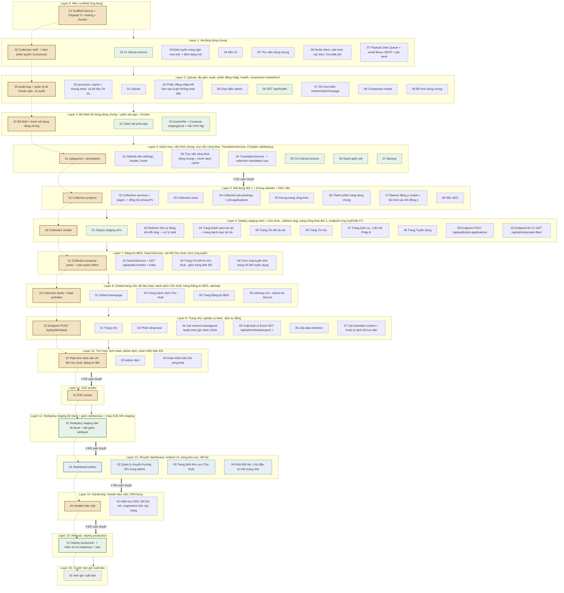

# Layer plan — Website TAMI (initial build `tami-website`)

- **Sinh bởi:** bước graph (`/start` bước 4), 16/10/2026 · **Trạng thái:** ✅ user duyệt 16/10/2026 kèm 3 điều chỉnh (mốc duyệt gộp, staging sớm sau L5, production trước Could)
- **Nguồn:** `SPECIFICATIONS.md` v1.2.2 · `docs/specs/2026-10-16-tami-website-design.md` (§4 thứ tự build) · `.context/design-spec.md` · `skills/react-nodejs/design-tokens.md` · `docs/ARCHITECTURE.md` · `docs/ERD.md` · `docs/API_SPEC.md` · `docs/PERMISSION.md` · `.context/project-config.md`
- **Task files:** `tasks/tami-website/layer-{N}-task-{NN}.md`
- **Diagram:** archify chưa cài, user chọn **không cài** (16/10/2026) → giữ Mermaid trong file này. Có thể sinh `docs/diagrams/layer-plan.html` sau nếu đổi ý.

## Tóm tắt

| Chỉ số | Giá trị |
|---|---|
| Tổng layer | 17 (Layer 0 → 16) |
| Tổng task | 74 |
| Theo ưu tiên | Nền 1 · Must 58 · Should 4 · Could 1 · DevOps 10 |
| Mức review gợi ý | STRICT 58 · NORMAL 14 · FAST 2 |
| Task có migration | 25 (toàn bộ additive, không dự kiến HIGH_RISK) |
| Verify | `pnpm install --frozen-lockfile` · `pnpm lint` · `pnpm typecheck` · `pnpm test` · `pnpm build` |

**Quy tắc:** task trong cùng layer không phụ thuộc nhau (đã kiểm bằng script khi sinh). Mỗi task: builder → reviewer độc lập → commit (1 task = 1 commit). Cuối mỗi layer: spec-validator. Layer N+1 mở khi mọi task Layer N PASS review và spec-validator PASS. **Chỉ dừng chờ user duyệt ở 5 mốc** (user chốt 16/10/2026); task chạm server (staging/production) vẫn hỏi user từng bước.

## Mốc duyệt (approval milestones)

| Mốc | Sau layer | Nội dung |
|---|---|---|
| M1 | L4 | Nền xong (scaffold, auth, i18n, UI, upload, bộ field, danh mục, cấu hình, CD/giám sát/backup dạng file) |
| M2 | L10 | Tính năng Must xong (website VI/EN, lead, tuyển dụng, tự dịch) — staging sớm đã chạy từ L6 |
| M3 | L12 | Staging đầy đủ Must + giám sát/backup + E2E PASS trên staging |
| M4 | L13 | Should xong (dashboard, redirect UI, trang khu vực, đối tác) |
| M5 | L14 | Trước deploy production: hardening xong; user duyệt production |

## Bảng layer

| Layer | Tên | Số task | Task | Mốc duyệt sau layer |
|---|---|---|---|---|
| 0 | Nền: scaffold ứng dụng | 1 | `01` Scaffold Next.js + Payload 3 + tooling + Docker Compose dev | — |
| 1 | Hạ tầng dùng chung (CI, auth, i18n, UI, thư viện, bảo mật, jobs) | 7 | `01` CI GitHub Actions: lint, typecheck, test, build, audit `02` Collection `staff` (auth) + hàm phân quyền `src/access/` `03` Định tuyến song ngữ `next-intl` (vi mặc định, `/en`) + định dạng Intl `04` Nền UI: tokens → Tailwind v4 + shadcn/ui, font, Phosphor, primitive `05` Thư viện dùng chung: slug, SĐT, chuẩn hoá chữ không dấu, response helper, ipHash `06` Redis client, rate limit, xác thực Turnstile phía server `07` Payload Jobs Queue + email Brevo SMTP + job `send-notification-email` | — |
| 2 | Upload, địa giới, audit, phiên đăng nhập, health, component media/form | 9 | `01` Upload: `media` (public) + `private-files` (CV) trên SeaweedFS S3 `02` `provinces`, `wards` + khung seed (`pnpm seed`) và dữ liệu 34 tỉnh/thành `03` `audit-logs` + quản lý tài khoản sale (tạo, khoá, đặt lại mật khẩu) có audit `04` Phiên đăng nhập hết hạn sau 8 giờ không hoạt động (làm mới token) `05` Giao diện admin: logo TAMI, màu nhấn, font, nhóm menu tiếng Việt `06` `GET /api/health` (DB, Redis, S3) `07` Ghi lượt bấm Hotline/Zalo/Fanpage: `click-events`, `click-stats-daily`, endpoint + job gộp `08` Component media: thư viện ảnh + lightbox, bản đồ MapLibre lười, video facade `09` Bộ form dùng chung: field có label/lỗi, ô consent, widget Turnstile lười | — |
| 3 | Bộ field nội dung dùng chung + giám sát app + Docker | 3 | `01` Giám sát phía app: GlitchTip (Sentry SDK), log JSON cho Loki, metrics Prometheus nội bộ `02` Bộ field + hook nội dung dùng chung (slug, SEO, status, author, hasEnglish, versions, xoá mềm, revalidate) `03` Dockerfile + Compose staging/prod + cấu hình Nginx host | — |
| 4 | Danh mục, cấu hình chung, truy vấn công khai, TranslationService, CD/giám sát/backup | 7 | `01` `categories` (cha–con theo scope) + `developers` (chủ đầu tư) `02` Globals `site-settings`, `header`, `footer` (localized, quyền đọc theo trường) `03` Truy vấn công khai dùng chung + chính sách cache `04` `TranslationService` (Claude API) + collection `translation-usage` + hạn mức chi phí `05` CD GitHub Actions: image theo SHA → staging (migrate, health) → duyệt tay → production `06` Stack giám sát: Prometheus, Grafana, Loki, GlitchTip, Uptime Kuma + cảnh báo `07` Backup: pgBackRest (WAL liên tục) + restic (file) + runbook khôi phục | ⏸ M1 |
| 5 | Nội dung đợt 1 (dự án, dịch vụ, pháp lý, tin tức, tuyển dụng) + khung website + SEO nền | 8 | `01` Collection `projects` (Dự án) `02` Collection `services` + `pages` (pháp lý) + đồng bộ `privacyPolicyVersion` `03` Collection `news` (Tin tức) `04` Collection `job-postings` + `job-applications` (quản lý hồ sơ) `05` Khung trang công khai: header, menu toàn màn hình, footer, chuyển ngôn ngữ `06` Thành phần trang dùng chung: nút liên hệ nổi, breadcrumb, page banner, phân trang, template danh mục, trạng thái trống/lỗi, 404/500 `07` Banner đồng ý cookie + tải GA4 sau khi đồng ý `08` Nền SEO: metadata, Open Graph, canonical, hreflang, JSON-LD builders | — |
| 6 | Deploy staging sớm + Cho thuê (dữ liệu), redirect slug, trang công khai đợt 1, endpoint ứng tuyển/tải CV | 10 | `01` Deploy staging sớm: Compose staging, Nginx, Cloudflare/noindex, CD chạy thật, health check `02` Collection `rentals` (Cho thuê): mã `CT-`, điều khoản thuê, `searchText` `03` Redirect 301 tự động khi đổi slug (theo từng ngôn ngữ) + xử lý redirect phía website `04` Trang Danh sách dự án (S02) + trang danh mục dự án `05` Trang Chi tiết dự án (S03) `06` Trang Tin tức: danh sách theo danh mục + chi tiết + bài liên quan (S10, S11) `07` Trang Dịch vụ (S14), Liên hệ (S15, chưa form), Pháp lý (S16) `08` Trang Tuyển dụng: danh sách + chi tiết, hết hạn, JSON-LD JobPosting (S12, S13) `09` Endpoint `POST /api/public/job-applications` (multipart, CV, email) `10` Endpoint tải CV `GET /api/admin/private-files/:id/download` + audit | — |
| 7 | Đăng tin BĐS, SearchService, chi tiết Cho thuê, form ứng tuyển | 4 | `01` Collection `property-posts` (Đăng tin BĐS) + job `expire-offers` `02` `SearchService` + `GET /api/public/rentals` + index trigram `03` Trang Chi tiết tin cho thuê (S07), gồm trạng thái "Đã thuê" và tin tương tự `04` Form ứng tuyển trên trang chi tiết tuyển dụng | — |
| 8 | Global trang chủ, dữ liệu lead, danh sách Cho thuê, trang Đăng tin BĐS, sitemap | 5 | `01` Global `homepage` (khối, thứ tự, hero video tuỳ chọn, CTA banner) `02` Collection `leads` + `lead-activities` (trạng thái, ghi chú, quyền theo người được giao) `03` Trang Danh sách Cho thuê (S04): bộ lọc trên URL, tìm không dấu, sắp xếp `04` Trang Đăng tin BĐS: danh sách theo danh mục + chi tiết (S08, S09) `05` `sitemap.xml` (vi + en, alternates), `robots.txt`, `llms.txt` | — |
| 9 | Trang chủ, nghiệp vụ lead (endpoint, phân công, nhắc, xuất, lưu trữ), dịch tự động | 7 | `01` Trang chủ (S01): hero slide, Về TAMI, dự án nổi bật, dịch vụ, ưu đãi, CTA `02` Endpoint `POST /api/public/leads`: chống spam, chống trùng 7 ngày, tự giao, email `03` Phân công lead: hook `leads.afterChange` (nơi duy nhất) + `POST /api/admin/leads/:id/assign` `04` Job `remind-unassigned-leads` theo giờ hành chính (BR-14) `05` Xuất lead ra Excel `GET /api/admin/leads/export` + audit `06` Job `data-retention`: ẩn danh lead 24 tháng, xoá CV 12 tháng, dọn log `07` Job `translate-content` + hook tự dịch khi lưu bản `vi` đã xuất bản / global | — |
| 10 | Tích hợp: form lead, admin dịch, hoàn thiện bản EN | 3 | `01` Ráp form lead vào chi tiết Cho thuê, Đăng tin BĐS, Dự án, Liên hệ `02` Admin dịch: nút "Dịch lại bằng AI", lọc trạng thái dịch, duyệt bản EN trang pháp lý, cảnh báo lỗi dịch `03` Hoàn thiện bản EN công khai: `en.json`, chuyển ngôn ngữ đúng trang tương ứng, hreflang toàn site | ⏸ M2 |
| 11 | E2E smoke (Playwright) | 1 | `01` E2E smoke (Playwright): trang chủ, lọc cho thuê, gửi lead, ứng tuyển, chuyển EN | — |
| 12 | Redeploy staging đủ Must + giám sát/backup + chạy E2E trên staging | 1 | `01` Redeploy staging bản đủ Must + bật giám sát/backup + chạy E2E smoke trên staging | ⏸ M3 |
| 13 | Should: dashboard, redirect UI, trang khu vực, đối tác | 4 | `01` Dashboard admin (FR-ADM-14): lead, nội dung, lượt bấm, cảnh báo dịch, chi phí dịch `02` Quản lý chuyển hướng 301 trong admin (FR-ADM-15): kiểm tra hợp lệ, chống vòng/chuỗi `03` Trang đích khu vực Cho thuê (FR-PUB-16, S06) `04` Khối Đối tác / chủ đầu tư trên trang chủ (FR-PUB-17) | ⏸ M4 |
| 14 | Hardening: header bảo mật, CWV/a11y | 2 | `01` Header bảo mật: CSP, HSTS, X-Frame-Options, Referrer-Policy, Permissions-Policy `02` Kiểm tra CWV, WCAG AA, responsive trên các trang chính và sửa lỗi nhỏ | ⏸ M5 |
| 15 | Release: deploy production | 1 | `01` Deploy production (cần user duyệt, mốc M5) + kiểm tra AI-readiness + bàn giao | — |
| 16 | Could: hẹn giờ xuất bản (lên production ở lần deploy kế tiếp) | 1 | `01` Hẹn giờ xuất bản (FR-ADM-16, Could): `publishedAt ≤ now` + job revalidate mỗi phút | — |

## Sơ đồ layer (Mermaid)

Viền nâu đậm = đường găng; xanh dương = Should; xám nét đứt = Could; xanh lá = DevOps.

## Đường găng (chuỗi dài nhất)

`layer-0-task-01` Scaffold Next.js + Payload 3 + tooling + Docker Compose dev → `layer-1-task-02` Collection `staff` (auth) + hàm phân quyền `src/access/` → `layer-2-task-03` `audit-logs` + quản lý tài khoản sale (tạo, khoá, đặt lại mật khẩu) có audit → `layer-3-task-02` Bộ field + hook nội dung dùng chung (slug, SEO, status, author, hasEnglish, versions, xoá mềm, revalidate) → `layer-4-task-01` `categories` (cha–con theo scope) + `developers` (chủ đầu tư) → `layer-5-task-01` Collection `projects` (Dự án) → `layer-6-task-02` Collection `rentals` (Cho thuê): mã `CT-`, điều khoản thuê, `searchText` → `layer-7-task-01` Collection `property-posts` (Đăng tin BĐS) + job `expire-offers` → `layer-8-task-02` Collection `leads` + `lead-activities` (trạng thái, ghi chú, quyền theo người được giao) → `layer-9-task-02` Endpoint `POST /api/public/leads`: chống spam, chống trùng 7 ngày, tự giao, email → `layer-10-task-01` Ráp form lead vào chi tiết Cho thuê, Đăng tin BĐS, Dự án, Liên hệ → `layer-11-task-01` E2E smoke (Playwright): trang chủ, lọc cho thuê, gửi lead, ứng tuyển, chuyển EN → `layer-12-task-01` Redeploy staging bản đủ Must + bật giám sát/backup + chạy E2E smoke trên staging → `layer-13-task-01` Dashboard admin (FR-ADM-14): lead, nội dung, lượt bấm, cảnh báo dịch, chi phí dịch → `layer-14-task-01` Header bảo mật: CSP, HSTS, X-Frame-Options, Referrer-Policy, Permissions-Policy → `layer-15-task-01` Deploy production (cần user duyệt, mốc M5) + kiểm tra AI-readiness + bàn giao → `layer-16-task-01` Hẹn giờ xuất bản (FR-ADM-16, Could): `publishedAt ≤ now` + job revalidate mỗi phút

## Phụ thuộc chi tiết (task → task)

```mermaid
flowchart LR
  n_scaffold --> n_ci
  n_scaffold --> n_auth
  n_scaffold --> n_i18n
  n_scaffold --> n_ui
  n_scaffold --> n_utils
  n_scaffold --> n_security
  n_scaffold --> n_jobs
  n_auth --> n_media
  n_auth --> n_geo
  n_auth --> n_audit
  n_utils --> n_audit
  n_auth --> n_session
  n_auth --> n_adminbrand
  n_ui --> n_adminbrand
  n_security --> n_health
  n_auth --> n_click
  n_security --> n_click
  n_jobs --> n_click
  n_utils --> n_click
  n_ui --> n_mediacomp
  n_i18n --> n_mediacomp
  n_ui --> n_formkit
  n_i18n --> n_formkit
  n_health --> n_monapp
  n_auth --> n_kit
  n_i18n --> n_kit
  n_utils --> n_kit
  n_audit --> n_kit
  n_health --> n_docker
  n_jobs --> n_docker
  n_kit --> n_cats
  n_media --> n_cats
  n_kit --> n_globals
  n_media --> n_globals
  n_kit --> n_pubq
  n_i18n --> n_pubq
  n_kit --> n_tsvc
  n_ci --> n_cd
  n_docker --> n_cd
  n_docker --> n_monstack
  n_monapp --> n_monstack
  n_docker --> n_backup
  n_geo --> n_projects
  n_cats --> n_projects
  n_media --> n_projects
  n_kit --> n_projects
  n_kit --> n_svcpages
  n_media --> n_svcpages
  n_globals --> n_svcpages
  n_cats --> n_news
  n_kit --> n_news
  n_media --> n_news
  n_geo --> n_jobsposts
  n_cats --> n_jobsposts
  n_kit --> n_jobsposts
  n_media --> n_jobsposts
  n_globals --> n_shell
  n_ui --> n_shell
  n_i18n --> n_shell
  n_globals --> n_layoututil
  n_ui --> n_layoututil
  n_i18n --> n_layoututil
  n_click --> n_layoututil
  n_globals --> n_cookie
  n_ui --> n_cookie
  n_i18n --> n_cookie
  n_globals --> n_seo
  n_i18n --> n_seo
  n_pubq --> n_seo
  n_cd --> n_deploystg0
  n_docker --> n_deploystg0
  n_shell --> n_deploystg0
  n_layoututil --> n_deploystg0
  n_cookie --> n_deploystg0
  n_seo --> n_deploystg0
  n_projects --> n_deploystg0
  n_svcpages --> n_deploystg0
  n_news --> n_deploystg0
  n_jobsposts --> n_deploystg0
  n_geo --> n_deploystg0
  n_cats --> n_deploystg0
  n_projects --> n_rentals
  n_geo --> n_rentals
  n_cats --> n_rentals
  n_kit --> n_rentals
  n_kit --> n_redirects
  n_news --> n_redirects
  n_projects --> n_pubprojlist
  n_shell --> n_pubprojlist
  n_layoututil --> n_pubprojlist
  n_pubq --> n_pubprojlist
  n_seo --> n_pubprojlist
  n_projects --> n_pubprojdetail
  n_shell --> n_pubprojdetail
  n_layoututil --> n_pubprojdetail
  n_mediacomp --> n_pubprojdetail
  n_seo --> n_pubprojdetail
  n_pubq --> n_pubprojdetail
  n_news --> n_pubnews
  n_shell --> n_pubnews
  n_layoututil --> n_pubnews
  n_seo --> n_pubnews
  n_pubq --> n_pubnews
  n_svcpages --> n_pubsvc
  n_shell --> n_pubsvc
  n_layoututil --> n_pubsvc
  n_mediacomp --> n_pubsvc
  n_seo --> n_pubsvc
  n_pubq --> n_pubsvc
  n_jobsposts --> n_pubcareers
  n_shell --> n_pubcareers
  n_layoututil --> n_pubcareers
  n_seo --> n_pubcareers
  n_pubq --> n_pubcareers
  n_jobs --> n_pubcareers
  n_jobsposts --> n_applyapi
  n_security --> n_applyapi
  n_jobs --> n_applyapi
  n_media --> n_applyapi
  n_jobsposts --> n_cvdl
  n_audit --> n_cvdl
  n_media --> n_cvdl
  n_rentals --> n_posts
  n_projects --> n_posts
  n_cats --> n_posts
  n_kit --> n_posts
  n_jobs --> n_posts
  n_rentals --> n_search
  n_security --> n_search
  n_utils --> n_search
  n_rentals --> n_pubrentdetail
  n_shell --> n_pubrentdetail
  n_layoututil --> n_pubrentdetail
  n_mediacomp --> n_pubrentdetail
  n_seo --> n_pubrentdetail
  n_pubq --> n_pubrentdetail
  n_pubcareers --> n_applyform
  n_applyapi --> n_applyform
  n_formkit --> n_applyform
  n_posts --> n_homepage
  n_svcpages --> n_homepage
  n_projects --> n_homepage
  n_cats --> n_homepage
  n_media --> n_homepage
  n_kit --> n_homepage
  n_rentals --> n_leads
  n_posts --> n_leads
  n_projects --> n_leads
  n_audit --> n_leads
  n_utils --> n_leads
  n_search --> n_pubrentlist
  n_shell --> n_pubrentlist
  n_layoututil --> n_pubrentlist
  n_seo --> n_pubrentlist
  n_posts --> n_pubposts
  n_shell --> n_pubposts
  n_layoututil --> n_pubposts
  n_mediacomp --> n_pubposts
  n_seo --> n_pubposts
  n_pubq --> n_pubposts
  n_posts --> n_sitemap
  n_rentals --> n_sitemap
  n_projects --> n_sitemap
  n_news --> n_sitemap
  n_svcpages --> n_sitemap
  n_jobsposts --> n_sitemap
  n_seo --> n_sitemap
  n_homepage --> n_pubhome
  n_shell --> n_pubhome
  n_layoututil --> n_pubhome
  n_mediacomp --> n_pubhome
  n_seo --> n_pubhome
  n_pubq --> n_pubhome
  n_leads --> n_leadapi
  n_security --> n_leadapi
  n_jobs --> n_leadapi
  n_utils --> n_leadapi
  n_leads --> n_leadassign
  n_jobs --> n_leadassign
  n_audit --> n_leadassign
  n_leads --> n_leadremind
  n_jobs --> n_leadremind
  n_leads --> n_leadexport
  n_audit --> n_leadexport
  n_security --> n_leadexport
  n_leads --> n_retention
  n_jobsposts --> n_retention
  n_click --> n_retention
  n_audit --> n_retention
  n_tsvc --> n_tjob
  n_jobs --> n_tjob
  n_homepage --> n_tjob
  n_posts --> n_tjob
  n_rentals --> n_tjob
  n_projects --> n_tjob
  n_news --> n_tjob
  n_svcpages --> n_tjob
  n_jobsposts --> n_tjob
  n_cats --> n_tjob
  n_globals --> n_tjob
  n_deploystg0 --> n_tjob
  n_leadapi --> n_leadform
  n_formkit --> n_leadform
  n_pubrentdetail --> n_leadform
  n_pubposts --> n_leadform
  n_pubprojdetail --> n_leadform
  n_pubsvc --> n_leadform
  n_tjob --> n_tadmin
  n_audit --> n_tadmin
  n_pubhome --> n_enpublic
  n_pubrentlist --> n_enpublic
  n_pubposts --> n_enpublic
  n_pubprojlist --> n_enpublic
  n_pubnews --> n_enpublic
  n_pubcareers --> n_enpublic
  n_shell --> n_enpublic
  n_cd --> n_deploystg
  n_monstack --> n_deploystg
  n_backup --> n_deploystg
  n_leadform --> n_deploystg
  n_enpublic --> n_deploystg
  n_tadmin --> n_deploystg
  n_leadassign --> n_deploystg
  n_leadremind --> n_deploystg
  n_leadexport --> n_deploystg
  n_retention --> n_deploystg
  n_applyform --> n_deploystg
  n_sitemap --> n_deploystg
  n_redirects --> n_deploystg
  n_cvdl --> n_deploystg
  n_session --> n_deploystg
  n_adminbrand --> n_deploystg
  n_deploystg0 --> n_deploystg
  n_e2e --> n_deploystg
  n_leadassign --> n_dashboard
  n_click --> n_dashboard
  n_tadmin --> n_dashboard
  n_deploystg --> n_dashboard
  n_redirects --> n_redirui
  n_deploystg --> n_redirui
  n_pubrentlist --> n_arealanding
  n_search --> n_arealanding
  n_seo --> n_arealanding
  n_deploystg --> n_arealanding
  n_pubhome --> n_partners
  n_cats --> n_partners
  n_deploystg --> n_partners
  n_leadform --> n_headers
  n_cookie --> n_headers
  n_mediacomp --> n_headers
  n_monapp --> n_headers
  n_deploystg --> n_headers
  n_dashboard --> n_headers
  n_redirui --> n_headers
  n_arealanding --> n_headers
  n_partners --> n_headers
  n_leadform --> n_e2e
  n_applyform --> n_e2e
  n_enpublic --> n_e2e
  n_leadform --> n_cwv
  n_enpublic --> n_cwv
  n_pubhome --> n_cwv
  n_deploystg --> n_cwv
  n_dashboard --> n_cwv
  n_redirui --> n_cwv
  n_arealanding --> n_cwv
  n_partners --> n_cwv
  n_pubq --> n_schedule
  n_sitemap --> n_schedule
  n_tjob --> n_schedule
  n_jobs --> n_schedule
  n_deployprod --> n_schedule
  n_headers --> n_deployprod
  n_cwv --> n_deployprod
  n_deploystg --> n_deployprod
  n_dashboard --> n_deployprod
  n_redirui --> n_deployprod
  n_arealanding --> n_deployprod
  n_partners --> n_deployprod
```

Mở sơ đồ phụ thuộc đầy đủ (279 cạnh)

## Danh sách task

| Task | Tên | Ưu tiên | Review | Phụ thuộc | Migration |
|---|---|---|---|---|---|
| `layer-0-task-01` | Scaffold Next.js + Payload 3 + tooling + Docker Compose dev | Nền | STRICT | — | có |
| `layer-1-task-01` | CI GitHub Actions: lint, typecheck, test, build, audit | DevOps | NORMAL | `layer-0-task-01` | — |
| `layer-1-task-02` | Collection `staff` (auth) + hàm phân quyền `src/access/` | Must | STRICT | `layer-0-task-01` | có |
| `layer-1-task-03` | Định tuyến song ngữ `next-intl` (vi mặc định, `/en`) + định dạng Intl | Must | STRICT | `layer-0-task-01` | — |
| `layer-1-task-04` | Nền UI: tokens → Tailwind v4 + shadcn/ui, font, Phosphor, primitive | Must | STRICT | `layer-0-task-01` | — |
| `layer-1-task-05` | Thư viện dùng chung: slug, SĐT, chuẩn hoá chữ không dấu, response helper, ipHash | Must | STRICT | `layer-0-task-01` | — |
| `layer-1-task-06` | Redis client, rate limit, xác thực Turnstile phía server | Must | STRICT | `layer-0-task-01` | — |
| `layer-1-task-07` | Payload Jobs Queue + email Brevo SMTP + job `send-notification-email` | Must | STRICT | `layer-0-task-01` | có |
| `layer-2-task-01` | Upload: `media` (public) + `private-files` (CV) trên SeaweedFS S3 | Must | STRICT | `layer-1-task-02` | có |
| `layer-2-task-02` | `provinces`, `wards` + khung seed (`pnpm seed`) và dữ liệu 34 tỉnh/thành | Must | STRICT | `layer-1-task-02` | có |
| `layer-2-task-03` | `audit-logs` + quản lý tài khoản sale (tạo, khoá, đặt lại mật khẩu) có audit | Must | STRICT | `layer-1-task-02`, `layer-1-task-05` | có |
| `layer-2-task-04` | Phiên đăng nhập hết hạn sau 8 giờ không hoạt động (làm mới token) | Must | STRICT | `layer-1-task-02` | — |
| `layer-2-task-05` | Giao diện admin: logo TAMI, màu nhấn, font, nhóm menu tiếng Việt | Must | FAST | `layer-1-task-02`, `layer-1-task-04` | — |
| `layer-2-task-06` | `GET /api/health` (DB, Redis, S3) | DevOps | NORMAL | `layer-1-task-06` | — |
| `layer-2-task-07` | Ghi lượt bấm Hotline/Zalo/Fanpage: `click-events`, `click-stats-daily`, endpoint + job gộp | Must | STRICT | `layer-1-task-02`, `layer-1-task-06`, `layer-1-task-07`, `layer-1-task-05` | có |
| `layer-2-task-08` | Component media: thư viện ảnh + lightbox, bản đồ MapLibre lười, video facade | Must | STRICT | `layer-1-task-04`, `layer-1-task-03` | — |
| `layer-2-task-09` | Bộ form dùng chung: field có label/lỗi, ô consent, widget Turnstile lười | Must | STRICT | `layer-1-task-04`, `layer-1-task-03` | — |
| `layer-3-task-01` | Giám sát phía app: GlitchTip (Sentry SDK), log JSON cho Loki, metrics Prometheus nội bộ | DevOps | STRICT | `layer-2-task-06` | — |
| `layer-3-task-02` | Bộ field + hook nội dung dùng chung (slug, SEO, status, author, hasEnglish, versions, xoá mềm, revalidate) | Must | STRICT | `layer-1-task-02`, `layer-1-task-03`, `layer-1-task-05`, `layer-2-task-03` | có |
| `layer-3-task-03` | Dockerfile + Compose staging/prod + cấu hình Nginx host | DevOps | STRICT | `layer-2-task-06`, `layer-1-task-07` | có |
| `layer-4-task-01` | `categories` (cha–con theo scope) + `developers` (chủ đầu tư) | Must | STRICT | `layer-3-task-02`, `layer-2-task-01` | có |
| `layer-4-task-02` | Globals `site-settings`, `header`, `footer` (localized, quyền đọc theo trường) | Must | STRICT | `layer-3-task-02`, `layer-2-task-01` | có |
| `layer-4-task-03` | Truy vấn công khai dùng chung + chính sách cache | Must | STRICT | `layer-3-task-02`, `layer-1-task-03` | — |
| `layer-4-task-04` | `TranslationService` (Claude API) + collection `translation-usage` + hạn mức chi phí | Must | STRICT | `layer-3-task-02` | có |
| `layer-4-task-05` | CD GitHub Actions: image theo SHA → staging (migrate, health) → duyệt tay → production | DevOps | STRICT | `layer-1-task-01`, `layer-3-task-03` | có |
| `layer-4-task-06` | Stack giám sát: Prometheus, Grafana, Loki, GlitchTip, Uptime Kuma + cảnh báo | DevOps | STRICT | `layer-3-task-03`, `layer-3-task-01` | — |
| `layer-4-task-07` | Backup: pgBackRest (WAL liên tục) + restic (file) + runbook khôi phục | DevOps | STRICT | `layer-3-task-03` | — |
| `layer-5-task-01` | Collection `projects` (Dự án) | Must | STRICT | `layer-2-task-02`, `layer-4-task-01`, `layer-2-task-01`, `layer-3-task-02` | có |
| `layer-5-task-02` | Collection `services` + `pages` (pháp lý) + đồng bộ `privacyPolicyVersion` | Must | STRICT | `layer-3-task-02`, `layer-2-task-01`, `layer-4-task-02` | có |
| `layer-5-task-03` | Collection `news` (Tin tức) | Must | STRICT | `layer-4-task-01`, `layer-3-task-02`, `layer-2-task-01` | có |
| `layer-5-task-04` | Collection `job-postings` + `job-applications` (quản lý hồ sơ) | Must | STRICT | `layer-2-task-02`, `layer-4-task-01`, `layer-3-task-02`, `layer-2-task-01` | có |
| `layer-5-task-05` | Khung trang công khai: header, menu toàn màn hình, footer, chuyển ngôn ngữ | Must | STRICT | `layer-4-task-02`, `layer-1-task-04`, `layer-1-task-03` | — |
| `layer-5-task-06` | Thành phần trang dùng chung: nút liên hệ nổi, breadcrumb, page banner, phân trang, template danh mục, trạng thái trống/lỗi, 404/500 | Must | STRICT | `layer-4-task-02`, `layer-1-task-04`, `layer-1-task-03`, `layer-2-task-07` | — |
| `layer-5-task-07` | Banner đồng ý cookie + tải GA4 sau khi đồng ý | Must | STRICT | `layer-4-task-02`, `layer-1-task-04`, `layer-1-task-03` | — |
| `layer-5-task-08` | Nền SEO: metadata, Open Graph, canonical, hreflang, JSON-LD builders | Must | STRICT | `layer-4-task-02`, `layer-1-task-03`, `layer-4-task-03` | — |
| `layer-6-task-01` | Deploy staging sớm: Compose staging, Nginx, Cloudflare/noindex, CD chạy thật, health check | DevOps | STRICT | `layer-4-task-05`, `layer-3-task-03`, `layer-5-task-05`, `layer-5-task-06`, `layer-5-task-07`, `layer-5-task-08`, `layer-5-task-01`, `layer-5-task-02`, `layer-5-task-03`, `layer-5-task-04`, `layer-2-task-02`, `layer-4-task-01` | có |
| `layer-6-task-02` | Collection `rentals` (Cho thuê): mã `CT-`, điều khoản thuê, `searchText` | Must | STRICT | `layer-5-task-01`, `layer-2-task-02`, `layer-4-task-01`, `layer-3-task-02` | có |
| `layer-6-task-03` | Redirect 301 tự động khi đổi slug (theo từng ngôn ngữ) + xử lý redirect phía website | Must | STRICT | `layer-3-task-02`, `layer-5-task-03` | có |
| `layer-6-task-04` | Trang Danh sách dự án (S02) + trang danh mục dự án | Must | NORMAL | `layer-5-task-01`, `layer-5-task-05`, `layer-5-task-06`, `layer-4-task-03`, `layer-5-task-08` | — |
| `layer-6-task-05` | Trang Chi tiết dự án (S03) | Must | NORMAL | `layer-5-task-01`, `layer-5-task-05`, `layer-5-task-06`, `layer-2-task-08`, `layer-5-task-08`, `layer-4-task-03` | — |
| `layer-6-task-06` | Trang Tin tức: danh sách theo danh mục + chi tiết + bài liên quan (S10, S11) | Must | NORMAL | `layer-5-task-03`, `layer-5-task-05`, `layer-5-task-06`, `layer-5-task-08`, `layer-4-task-03` | — |
| `layer-6-task-07` | Trang Dịch vụ (S14), Liên hệ (S15, chưa form), Pháp lý (S16) | Must | NORMAL | `layer-5-task-02`, `layer-5-task-05`, `layer-5-task-06`, `layer-2-task-08`, `layer-5-task-08`, `layer-4-task-03` | — |
| `layer-6-task-08` | Trang Tuyển dụng: danh sách + chi tiết, hết hạn, JSON-LD JobPosting (S12, S13) | Must | NORMAL | `layer-5-task-04`, `layer-5-task-05`, `layer-5-task-06`, `layer-5-task-08`, `layer-4-task-03`, `layer-1-task-07` | — |
| `layer-6-task-09` | Endpoint `POST /api/public/job-applications` (multipart, CV, email) | Must | STRICT | `layer-5-task-04`, `layer-1-task-06`, `layer-1-task-07`, `layer-2-task-01` | — |
| `layer-6-task-10` | Endpoint tải CV `GET /api/admin/private-files/:id/download` + audit | Must | STRICT | `layer-5-task-04`, `layer-2-task-03`, `layer-2-task-01` | — |
| `layer-7-task-01` | Collection `property-posts` (Đăng tin BĐS) + job `expire-offers` | Must | STRICT | `layer-6-task-02`, `layer-5-task-01`, `layer-4-task-01`, `layer-3-task-02`, `layer-1-task-07` | có |
| `layer-7-task-02` | `SearchService` + `GET /api/public/rentals` + index trigram | Must | STRICT | `layer-6-task-02`, `layer-1-task-06`, `layer-1-task-05` | có |
| `layer-7-task-03` | Trang Chi tiết tin cho thuê (S07), gồm trạng thái "Đã thuê" và tin tương tự | Must | NORMAL | `layer-6-task-02`, `layer-5-task-05`, `layer-5-task-06`, `layer-2-task-08`, `layer-5-task-08`, `layer-4-task-03` | — |
| `layer-7-task-04` | Form ứng tuyển trên trang chi tiết tuyển dụng | Must | NORMAL | `layer-6-task-08`, `layer-6-task-09`, `layer-2-task-09` | — |
| `layer-8-task-01` | Global `homepage` (khối, thứ tự, hero video tuỳ chọn, CTA banner) | Must | STRICT | `layer-7-task-01`, `layer-5-task-02`, `layer-5-task-01`, `layer-4-task-01`, `layer-2-task-01`, `layer-3-task-02` | có |
| `layer-8-task-02` | Collection `leads` + `lead-activities` (trạng thái, ghi chú, quyền theo người được giao) | Must | STRICT | `layer-6-task-02`, `layer-7-task-01`, `layer-5-task-01`, `layer-2-task-03`, `layer-1-task-05` | có |
| `layer-8-task-03` | Trang Danh sách Cho thuê (S04): bộ lọc trên URL, tìm không dấu, sắp xếp | Must | STRICT | `layer-7-task-02`, `layer-5-task-05`, `layer-5-task-06`, `layer-5-task-08` | — |
| `layer-8-task-04` | Trang Đăng tin BĐS: danh sách theo danh mục + chi tiết (S08, S09) | Must | NORMAL | `layer-7-task-01`, `layer-5-task-05`, `layer-5-task-06`, `layer-2-task-08`, `layer-5-task-08`, `layer-4-task-03` | — |
| `layer-8-task-05` | `sitemap.xml` (vi + en, alternates), `robots.txt`, `llms.txt` | Must | STRICT | `layer-7-task-01`, `layer-6-task-02`, `layer-5-task-01`, `layer-5-task-03`, `layer-5-task-02`, `layer-5-task-04`, `layer-5-task-08` | — |
| `layer-9-task-01` | Trang chủ (S01): hero slide, Về TAMI, dự án nổi bật, dịch vụ, ưu đãi, CTA | Must | STRICT | `layer-8-task-01`, `layer-5-task-05`, `layer-5-task-06`, `layer-2-task-08`, `layer-5-task-08`, `layer-4-task-03` | — |
| `layer-9-task-02` | Endpoint `POST /api/public/leads`: chống spam, chống trùng 7 ngày, tự giao, email | Must | STRICT | `layer-8-task-02`, `layer-1-task-06`, `layer-1-task-07`, `layer-1-task-05` | — |
| `layer-9-task-03` | Phân công lead: hook `leads.afterChange` (nơi duy nhất) + `POST /api/admin/leads/:id/assign` | Must | STRICT | `layer-8-task-02`, `layer-1-task-07`, `layer-2-task-03` | — |
| `layer-9-task-04` | Job `remind-unassigned-leads` theo giờ hành chính (BR-14) | Must | STRICT | `layer-8-task-02`, `layer-1-task-07` | có |
| `layer-9-task-05` | Xuất lead ra Excel `GET /api/admin/leads/export` + audit | Must | STRICT | `layer-8-task-02`, `layer-2-task-03`, `layer-1-task-06` | — |
| `layer-9-task-06` | Job `data-retention`: ẩn danh lead 24 tháng, xoá CV 12 tháng, dọn log | Must | STRICT | `layer-8-task-02`, `layer-5-task-04`, `layer-2-task-07`, `layer-2-task-03` | — |
| `layer-9-task-07` | Job `translate-content` + hook tự dịch khi lưu bản `vi` đã xuất bản / global | Must | STRICT | `layer-4-task-04`, `layer-1-task-07`, `layer-8-task-01`, `layer-7-task-01`, `layer-6-task-02`, `layer-5-task-01`, `layer-5-task-03`, `layer-5-task-02`, `layer-5-task-04`, `layer-4-task-01`, `layer-4-task-02`, `layer-6-task-01` | — |
| `layer-10-task-01` | Ráp form lead vào chi tiết Cho thuê, Đăng tin BĐS, Dự án, Liên hệ | Must | STRICT | `layer-9-task-02`, `layer-2-task-09`, `layer-7-task-03`, `layer-8-task-04`, `layer-6-task-05`, `layer-6-task-07` | — |
| `layer-10-task-02` | Admin dịch: nút "Dịch lại bằng AI", lọc trạng thái dịch, duyệt bản EN trang pháp lý, cảnh báo lỗi dịch | Must | STRICT | `layer-9-task-07`, `layer-2-task-03` | — |
| `layer-10-task-03` | Hoàn thiện bản EN công khai: `en.json`, chuyển ngôn ngữ đúng trang tương ứng, hreflang toàn site | Must | STRICT | `layer-9-task-01`, `layer-8-task-03`, `layer-8-task-04`, `layer-6-task-04`, `layer-6-task-06`, `layer-6-task-08`, `layer-5-task-05` | — |
| `layer-12-task-01` | Redeploy staging bản đủ Must + bật giám sát/backup + chạy E2E smoke trên staging | DevOps | STRICT | `layer-4-task-05`, `layer-4-task-06`, `layer-4-task-07`, `layer-10-task-01`, `layer-10-task-03`, `layer-10-task-02`, `layer-9-task-03`, `layer-9-task-04`, `layer-9-task-05`, `layer-9-task-06`, `layer-7-task-04`, `layer-8-task-05`, `layer-6-task-03`, `layer-6-task-10`, `layer-2-task-04`, `layer-2-task-05`, `layer-6-task-01`, `layer-11-task-01` | có |
| `layer-13-task-01` | Dashboard admin (FR-ADM-14): lead, nội dung, lượt bấm, cảnh báo dịch, chi phí dịch | Should | STRICT | `layer-9-task-03`, `layer-2-task-07`, `layer-10-task-02`, `layer-12-task-01` | — |
| `layer-13-task-02` | Quản lý chuyển hướng 301 trong admin (FR-ADM-15): kiểm tra hợp lệ, chống vòng/chuỗi | Should | NORMAL | `layer-6-task-03`, `layer-12-task-01` | — |
| `layer-13-task-03` | Trang đích khu vực Cho thuê (FR-PUB-16, S06) | Should | NORMAL | `layer-8-task-03`, `layer-7-task-02`, `layer-5-task-08`, `layer-12-task-01` | — |
| `layer-13-task-04` | Khối Đối tác / chủ đầu tư trên trang chủ (FR-PUB-17) | Should | FAST | `layer-9-task-01`, `layer-4-task-01`, `layer-12-task-01` | — |
| `layer-14-task-01` | Header bảo mật: CSP, HSTS, X-Frame-Options, Referrer-Policy, Permissions-Policy | Must | STRICT | `layer-10-task-01`, `layer-5-task-07`, `layer-2-task-08`, `layer-3-task-01`, `layer-12-task-01`, `layer-13-task-01`, `layer-13-task-02`, `layer-13-task-03`, `layer-13-task-04` | — |
| `layer-11-task-01` | E2E smoke (Playwright): trang chủ, lọc cho thuê, gửi lead, ứng tuyển, chuyển EN | Must | NORMAL | `layer-10-task-01`, `layer-7-task-04`, `layer-10-task-03` | — |
| `layer-14-task-02` | Kiểm tra CWV, WCAG AA, responsive trên các trang chính và sửa lỗi nhỏ | Must | NORMAL | `layer-10-task-01`, `layer-10-task-03`, `layer-9-task-01`, `layer-12-task-01`, `layer-13-task-01`, `layer-13-task-02`, `layer-13-task-03`, `layer-13-task-04` | — |
| `layer-16-task-01` | Hẹn giờ xuất bản (FR-ADM-16, Could): `publishedAt ≤ now` + job revalidate mỗi phút | Could | STRICT | `layer-4-task-03`, `layer-8-task-05`, `layer-9-task-07`, `layer-1-task-07`, `layer-15-task-01` | có |
| `layer-15-task-01` | Deploy production (cần user duyệt, mốc M5) + kiểm tra AI-readiness + bàn giao | DevOps | STRICT | `layer-14-task-01`, `layer-14-task-02`, `layer-12-task-01`, `layer-13-task-01`, `layer-13-task-02`, `layer-13-task-03`, `layer-13-task-04` | có |

## Ghi chú đã xử lý

- **M4 (hẹn giờ xuất bản):** `publicWhere` (task `layer-4-task-03`) là nơi duy nhất dựng điều kiện công khai; điều kiện `publishedAt ≤ now` + job revalidate mỗi phút nằm trong task Could `layer-16-task-01`. Ở Must, `publishedAt` tự gán khi xuất bản lần đầu và chỉ đọc.
- **Session 8 giờ không hoạt động:** task `layer-2-task-04` (`tokenExpiration` 8 giờ + admin provider làm mới token khi có thao tác, throttle 15 phút). Không làm được thì ghi residual risk và hỏi user.
- **Tokens / Phosphor / cookie banner:** `layer-1-task-04` (tokens → Tailwind v4, Phosphor, chặn lucide), `layer-5-task-07` (GA4 chỉ sau đồng ý).
- **CI chạy từ đầu:** `layer-1-task-01` ngay Layer 1. **Staging sớm** `layer-6-task-01` (sau L5), **redeploy staging đủ Must + E2E** `layer-12-task-01`, **production** `layer-15-task-01` (mốc M5, sau Should + hardening). **Could** `layer-16-task-01` là layer cuối, lên production ở lần deploy kế tiếp; production không phụ thuộc Could.
- **Hỏi user trước khi làm** (ghi trong task): runner/registry (`layer-4-task-05`, `layer-6-task-01`), kho backup (`layer-4-task-07`, `layer-12-task-01`), giám sát dùng chung (`layer-4-task-06`), nguồn dữ liệu tỉnh/phường (`layer-2-task-02`).
- **Lệch nhỏ đã chọn theo SPEC:** `close-job-postings` chỉ revalidate (không đổi `status`) để URL tin hết hạn vẫn mở với băng "đã hết hạn" (SPEC F6), khác câu "ẩn tin tuyển dụng" ở ARCHITECTURE §5.4.
