# BÁO CÁO RÀ SOÁT CHUYÊN SÂU TỪNG MÀN HÌNH TAMI ADMIN

> **Trạng thái (2026-10-21):** tài liệu tham khảo bên ngoài, user cung cấp; **chưa kiểm hết với code**. Rà bằng tài khoản **admin** — role khác vốn không thấy `audit-logs` / `click-events` / `click-stats-daily` / `private-files`.
> Nhận định "sửa 100% ở UI, không đổi schema" **không đúng hết** (link tới bài cụ thể, danh sách lý do "Không thành", tên hiển thị tài liệu, quý/năm bàn giao cần đổi schema).
> Phần UI-only đã ghép vào BL-039 / BL-041 / BL-042 (`spec/changes/2026-10-20-admin-*.md`). Phần lớn còn lại (bản đồ chọn vị trí, bộ chọn liên kết menu, bộ chọn icon, kéo thả khối trang chủ, danh mục chia tab, dashboard thống kê + lead dòng thời gian, tiện ích nhập liệu Cho thuê/Tin BĐS/Tin tức, Ctrl+K, cắt ảnh bìa, diff nhật ký) **chưa ghi BL** — user hoãn.
> **Mục tiêu:** Rà soát chi tiết đến từng trường dữ liệu (data fields), vị trí nút bấm (actions), cách hiển thị (display logic) của từng màn hình trong hệ thống quản trị TAMI Admin (`https://187-52-119-50.sslip.io/admin`), phân tích các rào cản khiến hệ thống mang nặng tính kỹ thuật (tech-centric) và đưa ra đặc tả sửa đổi trọn vẹn cho người dùng nghiệp vụ (non-tech).

---

## MỤC LỤC
1. [Khung sườn chung & Thanh điều hướng (Shell & Sidebar)](#1-khung-sườn-chung--thanh-điều-hướng-shell--sidebar)
2. [Màn Tổng quan (Dashboard)](#2-màn-tổng-quan-dashboard)
3. [Phân hệ Khách hàng & Chăm sóc Lead (`leads`, `lead-activities`)](#3-phân-hệ-khách-hàng--chăm-sóc-lead)
4. [Phân hệ Dự án (`projects`)](#4-phân-hệ-dự-án-projects)
5. [Phân hệ Tin cho thuê (`rentals`)](#5-phân-hệ-tin-cho-thuê-rentals)
6. [Phân hệ Tin đăng BĐS (`property-posts`) & Tin tức (`news`)](#6-phân-hệ-tin-đăng-bđs--tin-tức)
7. [Phân hệ Tuyển dụng & Hồ sơ (`job-postings`, `job-applications`, `private-files`)](#7-phân-hệ-tuyển-dụng--hồ-sơ)
8. [Phân hệ Cấu hình Website (Header, Footer, Homepage, Site Settings, Redirects)](#8-phân-hệ-cấu-hình-website)
9. [Phân hệ Dữ liệu nền & Hệ thống (`categories`, `developers`, `provinces`, `wards`, logs)](#9-phân-hệ-dữ-liệu-nền--hệ-thống)
10. [7 Cơ chế dùng chung cần thiết kế lại UX cho người Non-tech](#10-7-cơ-chế-dùng-chung-cần-thiết-kế-lại-ux)

---

## 1. KHUNG SƯỜN CHUNG & THANH ĐIỀU HƯỚNG (SHELL & SIDEBAR)

### 1.1. Hiện trạng hiển thị & Dữ liệu
* **Cấu trúc Sidebar hiện tại:** Đang hiển thị **7 nhóm** với tổng cộng **21 Collections** và **4 Globals**:
  1. *Khách hàng*: Lead (`leads`), Lịch sử chăm sóc (`lead-activities`).
  2. *Nội dung*: Dự án (`projects`), Cho thuê (`rentals`), Tin bất động sản (`property-posts`), Tin tức (`news`), Dịch vụ (`services`), Trang pháp lý (`pages`).
  3. *Tuyển dụng*: Tin tuyển dụng (`job-postings`), Hồ sơ ứng tuyển (`job-applications`).
  4. *Thư viện*: Thư viện ảnh & tệp (`media`), Tệp CV ứng viên (`private-files`).
  5. *Dữ liệu nền*: Danh mục (`categories`), Chủ đầu tư (`developers`), Tỉnh/thành (`provinces`), Phường/xã (`wards`).
  6. *Website*: Chuyển hướng đường dẫn (`redirects`), Cấu hình chung (`site-settings`), Trang chủ (`homepage`), Menu đầu trang (`header`), Chân trang (`footer`).
  7. *Hệ thống*: Nhân viên (`staff`), Nhật ký thao tác (`audit-logs`), Lượt bấm liên hệ (`click-events`), Thống kê liên hệ theo ngày (`click-stats-daily`), Chi phí dịch tự động (`translation-usage`).
* **Thanh Header trên cùng:**
  * Bên trái: Nút thu/phóng sidebar (hamburger).
  * Bên phải: Switch Theme (Sáng/Tối), Avatar & Tên tài khoản (`Admin Dev`), Dropdown hồ sơ (Hồ sơ, Đăng xuất).

### 1.2. Rào cản Non-tech sâu sắc
1. **Quá tải nhận thức (Cognitive Overload):** Có tới 25 mục điều hướng trải dài. Nhân viên văn phòng, biên tập viên hay sale chỉ làm việc thường xuyên với 4–5 mục (Dự án, Cho thuê, Lead, Tin tức), nhưng hàng ngày phải nhìn thấy hàng loạt bảng kỹ thuật.
2. **Lộ ruột cơ sở dữ liệu:**
   * Bảng `Phường/xã` (3.321 dòng) và `Tỉnh/thành` (34 dòng) là dữ liệu địa giới hành chính cố định, phơi ra ngoài sidebar khiến người dùng sợ bấm nhầm làm hỏng liên kết bản đồ.
   * Bảng `private-files` (Tệp CV): Bấm vào chỉ thấy mã ID hash không xem được.
   * Bảng `click-events` & `translation-usage`: Là bảng log kỹ thuật của developer/DevOps để đo đếm hệ thống.
3. **Thiếu nút "Xem website ngoài" (View Live Site):** Biên tập viên sau khi sửa hoặc xuất bản bài viết không có cách nào nhảy nhanh ra ngoài website công khai để xem giao diện thực tế trông ra sao.
4. **Không có thanh tìm kiếm nhanh (Global Search/Quick Jump):** Muốn tìm nhanh một căn hộ hay một khách hàng phải tự nhớ căn đó nằm ở menu nào.

### 1.3. Phương án cải tiến chi tiết (To-Be)

```mermaid
flowchart LR
    subgraph Menu_Hien_Tai["Hiện tại (25 mục)"]
        A1["Dữ liệu nền (Wards, Provinces)"]
        A2["Hệ thống (Logs, Events, Translation Cost)"]
        A3["Tệp CV riêng tư"]
        A4["Lịch sử chăm sóc riêng lẻ"]
    end
    subgraph Menu_De_Xuat["Đề xuất (Gọn gàng nghiệp vụ)"]
        B1["Kinh doanh: Lead & Chăm sóc"]
        B2["Bất động sản: Dự án & Căn cho thuê"]
        B3["Nội dung: Tin tức & Đăng tin BĐS"]
        B4["Tuyển dụng: Vị trí & Hồ sơ nộp"]
        B5["Cài đặt website & Giao diện"]
    end
    Menu_Hien_Tai -->|Ẩn bảng ngầm, gộp nghiệp vụ| Menu_De_Xuat
```


* **Ẩn hoàn toàn khỏi Sidebar:** `wards`, `provinces`, `private-files`, `click-events`, `click-stats-daily`, `translation-usage`, `lead-activities`.
* **Thêm nút "Xem website" trên Header:** Icon `ExternalLink` dẫn thẳng về `https://187-52-119-50.sslip.io/`.
* **Thêm thanh Quick Jump (`Ctrl+K`):** Gõ tên dự án, mã căn (`CT-000001`), tên khách hàng để mở ngay form chỉnh sửa.

---

## 2. MÀN TỔNG QUAN (DASHBOARD)

### 2.1. Cấu trúc hiển thị & Dữ liệu hiện tại
1. **Header chào hỏi:**
   * Text: `Chào buổi sáng, Admin Dev` + Ngày tháng định dạng tiếng Việt.
   * Nút hành động: `[＋ Tạo mới ▾]` (Dropdown liệt kê 5 loại: Dự án, Tin cho thuê, Tin bất động sản, Tin tức, Tin tuyển dụng).
2. **Cảnh báo lỗi dịch AI (`TranslationFailedBanner`):**
   * Nếu có bài viết dịch lỗi, một banner đỏ chiếm trọn chiều ngang hiện ra: *"Có N nội dung dịch tiếng Anh thất bại"*, kèm liên kết xem danh sách lọc.
3. **Thẻ số liệu (StatCards - 4 cột):**
   * Thẻ 1: `Lead mới` (Đếm toàn bộ lead `status = new`).
   * Thẻ 2: `Lead chưa phân công` (Đếm lead `status = new` VÀ `assignedTo = null`). Có badge cảnh báo màu vàng nếu > 0.
   * Thẻ 3: `Hồ sơ ứng tuyển mới` (Đếm `job-applications` có `status = new`).
   * Thẻ 4: `Tin đang hiển thị` (Tổng số bản ghi `status = published` của 4 collection: Dự án, Cho thuê, Tin BĐS, Tin tức).
4. **Khối 2 cột (Danh sách mới nhất):**
   * Cột trái: `Lead mới nhất` (5 lead mới nhất gồm: Mã lead, Tên khách, Nguồn, Badge trạng thái, Tên sale phụ trách).
   * Cột phải: `Bài của bạn cập nhật gần đây` (5 bài viết do user hiện tại cập nhật gần nhất).
5. **Khối "Mục quản lý" (NavGroupCards):**
   * 7 thẻ tương ứng 7 nhóm của Sidebar, mỗi thẻ liệt kê lại các link collection và số lượng click.

### 2.2. Điểm trừ với người dùng Non-tech
* **Khối "Mục quản lý" chiếm tới 40% diện tích trang:** Người dùng vừa nhìn thấy menu bên trái, nhìn sang giữa màn hình lại thấy đúng các mục đó một lần nữa. Rất thừa thãi.
* **Banner lỗi AI quá đáng sợ:** Lỗi API hoặc token của mô hình AI Claude nhảy lên đầu dashboard bằng thông báo đỏ chót khiến nhân viên văn phòng nghĩ rằng cả hệ thống đang bị sập.
* **Thẻ số liệu thiếu tính trực quan:** Không có đồ thị đường (Line chart) biểu thị lead tăng/giảm theo ngày; không có tỷ lệ chốt deal (conversion rate).

### 2.3. Thiết kế lại chi tiết (Actionable Overhaul)
* **Loại bỏ:** Khối thẻ lặp lại "Mục quản lý".
* **Thêm Khối "Phễu Lead & Hiệu quả kinh doanh" (Lead Funnel):**
  * Chia 4 cột thẻ ngang có màu sắc: `Mới tiếp nhận` (Xanh dương) ➔ `Đang tư vấn` (Vàng) ➔ `Đã chốt thành công` (Xanh lá) ➔ `Không thành / Huỷ` (Xám).
  * Hiển thị số lượng và % chuyển đổi trực quan.
* **Thêm Widget "Căn hộ cho thuê cần chú ý":**
  * Căn sắp hết hạn hợp đồng hoặc căn đang trống trên 30 ngày để bộ phận kinh doanh tập trung đẩy bài.
* **Lối tắt thao tác nhanh (Quick Action Tiles):** Đổi nút dropdown nhỏ ở góc thành 3 card nút bấm lớn:
  * `[+ Đăng tin căn hộ mới]`
  * `[+ Phân công Lead gấp (N)]`
  * `[+ Viết tin thị trường]`

---

## 3. PHÂN HỆ KHÁCH HÀNG & CHĂM SÓC LEAD (`leads`)

### 3.1. Danh sách Lead (`/admin/collections/leads`)
* **Dữ liệu cột hiện tại:**
  * `code`: Mã lead dạng chuỗi (`LD-000001`).
  * `fullName`: Họ tên khách.
  * `phone`: Số điện thoại.
  * `source`: Nguồn (Tin cho thuê, Tin BĐS, Dự án, Liên hệ).
  * `status`: Trạng thái (Mới, Đã liên hệ, Đang tư vấn, Đã chốt, Không thành, Spam).
  * `assignedTo`: Tên Sale phụ trách (kèm badge "Sale đã nghỉ" nếu tài khoản sale bị khoá).
  * `createdAt`: Ngày gửi form.
* **Thanh công cụ hiện tại:**
  * Ô tìm kiếm hỗ trợ chuẩn hoá SĐT (gõ `0912...` hay `+84...` đều ra).
  * Nút `Xuất Excel` (chỉ admin thấy, có ghi audit log).
  * Dải chip lọc nhanh: `Tất cả` | `Mới (chưa giao)` | `Đang tư vấn` | `Đã chốt` | `Không thành`.

### 3.2. Form Chi tiết Lead - Soi sâu từng trường dữ liệu

| Vị trí / Tab | Tên trường (`name`) | Kiểu dữ liệu | Nhãn hiển thị | Rào cản với Non-tech | Giải pháp sửa đổi |
| :--- | :--- | :--- | :--- | :--- | :--- |
| **Tab 1: Khách hàng** | `fullName` | `text` | Họ tên khách | Cho phép sửa (với admin) | Giữ nguyên, thêm nút copy nhanh họ tên. |
| | `phone` | `text` | Số điện thoại | Chỉ hiển thị chuỗi | Thêm nút bấm **Gọi ngay** (`tel:`) và nút **Mở Zalo chat** trực tiếp. |
| | `email` | `email` | Email | Textbox thường | Thêm nút **Gửi email** (`mailto:`). |
| | `message` | `textarea` | Lời nhắn của khách | Textbox thường | Giữ nguyên. |
| | `locale` | `select` | Ngôn ngữ khách dùng | Bắt buộc chọn `vi` hoặc `en` | Đổi thành nhãn badge tự động, không bắt sale chọn tay. |
| **Tab 2: Nguồn** | `source` | `select` | Nguồn lead | Hiện mã nguồn | Giữ nguyên. |
| | `rental` / `project` / `propertyPost` | `relationship` | Căn / Dự án quan tâm | Link quan hệ Payload | Thêm nút **"Xem căn hộ trên web"** để sale vừa nghe điện thoại vừa mở xem thông số căn tư vấn cho khách. |
| | `utm.source`, `utm.medium`, `utm.campaign`, `utm.term`, `utm.content` | `text` | Nguồn quảng cáo (UTM) | **Rất rối:** Hiện 5 ô text kỹ thuật marketing mà sale không hiểu để làm gì | **Gom lại:** Thu gọn vào 1 Accordion phụ `[+ Dữ liệu chiến dịch Marketing]`, mặc định đóng. |
| | `pageUrl`, `referrer` | `text` | Trang gửi / Trang đến | Text dài ngoằng, lộ URL | Rút gọn thành link bấm được hoặc ẩn trong khối kỹ thuật. |
| | `consentAt`, `consentVersion` | `date`, `text` | Ngày đồng ý / Bản chính sách | Thông số pháp lý tĩnh | Chuyển xuống góc footer chỉ đọc của tab Nguồn. |
| **Tab 3: Chăm sóc** | `activities` | `join` | Lịch sử chăm sóc | Hiển thị bảng con của Payload khá thô | Thiết kế lại thành **Dòng thời gian tương tác (Timeline)**: Hiện bong bóng ghi chú cuộc gọi, thời gian, ai gọi, kết quả. |
| **Sidebar phải** | `status` | `select` | Trạng thái | Dropdown đơn điệu | Đổi thành thanh tiến trình trực quan (Status Stepper): Mới ➔ Đã liên hệ ➔ Đang tư vấn ➔ Đã chốt. |
| | `lostReason` | `textarea` | Lý do không thành | Chỉ hiện khi chọn "Không thành" | Đổi thành danh sách chọn nhanh lý do (Giá cao, Khách đổi ý, Sai số...) + ô ghi chú thêm. |
| | `assignedTo` | `relationship` | Sale phụ trách | Dropdown chọn staff | Thêm avatar của Sale, bộ lọc nhanh theo nhóm kinh doanh. |
| | `assignedAt` | `date` | Ngày giao | Text ngày giờ | Tự động cập nhật ngầm, không cần chiếm chỗ ở sidebar. |
| | `firstContactedAt`, `lastActivityAt`, `mergedCount`, `remindedAt` | `date`, `number` | Các mốc thời gian | **Quá nhiều trường thời gian:** 5 ô date/number chiếm hết chiều dài sidebar | Gom thành khối tóm tắt 1 dòng: *"Hoạt động gần nhất: 2 giờ trước (gửi lại 2 lần)"*. |
| | `anonymizedAt` | `date` | Ngày xoá thông tin cá nhân | **Gây hiểu lầm:** Nhân viên tưởng bấm vào sẽ bị mất khách | **Ẩn hoàn toàn khỏi giao diện người dùng thường**. Đây là trường của job tự động GDPR sau 24 tháng. |

---

## 4. PHÂN HỆ DỰ ÁN (`projects`)

### 4.1. Danh sách Dự án (`/admin/collections/projects`)
* Cột: `Ảnh thu nhỏ` (lấy ảnh đầu `gallery`), `Tiêu đề`, `Danh mục`, `Tình trạng mở bán` (Badge: Sắp mở bán / Đang mở bán / Đã bàn giao), `Trạng thái bài` (Nháp / Xuất bản), `Ngày xuất bản`, `Tác giả`.
* Điểm cần sửa: Bổ sung cột **Số căn / Quy mô** và **Khoảng giá** ngay trên bảng để người quản lý nhìn thấy ngay trạng thái rổ hàng mà không cần bấm vào xem chi tiết từng dự án.

### 4.2. Form Chi tiết / Tạo mới Dự án - Soi sâu từng trường dữ liệu

#### Tab 1: "Nội dung"
1. `title` (Tiêu đề): Text localized (VI/EN).
2. `category` (Danh mục): Bắt buộc scope `project`. Hiện tại nếu click chọn danh mục, dropdown hiện tất cả danh mục của cả hệ thống nhưng chỉ cho phép lưu danh mục thuộc scope dự án (nếu chọn nhầm danh mục tin tức thì bấm Lưu mới báo lỗi đỏ).
   * ➔ **Sửa:** Dropdown chỉ truy vấn và hiển thị danh mục thuộc dự án ngay từ đầu.
3. `summary` (Mô tả ngắn): Textarea bắt buộc. Cần bổ sung bộ đếm ký tự (khuyến nghị 150–200 ký tự chuẩn SEO).
4. `overview`, `legalInfo`, `salesPolicy`: 3 ô RichText (Lexical).
   * ➔ **Rào cản:** Biên tập viên không biết viết gì ở mục Pháp lý / Chính sách. Cần thêm bản mẫu gợi ý sẵn (Template / Placeholder: *"Quyết định phê duyệt 1/500 số...", "Chính sách chiết khấu 5% khi thanh toán sớm..."*).

#### Tab 2: "Thông tin dự án"
1. `developer` (Chủ đầu tư): Quan hệ chọn từ bảng `developers`.
2. `salesStatus` (Tình trạng mở bán): Select 3 mức.
3. **Địa giới hành chính (`province`, `ward`):**
   * Trường `ward` phụ thuộc vào `province`.
   * ➔ **Điểm tốt:** Đã có validator chặn nếu phường không thuộc tỉnh.
   * ➔ **Rào cản:** Người dùng phải tự chọn Tỉnh -> tự cuộn tìm Phường trong hàng trăm phường.
4. **Địa chỉ & Bản đồ (`address`, `location`):**
   * `address`: Ô text thường.
   * `location`: **Kiểu `point` (2 ô số Kinh độ - Vĩ độ).**
   * ➔ **Rào cản cực lớn:** Người dùng non-tech hoàn toàn không biết kinh độ/vĩ độ là gì để nhập.
   * ➔ **Sửa đổi bắt buộc:** Tích hợp bản đồ Leaflet/MapLibre: Người dùng gõ địa chỉ vào ô `address` ➔ Hệ thống tự geocode và ghim chấm đỏ trên bản đồ, cho phép kéo thả chấm đỏ để chốt toạ độ ngầm.
5. `priceFromVnd`, `priceToVnd` (Giá từ - đến): Đã có định dạng VND `110.000.000 ₫`. Cần thêm nhãn đọc bằng chữ tiếng Việt bên dưới (vd: *"Khoảng 3,5 tỷ đến 5 tỷ"* để tránh gõ thừa/thiếu số 0).
6. `scaleGroup` (Quy mô dự án):
   * `totalUnits` (Tổng số căn), `blocks` (Số toà), `floors` (Số tầng), `landAreaM2` (Diện tích đất).
   * `handoverTime`: Đang là ô text tự do. Người gõ "Quý 4/2026", người gõ "T12/26". Nên đổi thành chọn Quý/Năm hoặc chuẩn hoá định dạng.
7. `amenities` (Tiện ích nội khu):
   * Mảng array gồm: `name` (Tên tiện ích) và `icon` (Biểu tượng).
   * ➔ **Rào cản kỹ thuật:** Ô `icon` là ô text bắt gõ mã string (vd: gõ `pool` hay `swimming`). Non-tech không thể biết gõ chữ gì.
   * ➔ **Sửa đổi:** Tích hợp bộ chọn Icon trực quan có hình minh hoạ (Icon Picker) với 20 tiện ích thông dụng nhất của BĐS.

#### Tab 3: "Bảng giá & thông tin thêm" (Market Blocks)
1. `highlights` (Điểm nổi bật - tối đa 8 dòng): Có trường `icon` cũng đang bắt gõ text code ➔ Cần chuyển thành Icon Picker.
2. `nearbyAmenities` (Tiện ích xung quanh - tối đa 40 dòng):
   * Có `category` (Giáo dục, Y tế, Mua sắm, Công viên, Giao thông, Khác).
   * `name` (Tên địa điểm), `distance` (Khoảng cách, vd: "1,2 km").
   * `location: point`: Lại bắt nhập toạ độ kinh/vĩ độ cho từng trường học/bệnh viện! Biên tập viên không thể ngồi tra 40 toạ độ Google Maps. Cần bỏ bắt buộc toạ độ hoặc cho phép click vị trí ngay trên mini-map.
3. `priceTable` (Bảng giá theo loại căn):
   * Nhập theo dòng: `unitType` (Loại căn: Studio, 1PN, 2PN...), `areaFrom/To`, `priceFrom/To`, `availability` (Còn căn, Sắp hết căn, Hết căn), `note`.
   * Trường `priceUpdatedAt`: Cần có nút bấm 1 chạm *"Lấy ngày hôm nay"* thay vì mở date picker chọn ngày.
4. `faqs` (Câu hỏi thường gặp): Nhập danh sách câu hỏi & câu trả lời. Giao diện hiện tại ổn nhưng nên cho phép kéo thả đổi thứ tự các câu hỏi.

#### Tab 4: "Hình ảnh & Tài liệu"
1. `gallery` (Thư viện ảnh):
   * Có validator bắt buộc tối thiểu 1 ảnh khi xuất bản.
   * ➔ **Rào cản:** Khi bấm tải ảnh hàng loạt lên `media`, nếu ảnh thiếu trường `alt` (Mô tả ảnh) thì hệ thống từ chối lưu. Người đăng dự án phải click vào từng ảnh gõ `alt` text rất mất thời gian.
   * ➔ **Sửa:** Tự động lấy tên dự án làm `alt` mặc định (vd: *"Dự án Vinhomes Smart City - ảnh 1"*), không chặn lưu của người dùng.
2. `floorPlans` (Mặt bằng): Tên mặt bằng + Upload ảnh mặt bằng.
3. `documents` (Tài liệu PDF): Cho phép tải nhiều file PDF (Pháp lý, brochure bán hàng). Cần bổ sung trường `Tên hiển thị của tài liệu` thay vì chỉ hiện tên file tải lên (thường bị dạng `tailieu_final_v2.pdf`).

---

## 5. PHÂN HỆ TIN CHO THUÊ (`rentals`)

### 5.1. Danh sách Cho thuê (`/admin/collections/rentals`)
* Dải chip lọc nhanh đang hoạt động tốt:
  * Trạng thái: `Tất cả` | `Đang cho thuê` | `Đã thuê` | `Nháp`.
  * Phòng ngủ: `Tất cả` | `Studio` | `1 PN` | `2 PN` | `3 PN+`.
  * Khoảng giá: `< 10tr` | `10 – 20tr` | `20 – 50tr` | `Trên 50tr`.
* Cột hiển thị: Cột `priceMonthlyVnd` đã định dạng tiền tệ.
* ➔ **Điểm cần sửa:** Cần bổ sung cột hiển thị nhanh **Số phòng ngủ / Diện tích** (vd: `2 PN - 75 m²`) và **Tên dự án** để sale tìm căn nhanh trong danh sách mà không phải mở chi tiết.

### 5.2. Form Chi tiết / Tạo mới Tin cho thuê - Soi sâu từng trường dữ liệu

```
┌── Form Tin cho thuê ────────────────────────────────────────────────────────┐
│ Header: Mã tin [CT-000042] · Tiêu đề · Badge trạng thái [Đang cho thuê]      │
├─ Tab 1: Nội dung ────────────────────────────────────────────────────────────┤
│   - Tiêu đề (tự động gợi ý theo công thức: [Loại] + [Dự án] + [Số PN])        │
│   - Danh mục (scope: rental)                                                │
│   - Mô tả chi tiết (RichText)                                               │
│   - Ghi chú pháp lý                                                         │
├─ Tab 2: Thông tin căn ───────────────────────────────────────────────────────┤
│   - Thuộc dự án (Quan hệ với projects - khi chọn thì tự điền Tỉnh/Phường)   │
│   - Tỉnh/thành & Phường/xã                                                  │
│   - Địa chỉ chính xác + Checkbox [Cho khách xem địa chỉ chính xác]          │
│   - Toạ độ bản đồ (CẦN SỬA: thay bằng bản đồ ghim vị trí)                   │
│   - Giá thuê/tháng + Checkbox [Giá thương lượng]                            │
│   - Diện tích (m²) + Tầng (floor)                                           │
│   - Số PN + Số WC (nonNegativeNumber)                                       │
│   - Hướng nhà + Hướng ban công (Select 8 hướng)                             │
│   - Tình trạng nội thất (Không nội thất / Cơ bản / Đầy đủ)                  │
│   - Khối Điều kiện thuê: Hạn tối thiểu, Cọc, Kỳ thanh toán, Ngày trống      │
│   - Dịch vụ bao gồm (Multi-select: Điện, Nước, Internet, Giữ xe...)         │
├─ Tab 3: Hình ảnh & Video ────────────────────────────────────────────────────┤
│   - Thư viện ảnh (gallery - tối thiểu 3 ảnh khi xuất bản)                    │
│   - Link video YouTube/TikTok (videoUrl)                                    │
├─ Sidebar phải ───────────────────────────────────────────────────────────────┤
│   - Trạng thái bài (Nháp / Đang cho thuê / Đã thuê / Ẩn)                    │
│   - Ngày dọn vào ở được (availableFrom)                                     │
│   - Ngày cho thuê (rentedAt - tự điền khi chuyển sang Đã thuê)              │
│   - Người đăng tin (Sale phụ trách nhận lead tự động)                        │
│   - Đường dẫn (slug) + Cờ có tiếng Anh (hasEnglish)                         │
└──────────────────────────────────────────────────────────────────────────────┘
```

### 5.3. Rào cản Non-tech & Cách khắc phục
1. **Tiêu đề tin đăng thường bị lộn xộn:** Sale gõ mỗi người một kiểu (*"Cho thuê căn 2pn Vinhome"*, *"Cần pass lại căn hộ studio giá rẻ..."*).
   * ➔ **Giải pháp:** Cung cấp nút `[Tạo tiêu đề chuẩn]`: Tự động ghép: `Cho thuê căn hộ [Số PN] tại [Tên dự án], [Quận/Huyện] - [Diện tích]m²`.
2. **Chọn dự án nhưng vẫn bắt chọn lại Tỉnh / Phường:** Khi đã chọn `Thuộc dự án: Vinhomes Smart City`, hệ thống vẫn bắt sale phải chọn lại Tỉnh: Hà Nội, Phường: Tây Mỗ.
   * ➔ **Giải pháp:** Hook tự động điền Tỉnh/Thành và Phường/Xã từ Dự án cha sang nếu người dùng đã gắn căn vào dự án.
3. **Mã tin `code` (`CT-xxxxxx`):** Hiện nằm ở sidebar và bị khoá chỉ đọc. Khi khách gọi điện thoại đọc mã tin `CT-000123`, sale cần ô tìm kiếm gõ mã tin để ra ngay bài viết. Hiện tại ô tìm kiếm đã hỗ trợ tìm mã tin, cần làm nổi bật mã tin ở đầu trang form bằng chữ to, dễ đọc.

---

## 6. PHÂN HỆ TIN ĐĂNG BĐS & TIN TỨC

### 6.1. Màn Tin đăng BĐS (`property-posts`)
* Dùng cho các bài viết ưu đãi, voucher, bài bán lại hoặc tin bài BĐS chuyên sâu.
* **Khối Ưu đãi / Voucher (`offerGroup`):**
  * `startAt`, `endAt`: Ngày bắt đầu và kết thúc ưu đãi. Có validator chặn nếu `endAt < startAt`.
  * `voucherCode`: Mã voucher (vd: `TAMI50TR`).
  * `terms`: Điều kiện áp dụng ưu đãi.
* ➔ **Rào cản:** Người đăng hay quên nhập ngày kết thúc ưu đãi khiến tin đăng bị treo nhãn mãi mãi hoặc hết hạn mà không hay biết. Cần thêm trường chọn nhanh: `Thời hạn ưu đãi: 7 ngày / 15 ngày / 30 ngày` để tự cộng ngày kết thúc.

### 6.2. Màn Tin tức (`news`)
* Cấu trúc form: Tiêu đề, Danh mục, Tóm tắt, Nội dung RichText, Thẻ (Tags), Ảnh bìa (`cover`).
* ➔ **Rào cản:**
  * Thẻ `Tags`: Nhập từng tag rời rạc. Cần gợi ý các tag phổ biến đã có sẵn trong hệ thống để tránh trùng lặp (vd: người gõ "Thị trường", người gõ "thị trường BĐS", người gõ "BĐS 2026").
  * Ảnh bìa: Bắt buộc khi xuất bản. Cần tính năng cắt ảnh (Image Crop) theo đúng tỉ lệ chuẩn của thẻ tin tức (16:9 hoặc 4:3) để không bị méo/cắt đầu ảnh ngoài trang chủ.

---

## 7. PHÂN HỆ TUYỂN DỤNG & HỒ SƠ

### 7.1. Tin tuyển dụng (`job-postings`)
* Dữ liệu: Vị trí tuyển, Hình thức (Toàn thời gian, Bán thời gian...), Số lượng, Khoảng lương (`salaryMinVnd`, `salaryMaxVnd`), Chữ hiển thị lương (`salaryText`, vd: "Thoả thuận", "15–20 triệu"), Hạn nộp hồ sơ (`deadline`).
* ➔ **Điểm tốt:** Có trường `salaryText` riêng biệt để hiển thị mềm dẻo cho ứng viên, trong khi vẫn lưu số min/max để phục vụ SEO Google Jobs.
* ➔ **Rào cản:** Khi hết hạn nộp hồ sơ, tin tự ẩn khỏi web công khai nhưng trong admin không có badge cảnh báo "Đã quá hạn", khiến phòng nhân sự tưởng tin vẫn đang chạy.

### 7.2. Hồ sơ ứng tuyển (`job-applications`) & Bảng tệp riêng tư (`private-files`)
* **Màn Hồ sơ ứng tuyển:**
  * Lưu trữ hồ sơ ứng viên gửi CV từ web.
  * Thông tin ứng viên: Họ tên, Số điện thoại, Email, Lời giới thiệu.
  * Nút `Tải CV` (`CvDownloadButton`): Gọi endpoint bảo mật để tải file CV từ SeaweedFS private bucket.
  * Trạng thái ứng tuyển: `Mới` ➔ `Đang xem xét` ➔ `Phỏng vấn` ➔ `Đã tuyển` ➔ `Từ chối`.
* **Vấn đề nghiêm trọng tại `private-files`:**
  * Như đã chỉ ra ở Mục 1, bảng `private-files` đang hiện sờ sờ trên menu Thư viện.
  * Bấm vào từng dòng trong bảng này, admin chỉ thấy:
    ```
    Tên file: cv-f89a2b1c-9284-4820.pdf
    MIME: application/pdf
    Ngày tạo: 20/10/2026
    ```
  * Không hề biết file này là của ứng viên nào nộp vào vị trí nào! Nếu click mở file thì server trả về lỗi `404 Not Found` (do chính sách bảo mật chặn đọc trực tiếp).
* ➔ **Phương án giải quyết dứt điểm:**
  * **Khoá ẩn `private-files` 100% khỏi menu quản trị** (`admin.hidden: true`).
  * Chỉ quản lý ứng viên và tải CV duy nhất tại màn hình **Hồ sơ ứng tuyển (`job-applications`)**.

---

## 8. PHÂN HỆ CẤU HÌNH WEBSITE (GLOBALS)

Đây là phân hệ khiến người dùng non-tech "sợ" nhất, vì giao diện cấu hình hiện tại đòi hỏi tư duy lập trình web:

### 8.1. Menu Đầu trang (`header`) & Chân trang (`footer`)
* **Cơ chế lưu dữ liệu hiện tại:**
  * Cấu trúc cây 2 cấp: `navItems` ➔ mỗi mục có `label` (Tên hiển thị) và `link` (Liên kết).
  * Mục con: `children` ➔ mỗi mục con có `label` và `link`.
* **Trường `link` (`src/fields/nav-link.ts`):**
  * Đang là một ô nhập text trần với dòng mô tả:
    > *"Mã trang có sẵn: home (Trang chủ), projects (Dự án), rentals (Cho thuê), property-posts (Tin bất động sản), news (Tin tức), careers (Tuyển dụng), contact (Liên hệ), privacy-policy (Chính sách bảo mật), terms-of-use (Điều khoản sử dụng) — hoặc địa chỉ đầy đủ https://…"*
* **Hậu quả với người dùng:**
  * Người dùng muốn tạo menu "Dự án mới", gõ vào ô liên kết: `/du-an` hoặc `du-an` ➔ **Hệ thống báo lỗi đỏ: "Liên kết không hợp lệ"!**
  * Phải gõ đúng chữ `projects` bằng tiếng Anh thì hệ thống mới cho lưu!
  * Muốn gắn link tới một bài viết cụ thể thì không có chỗ tìm bài, phải tự mở tab khác, copy cả đường dẫn `https://187-52-119-50.sslip.io/...` rồi paste vào.
* ➔ **Thiết kế lại toàn diện (Actionable Redesign):**
  * Thay thế ô text bằng **Bộ chọn liên kết thông minh (Smart Link Picker)**:
    1. *Kiểu 1: Trang mặc định* ➔ Dropdown tiếng Việt: `Trang chủ`, `Dự án`, `Cho thuê`, `Tin tức`, `Tuyển dụng`, `Liên hệ`.
    2. *Kiểu 2: Bài viết / Dự án cụ thể* ➔ Ô tìm kiếm tự động điền tên bài viết, chọn trực tiếp từ CSDL.
    3. *Kiểu 3: Đường dẫn tuỳ ý* ➔ Nhập link ngoài bất kỳ.

### 8.2. Trang chủ (`homepage`)
* **Thứ tự khối (`blockOrder`):**
  * Đang hiển thị dạng một mảng danh sách các dòng (Array rows).
  * Mỗi dòng có một dropdown chọn tên khối: `about`, `featuredProjects`, `services`, `featuredOffers`, `partners`, `ctaBanner`, `rentals`, `news`.
  * Có quy định validation: *"Mỗi khối chỉ xuất hiện một lần trong thứ tự"*. Nếu người dùng lỡ chọn 2 khối trùng nhau, bấm lưu sẽ bị văng lỗi.
* ➔ **Thiết kế lại:**
  * Thay thế danh sách dòng bằng **Trình sắp xếp Kéo - Thả (Visual Block Manager)**:
    * Mỗi khối là một chiếc thẻ có tên tiếng Việt rõ ràng: `[≡] Khối Dự án nổi bật`, `[≡] Khối Căn hộ cho thuê`, `[≡] Khối Tin tức thị trường`...
    * Kèm công tắc gạt **Bật / Tắt (Toggle On/Off)** trực tiếp trên thẻ.
    * Người dùng chỉ cần cầm chuột kéo lên/xuống để đổi thứ tự hiển thị ngoài website.
* **Khối Kêu gọi hành động (`ctaBanner`):**
  * Có validation bắt buộc: *"Cần tiêu đề (tiếng Việt) khi bật khối kêu gọi hành động."*
  * Cần có chỉ dẫn rõ ràng ngay dưới ô bật/tắt để người dùng không bị bất ngờ khi lưu bài.

### 8.3. Cài đặt website (`site-settings`)
* **Tab Thông tin công ty:**
  * `mapLocation`: Lại là ô toạ độ bản đồ kiểu `point` (Kinh độ/Vĩ độ). Cần thay bằng bản đồ ghim vị trí trụ sở công ty.
* **Tab Dịch tự động (`translationGlossary`):**
  * Bảng nhập từ khoá cố định: `Tiếng Việt` - `Tiếng Anh` - `Ghi chú`.
  * Cần thêm hướng dẫn mẫu rõ ràng: *"Ví dụ: 'Căn hộ dịch vụ' ➔ 'Serviced Apartment'. AI sẽ luôn dịch đúng từ này mà không dùng từ khác."*
* **Tab Thống kê & chính sách:**
  * `gaMeasurementId`: Bắt buộc nhập mã `G-XXXXXXXXXX`. Nên có tooltip hướng dẫn lấy mã từ Google Analytics.
  * `privacyPolicyVersion`: Trường text read-only tự động cập nhật khi sửa trang chính sách. Nên chuyển thành nhãn thông tin nhỏ, không để ô text to làm người dùng thắc mắc.

---

## 9. PHÂN HỆ DỮ LIỆU NỀN & HỆ THỐNG

### 9.1. Quản lý Danh mục (`categories`)
* **Vấn đề cốt lõi:**
  * Toàn bộ danh mục của cả 5 loại nội dung bị nhét chung vào 1 bảng duy nhất.
  * Cột `scope` (Loại nội dung) bắt buộc chọn: `Dự án` | `Cho thuê` | `Tin bất động sản` | `Tin tức` | `Tuyển dụng`.
  * Khi tạo xong, trường `scope` này bị khoá vĩnh viễn không cho sửa. Nếu người dùng chọn nhầm loại lúc tạo, danh mục đó hỏng luôn và phải xoá đi tạo lại từ đầu.
* ➔ **Giải pháp:**
  * Chia bảng Danh mục thành 5 Tab danh mục riêng biệt trên thanh công cụ: `[Danh mục Dự án]` | `[Danh mục Cho thuê]` | `[Danh mục Tin tức]`...
  * Khi người dùng đứng ở Tab nào bấm `[+ Tạo danh mục]`, hệ thống tự động gán đúng `scope` đó, không bắt người dùng phải chọn thủ công.

### 9.2. Nhật ký thao tác (`audit-logs`)
* Hiện bảng audit log gồm: `Thời gian`, `Người thực hiện`, `Hành động`, `Tóm tắt`.
* Chi tiết từng log chứa một khối mã `metadata` định dạng JSON thô (vd: `{"ip": "187.52.119.50", "changes": [...]}`).
* ➔ **Sửa:** Chỉ để Super Admin xem. Format trường JSON thành bảng so sánh Trước/Sau (Diff View) thân thiện: *"Đổi giá từ 10.000.000 ₫ thành 12.000.000 ₫"*, thay vì in cả cục JSON.

### 9.3. Bảng sự kiện (`click-events`, `click-stats-daily`, `translation-usage`)
* **Ẩn 100% khỏi menu Sidebar chính.**
* Tích hợp số liệu này vào **Báo cáo Thống kê** trực quan trên Dashboard của Admin:
  * Biểu đồ số lượt click Hotline / Zalo theo ngày.
  * Thẻ hiển thị kinh phí dịch AI đã dùng trong tháng (vd: *$2.45 / $20.00*).

---

## 10. 7 CƠ CHẾ DÙNG CHUNG CẦN THIẾT KẾ LẠI UX CHO NGƯỜI NON-TECH

Để hệ thống hoàn toàn thân thiện với người không biết kỹ thuật, đây là 7 thành phần dùng chung cần được lập trình lại thành các component giao diện thông minh:

```
┌─────────────────────────────────────────────────────────────────────────────┐
│               7 THAY ĐỔI COMPONENT TRỌNG TÂM CHO NON-TECH                   │
├─────────────────────────────────────────────────────────────────────────────┤
│ 1. MapLocationPicker: Thay toạ độ [lat, lng] bằng Bản đồ ghim vị trí + GPS  │
│ 2. SmartLinkPicker: Thay gõ text code menu bằng Dropdown chọn Trang/Bài     │
│ 3. VisualIconPicker: Thay gõ mã text icon bằng Bảng chọn biểu tượng đồ hoạ  │
│ 4. BlockOrderDragDrop: Thay danh sách mảng bằng Thẻ kéo thả + Toggle Bật/Tắt│
│ 5. CleanAiTranslationTab: Ẩn JSON hash, model name; chỉ hiện 1 nút Dịch lại │
│ 6. AutoAltMediaUpload: Tự sinh Alt text từ tên bài, không chặn lưu ảnh     │
│ 7. ScopedCategoryTabs: Tách danh mục dùng chung thành Tab nghiệp vụ riêng lẻ│
└─────────────────────────────────────────────────────────────────────────────┘
```

### Chi tiết 7 Component:
1. **`MapLocationPicker` (Bản đồ chọn vị trí):**
   * Tích hợp thanh tìm kiếm địa chỉ tự động (Nominatim / OpenStreetMap). Người dùng chỉ cần gõ tên đường, phường, toà nhà ➔ Bản đồ tự nhảy và lưu toạ độ ngầm.
2. **`SmartLinkPicker` (Bộ chọn liên kết menu):**
   * Cho phép chọn trực quan giữa 3 tab: `Trang hệ thống` / `Bài viết & Dự án cụ thể` / `Link tuỳ chỉnh bên ngoài`.
3. **`VisualIconPicker` (Bộ chọn icon đồ hoạ):**
   * Bảng lưới các icon trực quan của Phosphor Icons (Gym, Hồ bơi, Chỗ đỗ xe, Bảo vệ 24/7, Công viên, BBQ...). Bấm click để chọn, có ô tìm kiếm icon tiếng Việt.
4. **`BlockOrderDragDrop` (Quản lý khối trang chủ):**
   * Giao diện trực quan hoá từng section trang chủ, nắm kéo thả vị trí và công tắc bật/tắt không sợ lỗi trùng khối.
5. **`CleanAiTranslationTab` (Tab dịch thuật tinh gọn):**
   * Ẩn các trường: `sourceHash`, `model`, `lastError`, `viChangedAfterManual`.
   * Chỉ hiển thị:
     * Trạng thái bản dịch: Badge rõ ràng (`Đã dịch tiếng Anh`, `Đang chờ dịch`, `Chưa dịch`).
     * Ngày dịch gần nhất.
     * Nút bấm hành động duy nhất: `[Dịch lại bằng AI ngay]`.
6. **`AutoAltMediaUpload` (Upload ảnh thân thiện):**
   * Cho phép tải lên hàng loạt không bị chặn bởi trường `alt`. Hệ thống tự điền `alt` bằng tên tiêu đề bài viết hiện tại.
7. **`ScopedCategoryTabs` (Phân chia danh mục theo ngữ cảnh):**
   * Tách giao diện quản lý danh mục theo từng phân hệ, tự động khoá đúng scope mà không đòi hỏi người dùng phải hiểu cấu trúc DB.

---

## TỔNG KẾT & KẾ HOẠCH HÀNH ĐỘNG ĐỀ XUẤT

Hệ thống backend của TAMI Admin hiện tại rất mạnh mẽ, chuẩn chỉ về bảo mật và CSDL. Rào cản lớn nhất hiện tại thuần tuý nằm ở **lớp trải nghiệm người dùng (UI/UX Layer)** do phụ thuộc quá nhiều vào các component mặc định của Payload CMS.

Việc sửa chữa hoàn toàn có thể thực hiện **trọn vẹn 100% ở tầng UI Admin**, không làm thay đổi Schema CSDL, không làm hỏng dữ liệu đang chạy và không ảnh hưởng đến website ngoài. Các bước thực hiện được đề xuất chia theo 3 giai đoạn:
* **Giai đoạn 1 (Lọc & Dọn rác giao diện):** Ẩn 7 bảng kỹ thuật khỏi sidebar, ẩn các trường hash/model/anonymizedAt, dọn khối lặp ở Dashboard.
* **Giai đoạn 2 (Sửa các điểm nghẽn nhập liệu):** Triển khai `SmartLinkPicker` cho Menu và `MapLocationPicker` cho Dự án/Cho thuê/Site Settings.
* **Giai đoạn 3 (Nâng cấp trải nghiệm cao cấp):** Triển khai `VisualIconPicker`, `BlockOrderDragDrop` và thiết kế lại dòng thời gian tương tác CRM cho Lead.
