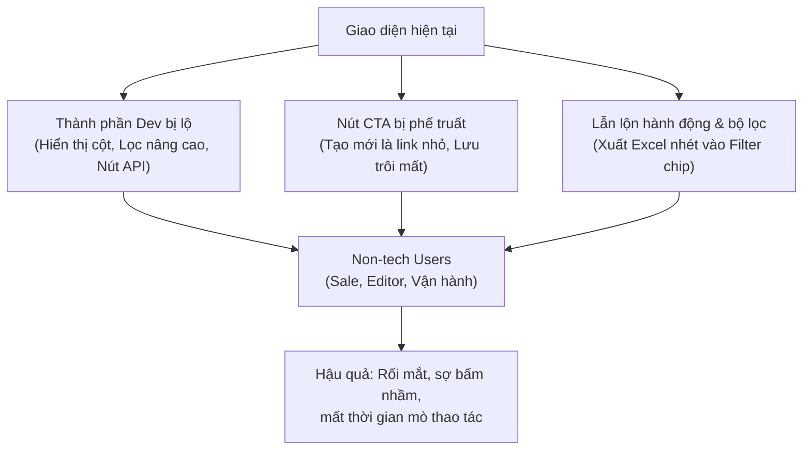

# BÁO CÁO KIỂM THỬ & ĐỀ XUẤT CẢI TIẾN UX/UI HỆ THỐNG ADMIN
**Dự án:** Hệ thống quản trị Bất động sản (TAMI Admin)  
**Nền tảng:** Payload CMS v3 (Next.js)  
**Đối tượng sử dụng chính:** Nhân viên biên tập nội dung, nhân viên kinh doanh (Sales), quản trị viên vận hành (Non-tech Users)

---

## 1. Tổng quan chẩn đoán: "Căn bệnh nửa vời" của giao diện

Hệ thống quản trị hiện tại đang trong tình trạng **nửa vời giữa công cụ kỹ thuật của Developer và phần mềm quản trị doanh nghiệp**:
* **Điểm tích cực đã làm:** Đã Việt hóa phần lớn nhãn (labels), đã bổ sung các chip lọc nhanh (Quick Filters) theo số phòng, khoảng giá, và đã tạo widget Dashboard tóm tắt dữ liệu.
* **Vấn đề cốt lõi:** Các thành phần gốc dành cho lập trình viên của Payload CMS (như *Hiển thị cột*, *Lọc nâng cao dạng Query Builder*, nút *API*, nút *+ Thêm mới* inline tại quan hệ dữ liệu nền) vẫn bị phơi bày ra ngoài.
* **Hậu quả:** 
  1. Người dùng non-tech cảm thấy giao diện rối rắm, ngập tràn các thuật ngữ dữ liệu thô.
  2. Nút hành động chính (Primary CTA) bị lép vế, thao tác hàng ngày (thêm bài, sửa, xóa, duyệt, xuất excel) bị phân tán và không trực quan.



---

## 2. Soi chi tiết từng màn hình & Hình ảnh thực tế

### 2.1. Màn hình danh sách dữ liệu (List View - Cho thuê, Dự án, Tin tức)


#### 🔴 Các bất hợp lý nghiêm trọng:
1. **Nút "Hiển thị cột" – Thừa thãi và gây hoang mang tột độ:**
   * Nút `Hiển thị cột v` nằm ép vào bên phải của ô tìm kiếm.
   * Khi người dùng vô tình bấm vào, một "ma trận" gần 30 chip kỹ thuật như: `utm_source`, `utm_medium`, `utm_campaign`, `updatedAt`, `id` bung ra chiếm hết nửa màn hình.
   * *Thực tế:* Nhân viên biên tập hoặc sale không bao giờ có nhu cầu (và cũng không nên) tự chỉnh sửa cấu trúc cột của bảng database.


2. **Nút "Lọc nâng cao" – Tự giẫm chân với các Chip lọc nhanh:**
   * Ngay bên dưới thanh tìm kiếm, hệ thống **đã có sẵn** các chip lọc nhanh rất tốt: `[Tất cả] [Đang cho thuê] [Đã thuê]`, `[Studio] [1 PN] [2 PN]`, `[Dưới 10tr] [10 - 20tr]`.
   * Thế nhưng trên thanh tìm kiếm lại có thêm nút `Lọc nâng cao v`. Khi bấm vào, nó mở ra bộ Query Builder thuần kỹ thuật (`Where... and... or... equals...`) mà người non-tech không thể hiểu nổi logic để dùng.


3. **Nút "Tạo mới" (Primary CTA) bị "phế truất":**
   * Nút quan trọng nhất trong ngày của người đăng bài là `Tạo mới`, nhưng hiện tại nó chỉ là một chữ link xám bé tí xíu nằm cạnh tiêu đề `Cho thuê`.
   * Vị trí góc trên bên phải (vị trí vàng của mắt người dùng) lại bị chiếm bởi 2 tab: `[Tất cả Cho thuê] [Thùng rác]`.

4. **Bảng dữ liệu thiếu hẳn cột "Thao tác" (Row Actions):**
   * Trong từng dòng chỉ có checkbox và text. Không hề có nút: **Xem trên web**, **Chỉnh sửa**, **Nhân bản**, **Xóa**.
   * Người dùng phải tự mò bấm vào tiêu đề bài viết để vào trang sửa.

5. **Thao tác hàng loạt (Bulk Actions) bị giấu trên đỉnh trời:**
   * Khi tích chọn nhiều dòng trong bảng, dòng chữ `Đã chọn 10 — Chọn tất cả (32) — Chỉnh sửa  Xóa` lại xuất hiện tuốt trên đỉnh đầu góc phải màn hình, nằm lẫn với tab `Thùng rác` dưới dạng text link mờ nhạt. Người dùng đang nhìn vào bảng bên dưới sẽ không hề biết các nút thao tác hàng loạt vừa xuất hiện ở đâu.


---

### 2.2. Màn hình Quản lý Lead (Khách hàng liên hệ)


#### 🔴 Các bất hợp lý:
1. **Đặt nút "Xuất Excel" lẫn lộn với Filter Chips:**
   * Hàng lọc trạng thái: `[Tất cả] [Mới (chưa giao)] [Đang tư vấn] [Đã chốt] [Không thành]`... và ngay bên cạnh là `[Xuất Excel]`.
   * `Xuất Excel` là một **Action Button**, không phải tiêu chí lọc. Đặt kiểu này làm người dùng tưởng nhầm bấm vào nút là để "lọc ra các lead liên quan đến file Excel".
2. **Không có thao tác phân công nhanh (Quick Assign):**
   * Mục tiêu chính của màn Lead là tiếp nhận và phân công sale phụ trách. Việc bắt buộc phải mở từng bản ghi để gán sale làm giảm tốc độ xử lý cơ hội bán hàng.

---

### 2.3. Màn hình Chi tiết / Tạo mới & Chỉnh sửa (Edit View)


#### 🔴 Các bất hợp lý:
1. **Lộ nút "API" kỹ thuật:**
   * Góc trên cùng bên phải xuất hiện tab/nút `[API]`. Bấm vào sẽ mở ra chuỗi JSON raw. Người dùng non-tech khi bấm nhầm sẽ nghĩ website bị lỗi crash hệ thống.
2. **Nút "Lưu" (Save) trôi mất khi cuộn trang:**
   * Nút `[Lưu]` nằm lơ lửng ở đầu cột bên phải. Khi cuộn form xuống phía dưới để nhập thông tin, nút Lưu hoàn toàn biến mất. Người dùng điền xong phải kéo chuột ngược lên đầu mới lưu được.
3. **Thiếu nút điều hướng thiết yếu:**
   * Không có nút **Quay lại / Hủy**: Muốn hủy bỏ chỉnh sửa, người dùng không biết bấm vào đâu ngoài nút Back của trình duyệt.
   * Không có nút **Xem trước (Preview)** trực tiếp bài viết ngoài giao diện website thực tế.
   * Nút **Xóa** và **Nhân bản tin (Duplicate)** bị giấu kín trong menu 3 chấm.
4. **Nút "+ Thêm mới" bừa bãi tại các trường danh mục nền:**
   * Tại các ô chọn `Tỉnh/thành`, `Phường/xã`, `Người tạo` đều xuất hiện nút `+ Thêm mới`.


> [!WARNING]
> Việc cho phép tạo mới inline tại trường `Người tạo` có thể khiến nhân viên vô tình tạo tài khoản nhân viên mới, hoặc tạo ra các tỉnh/phường trùng lặp gây rác cơ sở dữ liệu.

5. **Nút Tải ảnh dùng từ ngữ gây hiểu lầm:**
   * Dòng chữ: `Tạo mới hoặc Chọn từ thư viện hoặc kéo thả tệp vào đây`. Với tệp ảnh, dùng chữ `Tạo mới` (Create new) là phi lý. Người dùng chỉ hiểu là **"Tải ảnh lên"** (Upload).


6. **Tách rời vô lý tính năng Dịch AI:**
   * Trong tab `Bản dịch` có nút `[Dịch lại bằng AI]`, nhưng ở cột phải (Sidebar) lại có checkbox `[ ] Có bản tiếng Anh`. Hai thành phần thuộc cùng một luồng nghiệp vụ nhưng bị chia cắt ra 2 vị trí độc lập.


---

### 2.4. Màn hình Dashboard (Tổng quan)


#### 🔴 Các bất hợp lý:
1. **Nút "Tạo loại khác" bị lỗi tỷ lệ:**
   * Hàng đầu có 3 nút to dạng thẻ: `+ Đăng tin cho thuê mới`, `Phân công lead`, `Viết tin tức`. Nhưng cuối hàng lại có nút `Tạo loại khác` màu trắng, kích thước bé tí, cao lửng lơ trông như một nút bị lỗi CSS.
2. **Cụm "Sửa website" gây hiểu lầm là bộ lọc:**
   * Hàng nút `[Trang chủ] [Menu đầu trang] [Chân trang] [Cấu hình chung]` đặt ngang hàng với nhãn "Sửa website" trông giống thanh tab filter hơn là các nút điều hướng chuyển trang.

---

### 2.5. Thư viện ảnh & tệp (Media Library)


#### 🔴 Các bất hợp lý:
* Toàn bộ media hiển thị dưới dạng **BẢNG DANH SÁCH** liệt kê chuỗi UUID (`e89eccb3-6b4d-...jpg`) kèm ảnh thumbnail siêu nhỏ 30x30px.
* Không một người làm nội dung hay marketing nào có thể tìm và quản lý ảnh bằng cách đọc mã UUID.

---

### 2.6. Màn hình Cấu hình Trang chủ (Homepage Global)


#### 🔴 Các bất hợp lý:
1. **13 Tab ngang chật chội:** Thanh thông báo, Banner, Điểm mạnh, Giới thiệu, Dự án nổi bật, Dịch vụ, Ưu đãi, Cho thuê, Tin tức, Đối tác, Mời tư vấn, Thứ tự khối, SEO, Bản dịch.
2. **Bắt người dùng nhớ mã code để gõ:**
   * Tại ô "Liên kết", hệ thống chú thích: *Mã trang có sẵn: home, projects, rentals, property-posts, news, careers...*
   * Người non-tech không thể nhớ slug tiếng Anh này để nhập bằng tay.

---

## 3. Bản thiết kế lại chuẩn công thái học (Redesign Blueprint)

### 3.1. Thiết kế lại List View chuẩn

```
+----------------------------------------------------------------------------------------------------+
|  Cho thuê                                                     [ Thùng rác (0) ]  [ + ĐĂNG TIN MỚI ]|
|  Tin cho thuê căn hộ/nhà: vị trí, giá, diện tích...                                (Primary CTA)   |
|----------------------------------------------------------------------------------------------------|
|  [ 🔍 Tìm theo Mã tin, Tiêu đề hoặc Địa chỉ...                                   ] [ Xuất Excel ]  |
|                                                                                                    |
|  Trạng thái:   (•) Tất cả   ( ) Đang cho thuê   ( ) Đã thuê   ( ) Nháp                             |
|  Phòng ngủ:    [ Tất cả ] [ Studio ] [ 1 PN ] [ 2 PN ] [ 3 PN+ ]                                   |
|  Khoảng giá:   [ Tất cả ] [ Dưới 10tr ] [ 10 - 20tr ] [ 20 - 50tr ] [ Trên 50tr ]                  |
|----------------------------------------------------------------------------------------------------|
| [ ] | Ảnh    | Mã tin    | Tiêu đề                | Giá thuê      | Trạng thái  | THAO TÁC        |
|-----+--------+-----------+------------------------+---------------+-------------+------------------|
| [ ] | [Ảnh]  | CT-000029 | Cho thuê mặt bằng...   | 110.000.000 đ | [● Đã thuê] | 👁  ✏️  📋  🗑️   |
| [ ] | [Ảnh]  | CT-000028 | Cho thuê tầng hầm...   | 80.000.000 đ  | [● Đã thuê] | 👁  ✏️  📋  🗑️   |
|----------------------------------------------------------------------------------------------------|
| Khi tích checkbox:                                                                                 |
| ╭────────────────────────────────────────────────────────────────────────────────────────────────╮ |
| │ [✓] Đã chọn 2 tin  |  [ Đổi trạng thái v ]  [ Xuất Excel đã chọn ]  [ Xóa vào thùng rác ]      │ |
| ╰────────────────────────────────────────────────────────────────────────────────────────────────╯ |
| (Floating Bottom Action Bar - Ghim đáy màn hình)                                                   |
+----------------------------------------------------------------------------------------------------+
```

### 3.2. Thiết kế lại Edit View với Sticky Bottom Bar

```
+----------------------------------------------------------------------------------------------------+
|  ⌂ / Cho thuê / CT-000029                                                                          |
|  Cho thuê mặt bằng kinh doanh tầng 1-2 tại Xuân Diệu                                               |
|----------------------------------------------------------------------------------------------------|
|  [ Nội dung chính ]  [ Thông số & Vị trí ]  [ Bộ sưu tập ảnh ]  [ SEO ]  [ Đa ngôn ngữ ]           |
|                                                                                                    |
|  (Nội dung form nhập liệu thoải mái cuộn trang...)                                                 |
|                                                                                                    |
|----------------------------------------------------------------------------------------------------|
| [ ← Quay lại danh sách ]          [ Xem trên website ↗ ]   [ Lưu nháp ]   [ CẬP NHẬT / XUẤT BẢN ]   |
| (Sticky Bottom Bar luôn ghim cố định ở đáy màn hình, không bao giờ bị cuộn mất)                    |
+----------------------------------------------------------------------------------------------------+
```

---

## 4. Hướng dẫn kỹ thuật sửa triệt để trong mã nguồn Payload CMS

### 4.1. Ẩn nút "Hiển thị cột" và "Lọc nâng cao" của Dev
Trong cấu hình Collection (`collections/Rentals.ts`, `collections/Leads.ts`...):
```typescript
export const Rentals: CollectionConfig = {
  slug: 'rentals',
  admin: {
    // 1. Cố định danh sách cột hiển thị chuẩn cho non-tech
    defaultColumns: ['thumbnail', 'code', 'title', 'category', 'price', 'status', 'updatedAt'],
    // 2. Tắt bộ query builder thô và toggle columns nếu dùng custom components
    components: {
      beforeListTable: [
        // Component chứa Quick Filter Chips và Search Bar sạch sẽ
        CustomListControls,
      ],
    },
  },
  // ...
}
```

### 4.2. Ẩn nút API trên toàn bộ hệ thống
Trong file `payload.config.ts`:
```typescript
export default buildConfig({
  admin: {
    // Ẩn hoàn toàn nút API trên mọi màn hình đối với người dùng
    hideAPIURL: true,
  },
  // ...
})
```

### 4.3. Khóa nút "+ Thêm mới" tại các quan hệ danh mục nền
Tại các trường `province`, `ward`, `author` trong Collection schema:
```typescript
{
  name: 'province',
  type: 'relationship',
  relationTo: 'provinces',
  admin: {
    // Vô hiệu hóa nút tạo mới inline để tránh tạo rác dữ liệu
    allowCreate: false, 
    isSortable: true,
  },
}
```

### 4.4. Đưa "Tạo mới" thành Primary Button chuẩn
Cấu hình lại Header của List View thông qua `admin.components.views.list`:
* Đưa nút `+ Tạo mới` vào góc trên bên phải dạng `Button` với variant `primary`.
* Đưa `Thùng rác` và `Xuất file` thành các action phụ (Secondary/Outline Button).

### 4.5. Chuyển Thư viện Media sang Grid View
Trong `collections/Media.ts`:
```typescript
export const Media: CollectionConfig = {
  slug: 'media',
  upload: {
    staticDir: 'media',
    adminThumbnail: 'thumbnail',
  },
  admin: {
    // Kích hoạt hiển thị dạng lưới thẻ ảnh thay vì bảng table
    listSearchableFields: ['alt', 'filename'],
    defaultColumns: ['thumbnail', 'alt', 'filesize', 'createdAt'],
  },
}
```

---

## 5. Kế hoạch triển khai theo độ ưu tiên

| Giai đoạn | Hạng mục công việc | Thời gian ước tính | Tác động |
| :--- | :--- | :--- | :--- |
| **P0 (Cực cấp bách)** | • Ẩn nút `Hiển thị cột` và `Lọc nâng cao` khỏi search bar.<br>• Ẩn nút `API` trên Header.<br>• Tách nút `Xuất Excel` ra khỏi hàng Filter Chips trên màn Lead. | 1/2 ngày làm việc | Loại bỏ ngay 90% sự rối rắm và nguy cơ bấm nhầm cho non-tech. |
| **P1 (Cải thiện trải nghiệm)** | • Chuẩn hóa nút `+ Tạo mới` thành nút to góc phải.<br>• Làm Sticky Bottom Bar (Lưu / Xem trước / Quay lại) cho màn Edit.<br>• Khóa `allowCreate: false` ở các ô chọn Tỉnh/Xã/Tài khoản. | 1 ngày làm việc | Giúp thao tác biên tập và duyệt bài mượt mà, không bị cuộn tìm nút. |
| **P2 (Tối ưu hóa sâu)** | • Chuyển Media sang dạng Lưới ảnh (Grid Gallery).<br>• Thêm cột Thao tác nhanh (Xem, Sửa, Xóa) trên từng dòng dữ liệu.<br>• Thay ô nhập slug trang thủ công bằng Dropdown chọn trang. | 1 – 2 ngày làm việc | Đưa hệ thống đạt chuẩn phần mềm SaaS chuyên nghiệp. |
